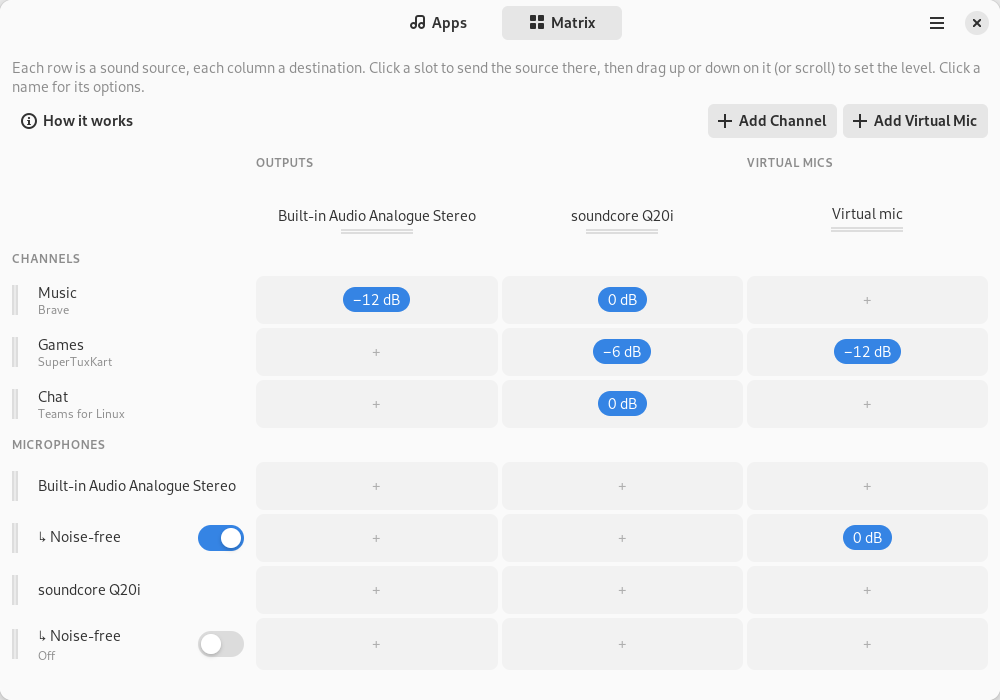

# Estuary

**Route, mix and clean up your audio on Linux.**

Estuary is an audio matrix for PipeWire. Send each app to the output or channel you choose,
mix channels and microphones into your headphones, speakers and virtual microphones with a level
on every crosspoint, and remove background noise from your microphone before it reaches Teams,
Discord or OBS.



- **Per-app routing.** Music to your headphones, a game to the speakers, a call to your headset.
  Estuary remembers each app's choice.
- **Channels.** Group apps (Music, Games, Chat) and give each group one fader.
- **The matrix.** Every row is a source (a channel or a microphone), every column a destination
  (a real output or a virtual microphone). One click sends a source there, a drag sets its level.
- **Virtual microphones.** A microphone for other apps: pick it in Teams, Discord or OBS and they
  hear exactly what you send to it, for example your voice and the game, but not your music.
- **Noise suppression.** RNNoise removes fans, traffic and keyboard clicks from your microphone,
  with an optional voice gate.
- **Live meters** on every app, channel, device and virtual microphone.
- **Runs in the background**, starts at login, survives device hot-plugging and PipeWire restarts.
  Quitting puts everything back the way your system had it.

Native GTK4 and libadwaita app, written in Rust, built directly on PipeWire. English and Italian.

## Contents

- [Requirements](#requirements)
- [Install](#install)
- [Quick start](#quick-start)
- [Using a clean microphone in calls](#using-a-clean-microphone-in-calls)
- [Mouse and keyboard](#mouse-and-keyboard)
- [Background, tray and quitting](#background-tray-and-quitting)
- [Troubleshooting](#troubleshooting)
- [Building from source](#building-from-source)
- [License](#license)

## Requirements

- A Linux desktop running **PipeWire ≥ 1.0** with **WirePlumber ≥ 0.5**, for example Pop!_OS
  24.04, Fedora 40+, Ubuntu 24.10+, Debian 13, Arch or openSUSE Tumbleweed. Check with:

  ```sh
  pipewire --version      # expect 1.0 or newer
  wireplumber --version   # expect 0.5 or newer
  ```

- **Flatpak**, for the packaged app (preinstalled on Pop!_OS, Fedora, Linux Mint and others).
- x86_64. Other architectures can [build from source](#building-from-source).
- Tray icon: GNOME needs the *AppIndicator and KStatusNotifierItem Support* extension (Pop!_OS and
  Ubuntu ship it enabled). KDE Plasma and most other desktops show it natively. Without a
  tray, Estuary still runs in the background; open it again from the app grid.

## Install

### From Flathub (recommended, coming soon)

Estuary is being submitted to [Flathub](https://flathub.org). Once it is listed, search for
**Estuary** in GNOME Software, Pop!_Shop or KDE Discover and click *Install*, or run:

```sh
flatpak install flathub io.github.abidibo.Estuary
```

Updates then arrive automatically with your other apps.

### From GitHub Releases (available now)

1. Make sure Flathub is configured. It provides the GNOME runtime Estuary runs on, and it's set up
   out of the box on most distributions. If you're not sure, this is safe to run:

   ```sh
   flatpak remote-add --if-not-exists --user flathub https://dl.flathub.org/repo/flathub.flatpakrepo
   ```

2. Download `Estuary-vX.Y.Z-x86_64.flatpak` from the
   [latest release](https://github.com/abidibo/Estuary/releases/latest).
3. Double-click it to open it in your software center, or install it from a terminal:

   ```sh
   flatpak install --user ./Estuary-vX.Y.Z-x86_64.flatpak
   ```

4. Start **Estuary** from your app grid, or with `flatpak run io.github.abidibo.Estuary`.

To update, download the new release and install it the same way. Each release also has a
`.sha256` file to verify the download (`sha256sum -c Estuary-*.flatpak.sha256`).

### Uninstall

```sh
flatpak uninstall --user io.github.abidibo.Estuary               # keep your settings
flatpak uninstall --user --delete-data io.github.abidibo.Estuary # remove settings too
```

If you turned on *Start at login*, turn it off in Preferences before uninstalling, or delete
`~/.config/autostart/io.github.abidibo.Estuary.desktop` afterwards.

## Quick start

1. **First run.** Choose *Recommended setup* (Music, Games and Chat channels plus a virtual
   microphone with noise suppression) or *Start empty* to build your own.
2. **Apps page.** Every app that is playing sound is listed with a live meter. Choose where each
   one plays: a real output (your headphones or speakers) or one of your channels. Estuary
   remembers the choice and applies it every time the app plays.
3. **Matrix page.** Rows are sources, columns are destinations.
   - **CHANNELS** and **MICROPHONES** are the rows. Under each microphone, **↳ Noise-free** is the
     same microphone with background noise removed.
   - **OUTPUTS** (your real devices) and **VIRTUAL MICS** are the columns.
   - Click a slot to send that row to that column, then drag up or down on it to set the level.
   - Click any name for its options: volume, noise suppression, rename, delete.

**Example.** Music and Games go to your headphones. Games and your noise-free microphone also go
to the virtual mic. Your friends on Discord hear you and the game, but not your music.

Click **How it works** on the Matrix page for the same explanation inside the app.

## Using a clean microphone in calls

Apps like Teams record straight from a microphone device, so the cleaned-up sound has to come out
of a device Estuary creates: a virtual microphone.

```
your microphone → ↳ Noise-free → Virtual mic → Teams / Discord / OBS
```

1. On the Matrix page, click the slot where **↳ Noise-free** (under your microphone) meets your
   **Virtual mic** column. Noise suppression switches on by itself. If you have no virtual mic
   yet, click **Add Virtual Mic** first.
2. Leave the slot of the raw microphone row off in that column, or the noisy sound leaks back in.
3. In your call app, choose **Virtual mic** as the microphone, for example in Teams under
   *Settings → Devices → Microphone*. To use it in every app at once, make it the default input
   in *Settings → Sound → Input*.
4. Optional: the **Voice gate** in the ↳ Noise-free popover silences everything between your
   sentences. Leave it at 0 (off) unless people still hear your keyboard; too high cuts the start
   of words.

To check it without bothering anyone, pick *Virtual mic* in *Settings → Sound → Input* and watch
the level meter while you talk.

The virtual microphone exists only while Estuary runs. That's why *Start at login* is on by
default.

## Mouse and keyboard

| Action | Mouse | Keyboard |
|---|---|---|
| Move between slots | | Arrow keys; Ctrl + arrows jump to the edge |
| Send on / off | Click | Space or Enter |
| Change the level | Drag up or down, or scroll | `+` / `−` (1 dB), Page Up / Page Down (6 dB) |
| Reset to 0 dB | Double-click | Home |
| Minimum level | | End |
| Remove the send | Right-click → *Remove send* | Delete |
| Slot menu | Right-click, or long-press on touch | Menu key or Shift + F10 |

A send switched off keeps its level, so switching it on again brings back the same mix.

## Background, tray and quitting

- **Closing the window** keeps Estuary running in the background (you're told the first time),
  so your routing keeps working. Change this in *Preferences → When closing the window*.
- **Tray icon:** *Show Estuary* and *Quit*.
- **Start at login** (on by default) starts Estuary hidden when you log in. In the Flatpak this
  goes through the desktop's Background portal, so your desktop may ask for permission once.
- **Quit** from the menu or the tray. Estuary warns you if an app is still playing into a channel
  or recording from a virtual mic, then removes everything it created and sends every app it
  moved back to your default output.

## Troubleshooting

**No tray icon on GNOME.** Install and enable the *AppIndicator and KStatusNotifierItem Support*
extension. Everything else works without it.

**Closing the window quits Estuary.** Background activity is not allowed for Estuary. Allow it in
*Settings → Apps → Estuary*.

**My call app doesn't list the virtual mic.** Restart the call app after creating the virtual
mic; some apps read the device list only at start. Browser-based apps may need a page reload.

**An app ignores its routing.** Some apps pin their own output device. Set the app's output to
*Default* in its own settings and choose the destination in Estuary instead.

**Start over.** Quit Estuary and delete its settings file, then start it again to see the
welcome screen:

```sh
rm ~/.var/app/io.github.abidibo.Estuary/config/estuary/config.toml   # Flatpak
rm ~/.config/estuary/config.toml                                     # built from source
```

**Logs for a bug report.**

```sh
flatpak run --env=ESTUARY_LOG=debug io.github.abidibo.Estuary
```

Please [open an issue](https://github.com/abidibo/Estuary/issues) with what you did, what you
expected and the log.

## Building from source

### Dependencies

| Distro | Command |
|---|---|
| Pop!_OS / Ubuntu ≥ 24.04 / Debian 13 | `sudo apt install build-essential pkg-config clang libpipewire-0.3-dev libgtk-4-dev libadwaita-1-dev gettext` |
| Fedora ≥ 42 | `sudo dnf install gcc pkgconf-pkg-config clang pipewire-devel gtk4-devel libadwaita-devel gettext` |
| Arch / Manjaro | `sudo pacman -S --needed base-devel clang pipewire gtk4 libadwaita gettext` |

`clang` is needed by `bindgen` in the PipeWire `-sys` crates. Check the library versions with:

```sh
pkg-config --modversion libpipewire-0.3 gtk4 libadwaita-1   # expect ≥ 1.0, ≥ 4.14, ≥ 1.5
```

Rust ≥ 1.93 (stable) is required; `rust-toolchain.toml` selects it automatically with rustup.

### Run

```sh
cargo run -p estuary
ESTUARY_LOG=debug cargo run -p estuary     # verbose logs (tracing EnvFilter syntax)
```

### Native install

```sh
ESTUARY_LOCALEDIR=/usr/local/share/locale cargo build --release -p estuary
sudo install -Dm0755 target/release/estuary /usr/local/bin/estuary
sudo build-aux/install-data.sh /usr/local
```

*Start at login* writes `~/.config/autostart/io.github.abidibo.Estuary.desktop` with
`Exec=estuary --background`, so the binary must be on `PATH`.

### Flatpak

```sh
build-aux/update-cargo-sources.sh   # after every Cargo.lock change
flatpak run org.flatpak.Builder --user --install --force-clean --repo=repo build-dir \
  build-aux/io.github.abidibo.Estuary.Devel.yml
flatpak run io.github.abidibo.Estuary
```

Needs `org.gnome.Platform//51`, `org.gnome.Sdk//51`, the `org.freedesktop.Sdk.Extension.rust-stable`
and `org.freedesktop.Sdk.Extension.llvm22` extensions and `org.flatpak.Builder` from Flathub. The
Devel manifest marks the window as a development build; release bundles are built by CI from
the same manifest with `ESTUARY_PROFILE=default`.

### Tests

```sh
cargo test --workspace
# Live tests need a running PipeWire + WirePlumber session (never run in CI):
cargo test --workspace --features estuary-engine/live-pw -- --include-ignored
```

### Translations

```sh
build-aux/update-pot.sh           # extract strings into po/estuary.pot and merge po/*.po
build-aux/compile-mo.sh target    # build .mo files into target/locale for cargo run
LANGUAGE=it cargo run -p estuary  # try a translation
```

To add a language, copy `po/estuary.pot` to `po/<lang>.po`, translate it, and add the code to
`po/LINGUAS`. `build-aux/check-i18n.sh` flags user-visible strings not wrapped in `i18n()`.

### Releasing

1. Bump `version` in `Cargo.toml` and add a `<release>` entry at the top of
   `data/io.github.abidibo.Estuary.metainfo.xml.in`.
2. Commit, then tag and push: `git tag -a vX.Y.Z -m "Estuary X.Y.Z" && git push origin vX.Y.Z`.
3. The *Release* workflow builds the Flatpak bundle and publishes the GitHub Release.

The design is documented in [`specs/estuary/spec.md`](specs/estuary/spec.md).

## License

Licensed under either of

- Apache License, Version 2.0 ([LICENSE-APACHE](LICENSE-APACHE))
- MIT license ([LICENSE-MIT](LICENSE-MIT))

at your option.

Unless you explicitly state otherwise, any contribution intentionally submitted for inclusion in
the work by you, as defined in the Apache-2.0 license, shall be dual licensed as above, without
any additional terms or conditions.
