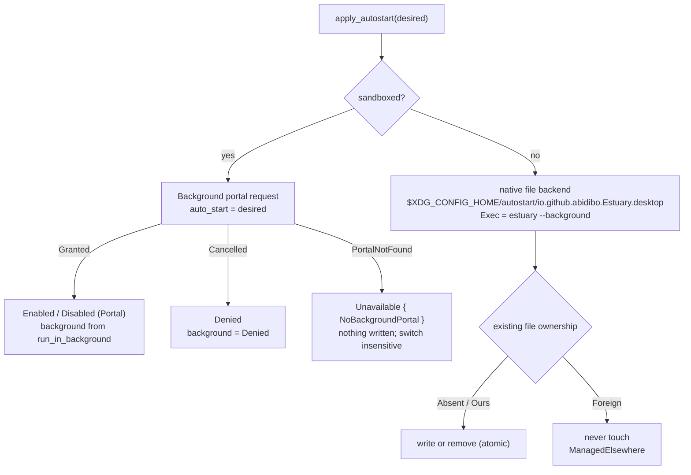

# estuary-desktop: application lifecycle and desktop integration (sub-spec)

> Sub-spec of [`specs/estuary/spec.md`](../estuary/spec.md). It covers the **desktop parts of milestone M11**. Contracts C1–C14 of the master are binding and are cited, never redefined. Steps are numbered `M11.D<n>`, because the UI sub-spec owns the other M11 steps (welcome dialog, preferences page, quit-confirm dialog widget).
>
> Detail level: **high**. Date: 2026-10-14.

---

## Summary

This sub-spec makes Estuary behave like a well-mannered background app. It has to:

- keep a single instance, and handle `--background`;
- keep running with the window hidden;
- quit only explicitly, through a deterministic quit state machine (confirmation, engine teardown, config flush);
- start at login through the Background portal, falling back to an XDG autostart file;
- show a StatusNotifierItem tray icon where the desktop supports one;
- shut down quickly and cleanly on SIGTERM/SIGINT.

## Problem Statement

Estuary carries live audio. Its channels, virtual mics, cells and denoisers only exist while the process is connected to PipeWire (C5: nothing lingers, C10). The desktop layer must therefore guarantee four things:

1. **Closing the window never silently breaks audio.** With `close_action = "hide"` the process keeps running, and the user is told once (C10).
2. **The app can always be stopped on purpose.** Menu, `Ctrl+Q`, tray, the GNOME "Background Apps" panel, or a signal from logout or `kill`. Each of these leads to the same clean teardown (C10, F17), and the user is warned when an app depends on a virtual device.
3. **The app can start at login hidden** (`estuary --background`). This must work on GNOME, where the Background portal exists, and on COSMIC, where it does not (F19), without ever producing two autostart entries.
4. **Launching it again does not start a second engine.** A second engine would create a second set of `estuary.*` nodes. Per C5 the first instance ignores them, but they would still duplicate audio paths.

## Solution Overview

- **Single instance.** Estuary is an `adw::Application` with id `io.github.abidibo.Estuary` (C14) and `ApplicationFlags::HANDLES_COMMAND_LINE`. A `--background` main option is registered. The primary instance's `command-line` handler decides whether to `activate()` (present the window) or stay hidden. A second launch reaches the primary instance through D-Bus and presents its window.
  - Verified in relm4 0.11 source: `RelmApp::run` builds the root component on `startup` and only shows the window inside `activate`. So `--background` just means "do not call `activate()`".
- **Staying alive.** The root window is added to the application (relm4 does this), which holds the app while hidden. In addition, the root model keeps an explicit `gio::ApplicationHoldGuard` until quit is finished, so the process never exits by accident if the window is destroyed.
- **Close button.** `close-request` always returns `Propagation::Stop` and asks a pure `decide_close()` function what to do: hide, hide with the one-time notice, or quit. When running sandboxed with the Background permission *denied*, hiding would get the app killed by the portal's background monitor, so close becomes quit (with a one-time explanation).
- **Quitting** is a pure, unit-tested `QuitController` state machine. It consumes inputs (requests, engine events, timer expiries, dialog answers) and returns effects. The root component executes the effects: send commands, show the dialog, arm timers, hide the window, finish. Finishing means `Engine::shutdown(1 s)`, a synchronous config flush, dropping the hold guard, shutting down the tray, and `app.quit()` (C10).
- **Start at login** (C10, amended), decided per environment:
  - **Sandboxed (Flatpak):** the Background portal **only**, via `ashpd` 0.13.13, with `auto_start` = `settings.start_at_login` and command `["estuary", "--background"]`. If the portal is missing (`Error::PortalNotFound`, as on COSMIC), start at login is **unavailable**. The Flatpak has no autostart-directory permission (C14, amended), so there is no file fallback, and Preferences shows the switch insensitive with an explanation.
  - **Native:** always an XDG autostart file. Verified in the ashpd source docs: "This portal only works for sandboxed applications".
  - The native file uses the **same file name the portal uses** (`io.github.abidibo.Estuary.desktop`) plus a marker key. A portal-owned entry (from a Flatpak install of Estuary) or a user-made file is never overwritten or deleted by a native build.
- **Tray.** A `ksni` 0.3.6 `Tray` implementation with "Show Estuary" and "Quit" items; left-click shows the window. It is spawned on relm4's shared tokio runtime with `relm4::spawn`. In the sandbox it calls `disable_dbus_name(true)`. Alongside `icon_name()` it also provides `icon_pixmap()` (ARGB32 at 22/32/48 px), because a host tray cannot resolve icon names installed only under `/app` in the sandbox. Where no `StatusNotifierWatcher` exists (GNOME without the AppIndicator extension), spawning fails softly and the app runs without a tray.
- **Signals.** `glib::unix_signal_add_local` handles SIGTERM, SIGINT and SIGHUP. The first signal triggers quit **without** the confirmation dialog. A second signal during teardown forces an immediate finish.

## Technical Context

### Binding contracts used

| Contract | Use here |
|---|---|
| C1 | Dependencies: `ashpd` (features `tokio`, `background` only, **never** `pipewire`), `ksni` 0.3.6, `relm4` 0.11, `adw`/`gtk`. `#![forbid(unsafe_code)]` in `estuary` |
| C2 | Portal and tray futures run on relm4's tokio runtime. All GTK work happens on the UI thread. Nothing here touches PipeWire |
| C3 | `Command::PrepareQuit`, `Command::Teardown`, `Event::QuitCheck`, `Event::TeardownComplete`, `Event::Connection`, `Engine::shutdown(timeout)` |
| C6 | `settings.close_action`, `settings.start_at_login`, `settings.background_notice_shown` |
| C10 | Startup, window close, the quit sequence, timeouts (teardown 2 s, shutdown 1 s), start at login |
| C12 | Synchronous config flush on quit |
| C14 | App id, binary name, `finish-args` (`--talk-name=org.kde.StatusNotifierWatcher`; **no** autostart filesystem permission, amended) |

### Verified library facts (crate sources downloaded 2026-10-14)

**ashpd 0.13.13**

- **Request API.** `ashpd::desktop::background::Background::request() -> BackgroundRequest`. Builder methods: `.identifier(impl Into<Option<WindowIdentifier>>)`, `.reason(impl Into<Option<&str>>)`, `.auto_start(impl Into<Option<bool>>)`, `.dbus_activatable(impl Into<Option<bool>>)`, `.command(IntoIterator<Item: AsRef<str>>)`.
- **Response.** `async fn send(self) -> Result<Request<Background>, Error>`, then `.response() -> Result<Background, Error>`. `Background::run_in_background() -> bool` and `Background::auto_start() -> bool`.
- **Status.** `BackgroundProxy::new().await?.set_status(SetStatusOptions::default().set_message(&str)).await`. Requires portal interface version ≥ 2 and otherwise returns `Error::RequiresVersion`.
- **Errors.**
  - `Error::PortalNotFound(_)`: "the user has no portals frontend installed or the frontend doesn't support the used portal".
  - `Error::Response(ResponseError::Cancelled | Other)`.
  - `Error::Portal(_)` and `Error::Zbus(_)`.
- **Sandbox check.** `ashpd::is_sandboxed() -> bool` (sync; true for Flatpak or Snap).
- **Native builds.** The module docs say: "This portal only works for sandboxed applications."
- **Default command.** If no command is given, the portal uses the desktop file's `Exec`.

**ksni 0.3.6**

- **Trait.** `ksni::Tray: Sized + Send + 'static` with `fn id(&self) -> String` (required). Optional: `activate(&mut self, x, y)`, `title`, `icon_name`, `tool_tip`, `menu(&self) -> Vec<MenuItem<Self>>`, `watcher_online(&self)`, and `watcher_offline(&self, OfflineReason) -> bool` (return `false` to stop the service).
- **Spawning.** `TrayMethods::spawn(self) -> Result<Handle<Self>, ksni::Error>` (async, the future is `Send`). `disable_dbus_name(bool)` and `assume_sni_available(bool)` return a `TrayServiceBuilder`, which has its own `.spawn()`.
- **Handle.** `Handle::update(f).await`, `Handle::shutdown() -> ShutdownAwaiter`, `Handle::is_closed()`.
- **Errors.** `ksni::Error::{Dbus, Watcher, WontShow}`. Without `assume_sni_available`, both a missing watcher and `WontShow` make `spawn` return `Err`.
- **Menu items.** `MenuItem::Standard(StandardItem { label, icon_name, activate: Box<dyn Fn(&mut T) + Send>, .. })` and `MenuItem::Separator`. `StandardItem` implements `Default`.
- **Runtime.** The default feature `tokio` requires a tokio runtime context, which relm4 provides.

**relm4 0.11.0**

- `RelmApp::from_app(app)`, `.visible_on_activate(bool)`, `.with_args(Vec<String>)`, `.run::<C>(init)`.
- `run` builds the component in `connect_startup` and, in `connect_activate`, calls `window.set_visible(true)` on the active window when `visible` is set.
- `run` enters `RUNTIME` (a multi-thread tokio runtime with 1 worker) for the whole main loop.
- `relm4::spawn(F: Future + Send)` runs on that runtime; `relm4::spawn_local` runs on the glib main context.

### Environment facts

- **Dev machine:** GNOME Wayland on Pop!_OS 24.04 (master, live-verified). On GNOME the Background portal is provided by `xdg-desktop-portal-gnome`.
- **COSMIC:** no Background portal (pop-os/xdg-desktop-portal-cosmic#49 open). The `StatusNotifierWatcher` is provided by `cosmic-applet-status-area` (master, source-verified).
- **KDE Plasma:** both a Background portal (`xdg-desktop-portal-kde`) and an SNI watcher. **UNVERIFIED-D1:** the Background interface version KDE implements, which matters for `set_status`.
- **Portal autostart file name and location.** When granted, xdg-desktop-portal writes the autostart entry to the **host** `~/.config/autostart/<app-id>.desktop`, with an `X-Flatpak=<app-id>` key. **~~UNVERIFIED-D2~~ resolved (M12):** the portal writes `io.github.abidibo.Estuary.desktop` with `X-Flatpak=io.github.abidibo.Estuary` and `Exec=flatpak run --command=estuary io.github.abidibo.Estuary --background`.
- **UNVERIFIED-D3: obsolete.** The sandboxed autostart-file fallback was removed (C10/C14 amended), so the host config dir never has to be resolved from inside Flatpak.
- **GNOME "Background Apps" panel.** GNOME Shell's background-apps quick-settings list lets the user stop a windowless sandboxed app. **UNVERIFIED-D4:** whether it activates the app's exported `app.quit` action over D-Bus (`org.gtk.Actions`, which GApplication exports automatically) or kills the Flatpak instance. The design handles both: the `app.quit` action runs the normal quit flow, and a kill is equivalent to F18 (no leftovers, because nothing lingers).

### Module layout (`crates/estuary/src/desktop/`)

```
crates/estuary/src/
├── main.rs                    # builds the adw::Application via desktop::app::build_application(), runs RelmApp
└── desktop/
    ├── mod.rs                 # pub use; DesktopEnv; DesktopError
    ├── app.rs                 # build_application(), command-line handling, LaunchMode
    ├── env.rs                 # DesktopEnv::detect()
    ├── window.rs              # show_window(), hide_window(), install_close_handler()
    ├── close.rs               # decide_close() (pure) + tests
    ├── actions.rs             # install_actions(): app.quit / app.preferences / app.show + accelerators
    ├── quit.rs                # QuitController state machine (pure) + tests
    ├── signals.rs             # install_signal_handlers()
    ├── autostart/
    │   ├── mod.rs             # apply_autostart() orchestrator, AutostartOutcome, precedence rules
    │   ├── portal.rs          # Background portal backend + set_status
    │   └── file.rs            # XDG autostart desktop-file backend (atomic write, marker)
    └── tray.rs                # EstuaryTray (ksni), spawn_tray(), TrayEvent
```

### Assumptions about the UI root component (`estuary-ui` sub-spec)

The root Relm4 component (`AppModel`, input `AppMsg`) is defined by the UI sub-spec. This sub-spec **requires** the following from it. The UI sub-spec must provide them or flag a conflict.

```rust
// Variants the desktop layer sends to, or expects in, AppMsg:
AppMsg::ShowWindow                                   // present the main window (tray, app.show, second launch)
AppMsg::WindowCloseRequested                         // from close-request; the root calls decide_close()
AppMsg::RequestQuit(QuitTrigger)                     // menu, Ctrl+Q, tray, app.quit via D-Bus, signals
AppMsg::Quit(QuitInput)                              // internal: timer expiries, forced finish
AppMsg::QuitConfirmed                                // from the UI's quit-confirm dialog
AppMsg::QuitCancelled                                // from the UI's quit-confirm dialog
AppMsg::BackgroundNoticeDismissed                    // from the UI's background notice dialog (then hide)
AppMsg::BackgroundDeniedNoticeDismissed              // from the UI's denied notice (then RequestQuit(CloseButton))
AppMsg::TrayReady(ksni::Handle<EstuaryTray>)         // from spawn_tray
AppMsg::OpenPreferences                              // app.preferences
AppMsg::SetStartAtLogin(bool)                        // from the Preferences switch
AppMsg::AutostartApplied(Result<AutostartOutcome, AutostartError>)
AppMsg::BackgroundStatusChanged(BackgroundPermission)
AppMsg::Engine(estuary_engine::Event)                // already defined by C2; QuitCheck / TeardownComplete feed the QuitController
```

The desktop layer also needs these root-model fields and UI services:

- `engine: Option<estuary_engine::Engine>`
- `config: ConfigStore`, providing `settings() -> &Settings`, `update_settings(impl FnOnce(&mut Settings))` (debounced save, C12) and `flush_sync() -> Result<(), ConfigError>`
- `quit: QuitController`
- `hold: Option<gio::ApplicationHoldGuard>`
- `tray: Option<ksni::Handle<EstuaryTray>>`
- `background: BackgroundPermission`
- UI functions:
  - `show_quit_confirm(&[VirtualDeviceUsage])`, which emits `QuitConfirmed` or `QuitCancelled`
  - `show_background_notice()`, the C10 one-time notice
  - `show_background_denied_notice()`
  - `show_toast(&str)`
  - a Preferences info row that renders an `AutostartOutcome`

### Assumptions about the engine (`estuary-engine` sub-spec)

- Behaviour as in C3 and C10. `Event::QuitCheck` is emitted within 1 s of `PrepareQuit` whenever the engine is `Connected`. When the engine is not connected it may never answer, and the desktop layer copes with that through the check timeout.
- `VirtualDeviceUsage` and `UsageKind` are defined in C3 (amended): `pub struct VirtualDeviceUsage { pub app_display_name: String, pub device_name: String, pub kind: UsageKind }`, `pub enum UsageKind { PlayingToChannel, RecordingFromVirtualMic }`. The desktop layer passes them through to the UI's quit-confirm dialog unchanged.

---

## Implementation Steps

**Implementation notes (M11 as built, 2026-10-15).** These deviate from or refine the steps below. Where they conflict, the notes are authoritative.

- **Signals:** glib 0.22 moved `unix_signal_add_local` into the sibling crate **`glib-unix` 0.22.8** (same gtk-rs line). It's a workspace dependency now (C1 addition, see the master amendment log).
- **Executor:** the quit effects run in `AppModel::execute` (`crates/estuary/src/app/lifecycle.rs`), not a free `desktop::quit::execute`, because they need the root's private fields. A fired timer is removed from `quit_timers` before its input is fed, so `DisarmTimer` never removes a dead source. Effects that fail (engine gone) feed the machine immediately (D-F2).
- **Single instance:** the M1.8 `NameHasOwner` pre-check stays. The remote's plain `app.run()` forwards the command line, including `--background`, to the primary's `command-line` handler. Measured: a second launch exits 0 in 77 ms and presents the window.
- **Tray:** there are no icon assets yet (packaging M12), so `render_tray_pixmaps` draws a light-grey 3×3 matrix glyph with cairo at 22/32/48 px instead of rendering the bundled SVG; packaging may swap in the real symbol. `icon_name` is `io.github.abidibo.Estuary-symbolic` when the theme has it, else `audio-card-symbolic`. If spawning fails, one retry after 10 s, in any launch mode. On the dev session a StatusNotifierWatcher exists and the tray spawns.
- **Autostart results** reach the root as `AppMsg::AutostartApplied(Result<AutostartOutcome, String>)` (errors stringified for the UI). There is no separate `BackgroundStatusChanged` message: the outcome carries the permission. The portal reason is localized on the UI thread and passed into `apply_autostart`.
- **Verified by script** (native, GNOME): background start, second launch, start-at-login file write/remove, SIGTERM, double SIGINT, `app.quit` over D-Bus with and without usages, signal over an open confirmation. All quits finish in under 100 ms with no `estuary.*` nodes left. Details and the remaining manual and Flatpak checks: `docs/testing/desktop.md`.


### M11.D1: Application bootstrap, single instance and `--background`

> **Binding constraint (found at M1.8, see packaging M1.5 "Implementation notes").** relm4 0.11's `RelmApp::run` hangs in a **remote** instance, because of a trailing blocking `MainContext::iteration(true)`. Whatever this step builds (`HANDLES_COMMAND_LINE`, `--background`), a second launch must never enter `RelmApp::run`. Keep the scaffold's pre-check (`NameHasOwner(APP_ID)` → plain `app.run()`, which forwards the command line or `activate` to the primary and exits). Never call `app.register()` on the primary path before relm4's run, since it emits `startup` too early. With `HANDLES_COMMAND_LINE`, the remote path's plain `app.run()` forwards `--background` to the primary's `command-line` handler unchanged. Add a manual check to M11.D13: a second launch exits in under 200 ms and presents the existing window (or keeps it hidden for `--background`).


**What.** Build the `adw::Application` with command-line handling, and run it through relm4.

**Why.** Single instance avoids a second engine (Problem 4). `--background` gives hidden autostart (C10 startup step 1).

**Files.** `crates/estuary/src/desktop/app.rs`, `crates/estuary/src/main.rs`.

```rust
// desktop/app.rs
use adw::prelude::*;
use gtk::{gio, glib};

pub const APP_ID: &str = "io.github.abidibo.Estuary";   // C14

#[derive(Clone, Copy, Debug, PartialEq, Eq)]
pub enum LaunchMode { Foreground, Background }

/// Builds the application. Must be called before RelmApp::from_app().
pub fn build_application() -> adw::Application {
    let app = adw::Application::builder()
        .application_id(APP_ID)
        .flags(gio::ApplicationFlags::HANDLES_COMMAND_LINE)
        .build();

    app.add_main_option(
        "background", glib::Char::from(b'b'), glib::OptionFlags::NONE, glib::OptionArg::None,
        &gettext("Start without showing the window"), None,
    );

    // Runs in the PRIMARY instance, for the first launch and for every remote launch.
    app.connect_command_line(|app, cmdline| {
        let mode = if cmdline.options_dict().contains("background") { LaunchMode::Background }
                   else { LaunchMode::Foreground };
        match mode {
            LaunchMode::Foreground => app.activate(),        // relm4's activate handler shows the window
            LaunchMode::Background => { /* window stays as is (hidden on first launch) */ }
        }
        glib::ExitCode::SUCCESS
    });
    app
}
```

```rust
// main.rs (desktop-relevant part; i18n/logging init belong to the UI sub-spec)
fn main() {
    let app = desktop::app::build_application();
    relm4::RelmApp::from_app(app.clone())
        .visible_on_activate(true)
        .run::<AppModel>(AppInit { /* … */ });
}
```

Behaviour table:

| Situation | Result |
|---|---|
| `estuary` (first) | startup builds the hidden window → command-line → `activate()` → window shown |
| `estuary --background` (first) | startup builds the hidden window → command-line → no activate → runs hidden |
| `estuary` while running | the remote instance forwards to the primary → `activate()` → `present()` of the existing window (hidden or not); the remote exits 0 |
| `estuary --background` while running | no-op, the remote exits 0 |

Notes:

- This **replaces** the packaging M1.5 scaffold in `main.rs` (a plain `adw::Application` + `RelmApp::from_app`) with `desktop::app::build_application()`.
- Do **not** call `RelmApp::with_args`. The default uses `std::env::args`, which GApplication parses for registered options.
- The root component's `init` must not call `set_visible(true)`. relm4's `activate` handler is the only place the window is first shown, plus `show_window()` (M11.D2).
- The engine is started from the root's `init` (C10 step 3) in both modes, so the background mode carries audio immediately.

### M11.D2: Hold guard and window show/hide helpers

**What.** Keep the process alive while it's hidden, and put presentation and hiding in one place.

**File.** `desktop/window.rs`.

```rust
/// Takes an explicit hold. Stored in AppModel::hold, dropped only by the quit Finish effect.
pub fn acquire_hold(app: &adw::Application) -> gio::ApplicationHoldGuard { app.hold() }

/// Shows and raises the main window. Used by tray, app.show, AppMsg::ShowWindow.
pub fn show_window(window: &adw::ApplicationWindow) {
    window.set_visible(true);
    window.present();
}

/// Hides without destroying (all widget state, meters subscription logic in UI decide on visibility).
pub fn hide_window(window: &adw::ApplicationWindow) { window.set_visible(false); }
```

- When the window is hidden, the UI sub-spec sends `SetMeterTargets(vec![])` so no meters run in the background (C9). That is a UI responsibility, noted here as the trigger point: hook `connect_visible_notify` on the window.
- **Sandboxed only:** after hiding, call `autostart::portal::set_background_status(gettext("Routing audio"))` (M11.D10), fire-and-forget, errors logged at `debug`. When the window is shown again, set the status to `None` (empty message).

### M11.D3: Close-request handling (`decide_close`)

**What.** A pure decision function plus its wiring.

**Files.** `desktop/close.rs`, `desktop/window.rs`.

```rust
// desktop/close.rs
use crate::config::{CloseAction, Settings};   // C6 types re-exported by the UI config module

#[derive(Clone, Copy, Debug, PartialEq, Eq)]
pub enum BackgroundPermission {
    NotApplicable,   // native build: nothing kills hidden apps
    Unknown,         // sandboxed, portal request not answered yet
    Allowed,         // portal: run_in_background == true
    Denied,          // portal: run_in_background == false or request cancelled
    Unavailable,     // sandboxed, no Background portal (COSMIC): hidden apps are not killed
}

#[derive(Clone, Copy, Debug, PartialEq, Eq)]
pub enum CloseDecision {
    Hide,                                   // notice already shown: hide silently
    ShowBackgroundNoticeThenHide,           // C10 (amended): one-time notice BEFORE hiding, while the window is still visible
    Quit,
    QuitBecauseBackgroundDenied { show_notice: bool },   // show_notice = once per session
}

pub fn decide_close(settings: &Settings, bg: BackgroundPermission, denied_notice_shown_this_session: bool) -> CloseDecision {
    match (settings.close_action, bg) {
        (CloseAction::Quit, _) => CloseDecision::Quit,
        (CloseAction::Hide, BackgroundPermission::Denied) =>
            CloseDecision::QuitBecauseBackgroundDenied { show_notice: !denied_notice_shown_this_session },
        (CloseAction::Hide, _) if !settings.background_notice_shown => CloseDecision::ShowBackgroundNoticeThenHide,
        (CloseAction::Hide, _) => CloseDecision::Hide,
    }
}
```

Wiring (in the root's `init`):

```rust
// desktop/window.rs
pub fn install_close_handler(window: &adw::ApplicationWindow, sender: relm4::ComponentSender<AppModel>) {
    window.connect_close_request(move |_| {
        sender.input(AppMsg::WindowCloseRequested);
        glib::Propagation::Stop          // never let GTK destroy the window
    });
}
```

How the root handles `AppMsg::WindowCloseRequested`:

- `Hide`: `hide_window`.
- `ShowBackgroundNoticeThenHide`: keep the window visible and call the UI's `show_background_notice()`, which emits `AppMsg::BackgroundNoticeDismissed` when closed. On that message: `config.update_settings(|s| s.background_notice_shown = true)`, then `hide_window`. A second ✕ while the notice is open is ignored, because the root keeps a `notice_open` flag.
- `Quit`: `AppMsg::RequestQuit(QuitTrigger::CloseButton)`.
- `QuitBecauseBackgroundDenied { show_notice }`: if `show_notice`, call `show_background_denied_notice()` and continue on `AppMsg::BackgroundDeniedNoticeDismissed` ("Background activity is not allowed for Estuary, so closing the window quits it. You can allow it in Settings → Apps → estuary."), then send `RequestQuit(CloseButton)`. The session flag lives in `AppModel` and is not persisted.

Unit tests cover the 2 close actions × 5 permissions × the two notice flags (exhaustive table). They also assert that `ShowBackgroundNoticeThenHide` is returned only when `background_notice_shown=false` and the permission is not `Denied`.

### M11.D4: Application actions and accelerators

**File.** `desktop/actions.rs`.

```rust
pub fn install_actions(app: &adw::Application, sender: relm4::ComponentSender<AppModel>) {
    let quit = gio::ActionEntry::builder("quit")
        .activate(clone!(#[strong] sender, move |_, _, _| sender.input(AppMsg::RequestQuit(QuitTrigger::Action)))).build();
    let prefs = gio::ActionEntry::builder("preferences")
        .activate(clone!(#[strong] sender, move |_, _, _| sender.input(AppMsg::OpenPreferences))).build();
    let show = gio::ActionEntry::builder("show")
        .activate(clone!(#[strong] sender, move |_, _, _| sender.input(AppMsg::ShowWindow))).build();
    app.add_action_entries([quit, prefs, show]);

    app.set_accels_for_action("app.quit", &["<Control>q"]);
    app.set_accels_for_action("app.preferences", &["<Control>comma"]);
    app.set_accels_for_action("window.close", &["<Control>w"]);   // → close-request → M11.D3
}
```

- GApplication exports these actions on the session bus automatically (`org.gtk.Actions` at `/io/github/abidibo/Estuary`). That is how GNOME's Background Apps panel may reach `app.quit` (UNVERIFIED-D4). `QuitTrigger::Action` covers both the menu and D-Bus, since they cannot be told apart.
- The primary menu (UI sub-spec) references `app.preferences` and `app.quit`.

### M11.D5: `QuitController` state machine (pure)

**What.** Deterministic orchestration of C10's quit steps 1–4, with C10's timeouts. It has no GTK or engine dependencies, so it is fully unit-testable.

**File.** `desktop/quit.rs`.

```rust
use std::time::Duration;
use estuary_engine::VirtualDeviceUsage;

pub const QUIT_CHECK_TIMEOUT: Duration = Duration::from_secs(1);    // amendment proposal A3
pub const TEARDOWN_TIMEOUT:   Duration = Duration::from_secs(2);    // C10 step 3 / F17
pub const ENGINE_SHUTDOWN_TIMEOUT: Duration = Duration::from_secs(1); // C10 step 4

#[derive(Clone, Copy, Debug, PartialEq, Eq)]
pub enum QuitTrigger { Action, Tray, CloseButton, Signal(i32) }

impl QuitTrigger { fn skips_confirmation(self) -> bool { matches!(self, QuitTrigger::Signal(_)) } }

#[derive(Clone, Copy, Debug, PartialEq, Eq, Hash)]
pub enum QuitTimer { Check, Teardown }

#[derive(Debug)]
pub enum QuitInput {
    Request { trigger: QuitTrigger, engine_connected: bool, engine_present: bool },
    QuitCheck(Vec<VirtualDeviceUsage>),
    TimerFired(QuitTimer),
    UserConfirmed,
    UserCancelled,
    TeardownComplete,
    Force,                         // second signal during an in-flight quit
}

#[derive(Debug, PartialEq)]
pub enum QuitEffect {
    SendPrepareQuit,
    ShowConfirm(Vec<VirtualDeviceUsage>),   // root presents the window first if hidden
    SendTeardown,
    ArmTimer(QuitTimer, Duration),
    DisarmTimer(QuitTimer),
    HideWindow,
    DismissConfirm,                          // close an open quit-confirmation dialog (signal override)
    Finish,                                  // root: Engine::shutdown(1 s) → config flush → drop hold → tray shutdown → app.quit()
}

#[derive(Clone, Copy, Debug, PartialEq, Eq)]
pub enum QuitState { Idle, Checking { skip_confirm: bool }, Confirming, TearingDown, Finished }

pub struct QuitController { state: QuitState }

impl QuitController {
    pub fn new() -> Self { Self { state: QuitState::Idle } }
    pub fn state(&self) -> QuitState { self.state }
    pub fn handle(&mut self, input: QuitInput) -> Vec<QuitEffect> { /* transition table below */ }
}
```

Transition table (normative):

| From | Input | Guard | Effects | To |
|---|---|---|---|---|
| Idle | Request | `!engine_present` | `HideWindow`, `Finish` | Finished |
| Idle | Request | `engine_present && !engine_connected` | `HideWindow`, `Finish` (no owned objects exist; C3 read-only before Setup / when not connected) | Finished |
| Idle | Request | connected | `SendPrepareQuit`, `ArmTimer(Check, 1 s)` | Checking{skip_confirm = trigger.skips_confirmation()} |
| Checking | QuitCheck(u) | `u.is_empty() \|\| skip_confirm` | `DisarmTimer(Check)`, `HideWindow`, `SendTeardown`, `ArmTimer(Teardown, 2 s)` | TearingDown |
| Checking | QuitCheck(u) | non-empty, `!skip_confirm` | `DisarmTimer(Check)`, `ShowConfirm(u)` | Confirming |
| Checking | TimerFired(Check) | – | same as the empty QuitCheck row (fail-open: never block quitting) | TearingDown |
| Confirming | UserConfirmed | – | `HideWindow`, `SendTeardown`, `ArmTimer(Teardown, 2 s)` | TearingDown |
| Confirming | UserCancelled | – | none | Idle |
| Confirming | Request{Signal} | – | `DismissConfirm`, `HideWindow`, `SendTeardown`, `ArmTimer(Teardown, 2 s)` (a signal overrides the dialog) | TearingDown |
| TearingDown | TeardownComplete | – | `DisarmTimer(Teardown)`, `Finish` | Finished |
| TearingDown | TimerFired(Teardown) | – | `Finish` (F17) | Finished |
| any non-Idle/Finished | Force | – | `Finish` | Finished |
| Checking / TearingDown | Request(any) | – | none (already quitting; idempotent) | unchanged |
| Confirming | Request(non-signal) | – | none (the dialog is already shown; the root re-presents the window) | Confirming |
| Finished | any | – | none | Finished |
| any | stale TimerFired / QuitCheck / TeardownComplete | not matching the state | none | unchanged |

Unit tests: every row; a stale timer after cancel; a signal while confirming; a double request; and "engine not connected" going straight to Finish.

### M11.D6: Quit wiring in the root component

**What.** Execute `QuitEffect`s.

**Files.** `desktop/quit.rs` (executor helper), with the UI root's `update` calling it.

```rust
/// Executed by AppModel::update for each effect returned by QuitController::handle.
pub fn execute(effect: QuitEffect, model: &mut AppModel, sender: &relm4::ComponentSender<AppModel>, widgets_window: &adw::ApplicationWindow)
```

| Effect | Implementation |
|---|---|
| `SendPrepareQuit` | `model.engine.as_ref().map(\|e\| e.send(Command::PrepareQuit))`. On `Err` (engine thread gone), feed `QuitInput::TimerFired(Check)` immediately |
| `ShowConfirm(u)` | `show_window(window)`, then `show_quit_confirm(&u)` (UI dialog; C10 step 2 text) |
| `SendTeardown` | `engine.send(Command::Teardown)`. On `Err`, feed `TeardownComplete` immediately |
| `ArmTimer(t, d)` | `glib::timeout_add_local_once(d, move \|\| sender.input(AppMsg::Quit(QuitInput::TimerFired(t))))`, storing the `SourceId` in `model.quit_timers: HashMap<QuitTimer, glib::SourceId>` |
| `DismissConfirm` | UI `close_quit_confirm()` (`adw::Dialog::force_close()` on the open quit dialog; no `QuitConfirmed`/`QuitCancelled` is emitted) |
| `DisarmTimer(t)` | remove the `SourceId`. If the source already fired, ignore `glib::BoolError` |
| `HideWindow` | `hide_window(window)` (avoids a frozen-looking window during teardown) |
| `Finish` | see the sequence below |

`Finish` sequence (C10 step 4). It runs synchronously on the UI thread; the window is already hidden, so a stall of ≤ 1 s is invisible.

```rust
fn finish(model: &mut AppModel, app: &adw::Application) {
    if let Some(engine) = model.engine.take() {
        if let Err(e) = engine.shutdown(ENGINE_SHUTDOWN_TIMEOUT) { tracing::warn!(?e, "engine shutdown"); }
    }
    if let Err(e) = model.config.flush_sync() { tracing::error!(?e, "config flush on quit"); }  // C12; never blocks quit
    if let Some(tray) = model.tray.take() { let _ = tray.shutdown(); }   // ShutdownAwaiter dropped; process exit ends the service
    model.hold.take();                                                    // drop ApplicationHoldGuard
    app.quit();
}
```

Engine events are routed like this: `AppMsg::Engine(Event::QuitCheck(u))` → `quit.handle(QuitInput::QuitCheck(u))`, and `Event::TeardownComplete` → `QuitInput::TeardownComplete`. Other engine events are untouched.

### M11.D7: Unix signal handling

**File.** `desktop/signals.rs`.

```rust
pub fn install_signal_handlers(sender: relm4::ComponentSender<AppModel>) -> Vec<glib::SourceId> {
    [libc_consts::SIGTERM, libc_consts::SIGINT, libc_consts::SIGHUP].into_iter().map(|sig| {
        let sender = sender.clone();
        glib::unix_signal_add_local(sig, move || {
            sender.input(AppMsg::RequestQuit(QuitTrigger::Signal(sig)));
            glib::ControlFlow::Continue
        })
    }).collect()
}
// libc_consts: SIGHUP = 1, SIGINT = 2, SIGTERM = 15 as i32 constants (avoids a libc dependency; values fixed on Linux).
```

- `AppMsg::RequestQuit(Signal)` in the root goes as follows:
  - If `quit.state()` is `Idle` or `Confirming`, it becomes a normal `Request` (no confirmation, by the table).
  - If the state is `Checking` or `TearingDown`, it becomes `QuitInput::Force`, so a second Ctrl+C or signal finishes immediately.
- Use case: logout or session stop, where systemd sends SIGTERM to the app scope. Total quit time ≤ 1 s (check) + 2 s (teardown) + 1 s (shutdown), which fits systemd's default 90 s stop timeout and GNOME session expectations.
- SIGKILL cannot be handled. That is F18 in the master: no leftovers, because nothing lingers.

### M11.D8: Desktop environment probe

**File.** `desktop/env.rs`.

```rust
#[derive(Clone, Debug)]
pub struct DesktopEnv {
    pub sandboxed: bool,                    // ashpd::is_sandboxed()
    pub flatpak_id: Option<String>,         // $FLATPAK_ID (logging/diagnostics only)
    pub autostart_dir: Option<PathBuf>,     // native: glib::user_config_dir()/autostart (honours XDG_CONFIG_HOME); sandboxed: None
}

impl DesktopEnv {
    pub fn detect() -> Self;
}
```

The sandboxed build never touches an autostart directory (C10/C14, amended), so no host-path resolution is needed (UNVERIFIED-D3 is obsolete).

`detect()` is cheap and synchronous. It is called once in the root's `init` and stored in `AppModel`.

### M11.D9: Autostart desktop-file backend

**File.** `desktop/autostart/file.rs`.

**Native builds only** (C10, amended). The sandboxed build never calls this module.

The file name is `<autostart_dir>/io.github.abidibo.Estuary.desktop`, the same name the portal uses (UNVERIFIED-D2). That way a portal entry left by a Flatpak install of Estuary is recognized as foreign rather than duplicated.

Content (`Exec` per C10, amended):

```ini
[Desktop Entry]
Type=Application
Name=Estuary
Comment=Audio matrix running in the background
Icon=io.github.abidibo.Estuary
Exec=estuary --background
Terminal=false
NoDisplay=true
X-GNOME-Autostart-enabled=true
X-Estuary-Autostart=true
```

`Exec=estuary --background` relies on `estuary` being on `PATH` (distro or `cargo install` builds). A `cargo run` dev build is not on `PATH`, so autostart from a dev tree is not supported (open item O1).

```rust
pub enum FileOwnership { Absent, Ours, Foreign }   // Ours = has X-Estuary-Autostart=true AND no X-Flatpak key
                                                   // Foreign = anything else (portal-written, user-made)

pub fn inspect(path: &Path) -> io::Result<FileOwnership>;
pub fn write(path: &Path) -> io::Result<()>;       // create dir (0o755), write .tmp, fsync, rename (same pattern as C12)
pub fn remove_if_ours(path: &Path) -> io::Result<bool>;     // true if removed
```

Precedence rules:

| Desired | Ownership | Action | Outcome |
|---|---|---|---|
| on | Absent | write | `Enabled { backend: DesktopFile }` |
| on | Ours | rewrite (idempotent) | `Enabled { backend: DesktopFile }` |
| on | Foreign | **do not touch** | `ManagedElsewhere(path)` |
| off | Ours | remove | `Disabled` |
| off | Absent | nothing | `Disabled` |
| off | Foreign | **do not touch** (a foreign file is never deleted) | `ManagedElsewhere(path)` |

### M11.D10: Background portal backend

**File.** `desktop/autostart/portal.rs`.

```rust
use ashpd::desktop::background::{Background, BackgroundProxy, SetStatusOptions};

pub enum PortalResult {
    Granted { run_in_background: bool, auto_start: bool },
    Cancelled,                 // ResponseError::Cancelled → treat as Denied
    Unavailable,               // Error::PortalNotFound(_) → start at login unavailable (F19)
}

/// Must run on relm4's tokio runtime (relm4::spawn); the future is Send.
pub async fn request(auto_start: bool) -> Result<PortalResult, ashpd::Error> {
    let req = Background::request()
        .reason(gettext("Keep audio routing active when the window is closed").as_str())
        .auto_start(auto_start)
        .command(["estuary", "--background"])     // C10; the portal wraps it with `flatpak run`
        .dbus_activatable(false);
    match req.send().await {
        Err(ashpd::Error::PortalNotFound(_)) => Ok(PortalResult::Unavailable),
        Err(e) => Err(e),
        Ok(request) => match request.response() {
            Ok(bg) => Ok(PortalResult::Granted { run_in_background: bg.run_in_background(), auto_start: bg.auto_start() }),
            Err(ashpd::Error::Response(ashpd::desktop::ResponseError::Cancelled)) => Ok(PortalResult::Cancelled),
            Err(e) => Err(e),
        },
    }
}

/// Best effort; ignores RequiresVersion (portal v1) and PortalNotFound.
pub async fn set_background_status(message: Option<String>) -> Result<(), ashpd::Error>;
// impl: BackgroundProxy::new().await?.set_status(SetStatusOptions::default().set_message(msg)).await
//       msg = message.unwrap_or_default(), truncated to 96 chars (portal limit).
```

- **No `WindowIdentifier`.** The request is sent with `identifier(None)`. Passing one would need ashpd's `gtk4` feature and a non-`Send` future on the glib context. On GNOME the permission dialog appears unparented, which is acceptable. **UNVERIFIED-D5:** dialog behaviour without a parent on GNOME 46+. If it's poor, enable ashpd `gtk4_wayland` and run the request with `relm4::spawn_local`, which works because relm4 enters its tokio runtime for the whole main loop (verified in `RelmApp::run`).
- **Mapping to `BackgroundPermission`:**
  - `Granted{run_in_background: true}` → `Allowed`
  - `Granted{run_in_background: false}` or `Cancelled` → `Denied`
  - `Unavailable` → `Unavailable`
  - `Err` → stays `Unknown` (logged) and is treated like `Allowed` for close decisions, so close behaviour never fails closed on a transient D-Bus error.

### M11.D11: Autostart orchestrator and startup sync

**File.** `desktop/autostart/mod.rs`.

```rust
#[derive(Clone, Debug, PartialEq)]
pub enum AutostartBackend { Portal, DesktopFile(PathBuf) }

#[derive(Clone, Debug, PartialEq)]
pub enum UnavailableReason {
    NoBackgroundPortal,            // sandboxed, PortalNotFound (COSMIC today), F19
}

#[derive(Clone, Debug, PartialEq)]
pub enum AutostartState {
    Enabled { backend: AutostartBackend },
    Disabled { backend: AutostartBackend },
    Denied,                        // user refused in the portal dialog
    ManagedElsewhere(PathBuf),     // native: a foreign autostart file exists; estuary will not touch it
    Unavailable { reason: UnavailableReason },   // Preferences shows the switch insensitive with an explanation
}

#[derive(Clone, Debug, PartialEq)]
pub struct AutostartOutcome {
    pub state: AutostartState,
    pub background: BackgroundPermission,
}

#[derive(thiserror::Error, Debug)]
pub enum AutostartError {
    #[error("portal error: {0}")] Portal(#[from] ashpd::Error),
    #[error("autostart file: {0}")] File(#[from] std::io::Error),
}

/// Idempotent. Safe to call on every startup and on every Preferences toggle.
pub async fn apply_autostart(desired: bool, env: DesktopEnv) -> Result<AutostartOutcome, AutostartError>;
```

Algorithm:

1. **Native** (`!env.sandboxed`): file backend (M11.D9) on `env.autostart_dir`. `background = NotApplicable`.
2. **Sandboxed:** call `portal::request(desired)`.
   - `Granted { auto_start, run_in_background }` → `Enabled{Portal}` if `auto_start`, else `Disabled{Portal}`. `background` comes from `run_in_background`.
   - `Cancelled` → `Denied`, `background = Denied`.
   - `Unavailable` → `Unavailable { reason: NoBackgroundPortal }`, `background = Unavailable`. Nothing is written anywhere.

When it runs:

- **Startup:** from the root's `init`, *after* the welcome dialog has completed (or immediately, if it isn't pending). `relm4::spawn(apply_autostart(settings.start_at_login, env.clone()))`, whose result goes to `AppMsg::AutostartApplied(..)`. The first sandboxed call is what shows GNOME's "allow background activity" dialog. Deferring it until after the welcome dialog keeps first launch from opening two dialogs at once.
- **Preferences toggle:** `AppMsg::SetStartAtLogin(b)` → `config.update_settings(|s| s.start_at_login = b)` → the same spawn. Every toggle re-runs `apply_autostart`, so toggling again after `Denied` or `Disabled` re-asks the portal (the portal itself may remember a denial; Preferences then explains how to re-allow it in system settings).
- **Root handling of `AutostartApplied(Ok(o))`:** store `o.background` in `AppModel::background`, then hand `o.state` to Preferences. `Unavailable` makes the switch insensitive, with the subtitle "Not available on this desktop: it has no background portal." `Denied` and `ManagedElsewhere` show an explanatory subtitle. If the effective state differs from `settings.start_at_login`, **do not** rewrite the setting, so the user's intent is preserved for a later retry (for example when COSMIC gains the portal).
- **`AutostartApplied(Err(e))`:** show a toast "Couldn't update start at login" and log the error. The setting is unchanged.

### M11.D12: StatusNotifierItem tray

**File.** `desktop/tray.rs`.

```rust
#[derive(Debug, Clone, Copy)]
pub enum TrayEvent { Show, Quit }

pub struct EstuaryTray {
    tx: async_channel::Sender<TrayEvent>,     // Send; ksni requires Tray: Send
    icon_name: String,
    icon_pixmaps: Vec<ksni::Icon>,            // ARGB32 22/32/48 px, rendered once at startup
    label_show: String,                        // localized on the UI thread before spawning
    label_quit: String,
    tooltip: String,
}

impl ksni::Tray for EstuaryTray {
    fn id(&self) -> String { "io.github.abidibo.Estuary".into() }
    fn title(&self) -> String { "estuary".into() }
    fn icon_name(&self) -> String { self.icon_name.clone() }
    fn icon_pixmap(&self) -> Vec<ksni::Icon> { self.icon_pixmaps.clone() }
    fn category(&self) -> ksni::Category { ksni::Category::Hardware }
    fn tool_tip(&self) -> ksni::ToolTip { ksni::ToolTip { title: self.tooltip.clone(), ..Default::default() } }
    fn activate(&mut self, _x: i32, _y: i32) { let _ = self.tx.try_send(TrayEvent::Show); }
    fn menu(&self) -> Vec<ksni::MenuItem<Self>> {
        use ksni::menu::StandardItem;
        vec![
            StandardItem { label: self.label_show.clone(), activate: Box::new(|t: &mut Self| { let _ = t.tx.try_send(TrayEvent::Show); }), ..Default::default() }.into(),
            ksni::MenuItem::Separator,
            StandardItem { label: self.label_quit.clone(), icon_name: "application-exit-symbolic".into(),
                           activate: Box::new(|t: &mut Self| { let _ = t.tx.try_send(TrayEvent::Quit); }), ..Default::default() }.into(),
        ]
    }
    fn watcher_offline(&self, reason: ksni::OfflineReason) -> bool {
        tracing::info!(?reason, "tray watcher offline");
        true                                   // keep the service; ksni re-registers when the watcher returns
    }
    fn watcher_online(&self) { tracing::info!("tray watcher online"); }
}

/// Spawns the tray on relm4's tokio runtime. Returns None if the desktop has no SNI support.
pub fn spawn_tray(sandboxed: bool, icon_name: String, sender: relm4::ComponentSender<AppModel>)
    -> relm4::JoinHandle<Option<ksni::Handle<EstuaryTray>>>;
```

Implementation notes:

- **Event channel.** `let (tx, rx) = async_channel::unbounded()`. A `relm4::spawn_local` loop forwards `rx` to the root: `Show` → `AppMsg::ShowWindow`, `Quit` → `AppMsg::RequestQuit(QuitTrigger::Tray)`.
- **Spawning.** `relm4::spawn(async move { EstuaryTray{..}.disable_dbus_name(sandboxed).spawn().await })`.
  - On `Ok(handle)`, send it back with `sender.input(AppMsg::TrayReady(handle))`. That is one more `AppMsg` variant, added to the assumptions list.
  - On `Err(ksni::Error::Watcher(_) | ksni::Error::WontShow)`, log at `info` ("no StatusNotifierItem host; running without tray"). This is a soft absence, typical of GNOME without the AppIndicator extension.
  - On `Err(Dbus(_))`, log at `warn`.
- **Why `relm4::spawn` and not a separate runtime.** relm4 already owns a multi-thread tokio runtime that is entered for the whole main loop (verified). ksni's `tokio` feature spawns its service task on the ambient runtime, and its spawn future is `Send` (ksni asserts this in-crate). A second runtime would only add a thread and shutdown-ordering problems.
- **`assume_sni_available`** stays `false`. Starting at login before the shell's watcher is ready would otherwise leave the tray absent for the session. Mitigation: if spawn fails with `Watcher(_)` and the launch mode is `Background`, retry once after 10 s (`glib::timeout_add_local_once` → respawn).
- **Icon name** (on the UI thread before spawning): `io.github.abidibo.Estuary-symbolic` if `gtk::IconTheme::for_display(..).has_icon(..)`, else `audio-card-symbolic`. This is only a hint for hosts that can resolve it; the pixmap is the reliable path.
- **Pixmap icon.** A host tray cannot resolve icon names that exist only under `/app` inside the sandbox (packaging finding), and a dev build has no installed icon either. So the tray always sends `icon_pixmap()` as well. Hosts that prefer names use `icon_name`; others fall back to the pixmap.
  - Rendering happens once on the UI thread before spawning, in `fn render_tray_pixmaps() -> Vec<ksni::Icon>`. It takes the bundled symbolic SVG (`include_bytes!("../../../data/icons/hicolor/symbolic/apps/io.github.abidibo.Estuary-symbolic.svg")`, path per the packaging sub-spec), loads it with `gdk_pixbuf::Pixbuf::from_stream_at_scale` at 22, 32 and 48 px (via `gio::MemoryInputStream`), and converts RGBA to ARGB32 in network byte order (`ksni::Icon { width, height, data }`, bytes `[A, R, G, B]` per pixel).
  - A symbolic SVG is recolored to a neutral light grey (`#dedede`) before rendering, because the tray background is usually dark.
  - If rendering fails, log at `warn` and send an empty `Vec`, so only the name is used.
  - **UNVERIFIED-D6:** whether COSMIC's `cosmic-applet-status-area` resolves `icon_name` for Flatpak-exported icons or uses the pixmap. KDE prefers names and falls back to pixmaps. Record the result in M11.D13.
- **Sandbox:** `disable_dbus_name(true)` means no `--own-name` permission is needed. The manifest needs only `--talk-name=org.kde.StatusNotifierWatcher` (C14).

### M11.D13: Manual verification script

**What.** A reproducible checklist for the acceptance criteria below, to be written as `docs/testing/desktop.md` when implementing.

**Contents:**

- commands: `pw-dump | grep estuary.`, `ls ~/.config/autostart`, `kill -TERM $(pidof estuary)`, `flatpak run io.github.abidibo.Estuary --background` (manual hidden start of the Flatpak), `gdbus call --session --dest io.github.abidibo.Estuary --object-path /io/github/abidibo/Estuary --method org.gtk.Actions.Activate quit [] {}`;
- expected results per desktop: GNOME on the dev machine; COSMIC and KDE in VMs or spare installs.

It also records the outcomes of UNVERIFIED-D1, D2, D4, D5 and D6 (D3 is obsolete).

---

## Visual Aids

### Quit state machine

```mermaid
stateDiagram-v2
  [*] --> Idle
  Idle --> Finished: Request / engine absent or not connected → HideWindow, Finish
  Idle --> Checking: Request / SendPrepareQuit, ArmTimer(Check 1s)
  Checking --> TearingDown: QuitCheck(empty) or skip_confirm or Check timeout → HideWindow, SendTeardown, ArmTimer(Teardown 2s)
  Checking --> Confirming: QuitCheck(non-empty) → ShowConfirm
  Confirming --> Idle: UserCancelled
  Confirming --> TearingDown: UserConfirmed or Signal
  TearingDown --> Finished: TeardownComplete or Teardown timeout
  Checking --> Finished: Force
  TearingDown --> Finished: Force
  Finished --> [*]: Engine::shutdown(1s) → flush config → drop hold → app.quit()
```

### Start-at-login decision



### Entry points into quit

| Entry point | Trigger | Confirmation when usages exist |
|---|---|---|
| Primary menu "Quit" / `Ctrl+Q` / `app.quit` via D-Bus (GNOME Background Apps, UNVERIFIED-D4) | `Action` | Yes |
| Tray "Quit" | `Tray` | Yes (window is presented to show the dialog) |
| Window ✕ with `close_action = "quit"` or background denied | `CloseButton` | Yes |
| SIGTERM / SIGINT / SIGHUP | `Signal(n)` | No; a second signal forces finish |
| SIGKILL / crash | (none) | n/a: F18, nothing lingers |

## Failure Modes & Recovery

| # | Where | Failure | Recovery | User sees |
|---|---|---|---|---|
| F17 (master) | Quit | Teardown does not complete | `TEARDOWN_TIMEOUT` 2 s → `Finish`; `Engine::shutdown(1 s)` timeout logged; non-lingering nodes die with the connection | Normal quit |
| F19 (master) | Autostart | No Background portal (COSMIC) or permission denied | Flatpak: `Unavailable { NoBackgroundPortal }`, nothing written (no autostart permission, C14). Denied → `Denied` and ✕ acts as Quit (M11.D3). Native: autostart file. Tray where an SNI watcher exists | Preferences: "Start at login" insensitive with explanation; one-time notice when ✕ quits |
| D-F1 | Quit | Engine never answers `PrepareQuit` (stuck, disconnected mid-quit) | `QUIT_CHECK_TIMEOUT` 1 s → proceed as no usages (fail-open) | Quit proceeds without the warning |
| D-F2 | Quit | Engine thread already dead (`send` returns `Err`) | Skip to the next state immediately (check → teardown → finish) | Normal quit |
| D-F3 | Quit | Config flush fails on quit | Logged at `error`; quit continues (in-memory changes since the last debounced save are lost, at most 500 ms of edits) | Nothing; the next start shows the last saved state |
| D-F4 | Quit | Second signal during teardown | `QuitInput::Force` → `Finish` immediately | Immediate exit |
| D-F5 | Portal | Background permission denied | `BackgroundPermission::Denied`; close acts as quit (M11.D3); autostart stays off; the setting keeps the user's intent | One-time notice on close; Preferences info row "Background activity not allowed — enable in Settings → Apps" |
| D-F6 | Portal | Transient D-Bus or portal error | `Err(Portal)` → toast; permission stays `Unknown` (treated as allowed for close decisions); retried on next startup or toggle | Toast "Couldn't update start at login" |
| D-F7 | Autostart file (native) | Write fails (EACCES, ENOSPC, read-only home) | `Err(File)`; temp file cleaned; setting unchanged | Toast and Preferences subtitle with the path |
| D-F8 | Autostart file (native) | Foreign file with the same name exists (portal entry from a Flatpak install, user-made file) | Never overwritten or deleted; `ManagedElsewhere(path)` | Subtitle "Start at login is managed by another Estuary installation or entry: <path>" |
| D-F9 | Autostart (Flatpak) | COSMIC later gains a Background portal | The next startup sync gets `Granted` instead of `PortalNotFound`; the setting (intent preserved) is applied automatically | Switch becomes sensitive and effective |
| D-F10 | Tray | No StatusNotifierWatcher at startup (GNOME without extension) | Soft absence; one retry after 10 s in background launches | No tray; app reachable via app grid / relaunch (single instance presents the window) |
| D-F11 | Tray | Watcher disappears or reappears (shell restart, applet disabled) | `watcher_offline` returns `true` (service kept); ksni re-registers on `watcher_online` | Tray icon vanishes and returns |
| D-F12 | Single instance | D-Bus session bus unavailable (GApplication can't register) | GApplication falls back to non-unique mode (GLib behaviour); log `warn`. Two engines are possible, but C5 ownership keeps them from managing each other's nodes | Possible duplicate audio paths; documented limitation |
| D-F13 | Window | Quit requested while hidden with usages present | `ShowConfirm` presents the window first, then the dialog | Window appears with the warning |
| D-F14 | Startup | Autostarted (`--background`) before the portal or shell is ready | Portal call is async and non-blocking; errors → D-F6; tray retry → D-F10 | Nothing, or a later tray appearance |

## Acceptance Criteria

**GNOME (dev machine: Pop!_OS 24.04, GNOME Wayland), native build:**

- [ ] `estuary` shows the window. Launching `estuary` again presents the same window (no second process: `pgrep -c estuary` = 1) and the second launch exits 0.
- [ ] `estuary --background` starts with no window. `pw-dump` shows `estuary.*` nodes once a setup exists. Running `estuary` afterwards presents the window.
- [ ] With `close_action = "hide"`: the first ✕ shows the one-time notice and then hides; `background_notice_shown = true` is persisted; later ✕ hide silently; audio keeps flowing.
- [ ] With `close_action = "quit"`: ✕ runs the quit flow.
- [ ] `Ctrl+Q`, the primary menu Quit, and `gdbus … org.gtk.Actions.Activate quit` all run the quit flow. With an app recording from the virtual mic, the confirmation lists it; Cancel leaves everything running; Quit removes all `estuary.*` nodes and the process exits within 4 s.
- [ ] `kill -TERM <pid>` exits within 4 s with no `estuary.*` nodes left and no dialog. Two quick `kill -INT` exit immediately.
- [ ] Toggling "Start at login" on writes `~/.config/autostart/io.github.abidibo.Estuary.desktop` with `X-Estuary-Autostart=true` and `Exec=estuary --background`. Toggling off removes it. A hand-made file without the marker is never modified or removed.
- [ ] After logout and login with start at login on, Estuary runs hidden and audio routes are active.
- [ ] `QuitController` and `decide_close` unit tests pass (all transition rows, exhaustive close table).

**GNOME, Flatpak build:**

- [ ] The first start (after the welcome dialog) shows GNOME's background permission dialog. Allowing it makes Estuary appear in Quick Settings → Background Apps while hidden, with status "Routing audio" (portal v2).
- [ ] Stopping it from Background Apps ends the process with no `estuary.*` nodes left (records UNVERIFIED-D4: quit action or kill).
- [ ] Denying background permission makes ✕ quit after a one-time explanation, and Preferences shows the denial.
- [ ] Start at login via the portal: after re-login Estuary runs hidden. Exactly one autostart entry exists (the portal's), and the Flatpak never writes to `~/.config/autostart` itself.

**COSMIC (Flatpak or native):**

- [ ] The tray icon appears in the status area. Left-click shows the window, "Show Estuary" shows it, and "Quit" runs the quit flow (with confirmation when usages exist).
- [ ] **Flatpak:** the "Start at login" switch is insensitive with the "no background portal" explanation. Nothing is written to `~/.config/autostart`. Tray and background mode work.
- [ ] **Native:** enabling start at login writes `~/.config/autostart/io.github.abidibo.Estuary.desktop` with `X-Estuary-Autostart=true` and `Exec=estuary --background` (binary on `PATH`). Re-login starts Estuary hidden.
- [ ] The tray icon is visible, via pixmap or name (records UNVERIFIED-D6).
- [ ] Restarting the panel (`cosmic-panel`) makes the tray icon disappear and come back without restarting estuary.

**KDE Plasma:**

- [ ] Tray works as on COSMIC. The Background portal path works in the Flatpak build (`set_status` failure on an older portal version is silent).

## Alternatives Considered

| Alternative | Why considered | Why rejected |
|---|---|---|
| `RelmApp::visible_on_activate(false)` and manual show logic everywhere | Full control over visibility | Not needed: with `HANDLES_COMMAND_LINE`, simply not calling `activate()` keeps the first window hidden, and relm4's default activate behaviour is exactly "present on launch" |
| Background portal for native builds too | One code path | ashpd docs: the portal only works for sandboxed apps; native builds use the XDG autostart file, which every desktop honours |
| Different file name for the native autostart entry (e.g. `estuary-autostart.desktop`) | Easy to tell apart from portal files | A user with both a Flatpak and a native install would get two entries, so two instances race at login. Using the portal's name plus a marker key makes the native build see the portal entry as foreign and leave it alone |
| Autostart-file fallback inside Flatpak (`--filesystem=xdg-config/autostart:create`) | Start at login on COSMIC Flatpak | Flathub does not grant the permission and flatpak-builder-lint points to the portal (packaging finding, C14 amended). Start at login is unavailable there until COSMIC ships the portal |
| Dedicated tokio runtime for ksni/ashpd | Isolation | relm4 already provides and enters a tokio runtime for the main loop; a second runtime adds threads and shutdown ordering issues for no benefit |
| `assume_sni_available(true)` for the tray | Survives a watcher that starts after Estuary at login | The tray may silently never appear on GNOME without the extension; a single delayed retry in background launches covers the login race |
| Confirmation dialog also for SIGTERM | Consistency | Signals come from logout or system tools with no user at the window; blocking on a dialog would stall session shutdown |
| Asynchronous `Engine::shutdown` on a blocking thread | No UI-thread stall | The window is already hidden at `Finish`, and the stall is bounded at 1 s. Synchronous is simpler and keeps the ordering (shutdown, then flush, then quit) obvious |

## Contract amendments

Proposals A1–A5 from this sub-spec were adopted into master C3 and C10 (see the master [Amendment log](../estuary/spec.md#amendment-log)). A1 was adopted in revised form: Flatpak uses the portal only, with no file fallback. A6, the autostart filesystem permission, was rejected: Flathub does not grant it, and C14 was amended to remove it.

Still open:

- **O1:** native autostart uses `Exec=estuary --background` (C10), so dev builds started via `cargo run` (not on `PATH`) cannot autostart. Acceptable for v1. If needed later, C10 could allow an absolute `Exec` for non-`PATH` installs.
