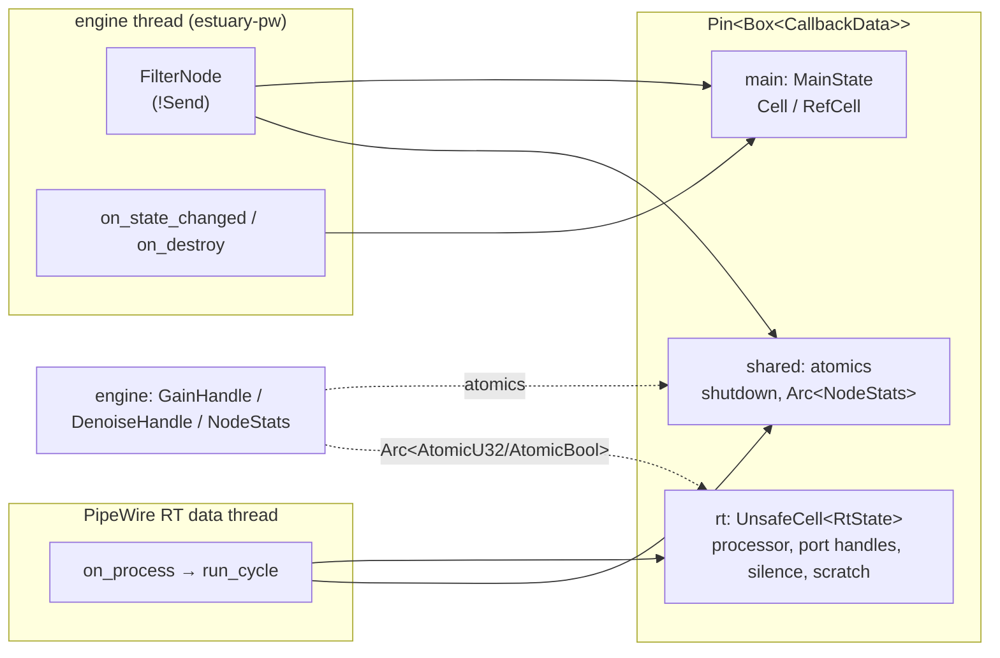
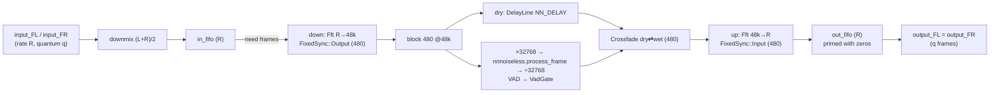
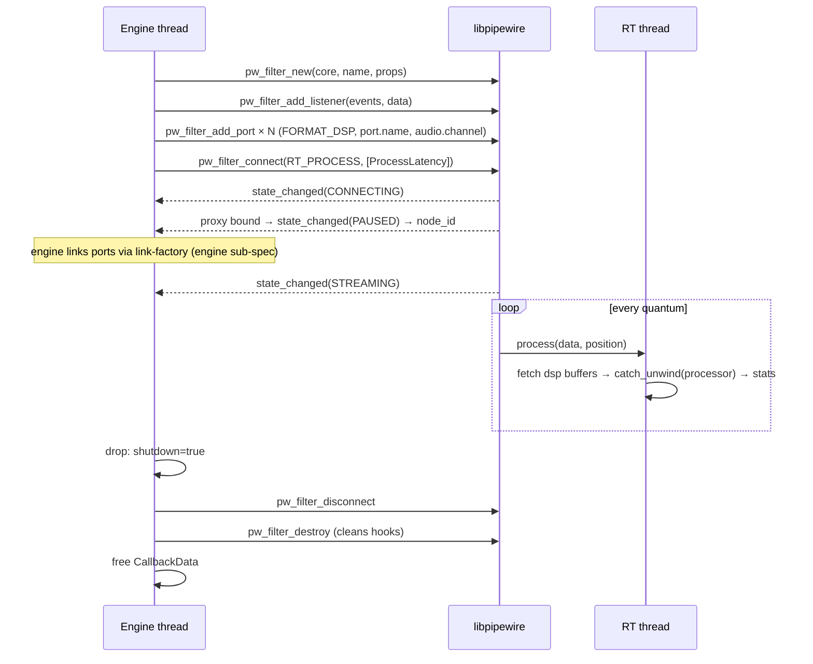

# estuary-dsp: realtime DSP nodes (sub-spec)

> Sub-spec of [`specs/estuary/spec.md`](../estuary/spec.md). Covers **M7** (safe `pw_filter` wrapper, gain node) and the processor side of **M10** (denoiser). Contracts **C1, C2, C5, C11** of the master are binding and are cited, never redefined. Where this spec needs a contract change, it is listed under [Contract amendments requested](#contract-amendments-requested) and must be adopted in the master before implementation.
>
> Detail level: **high**. Date: 2026-10-14.

---

## Summary

`estuary-dsp` is the only crate in the workspace allowed to contain `unsafe` code (C1). It provides:

- `FilterNode`, a safe Rust wrapper over libpipewire's `pw_filter`;
- the `Processor` trait that runs on PipeWire's realtime thread;
- two processors: `GainProcessor` (matrix cell, ~10 ms linear gain ramp) and `DenoiseProcessor` (downmix → optional resampling to 48 kHz → `nnnoiseless` RNNoise → identical stereo output, with VAD gate and click-free bypass).

## Problem Statement

Estuary needs per-crosspoint gain and noise suppression inside the PipeWire graph (master: Solution Overview, Approach A). pipewire-rs 0.10.1 has no `pw_filter` wrapper (upstream MRs !276/!277 are still open), so the raw `pipewire-sys` FFI must be wrapped safely. Realtime audio code has hard constraints that ordinary Rust code violates by default:

- no allocation, locks or syscalls on the RT thread;
- no unwinding across `extern "C"`;
- correct behaviour when inputs are unlinked;
- correct behaviour across quantum (buffer size) changes and graph sample-rate changes.

RNNoise also only works at 48 kHz in fixed 480-frame blocks, while PipeWire delivers arbitrary quanta at whatever rate the graph runs. A mistake here produces audible clicks, dropouts, xruns or a crashed audio thread. That's why this crate is specified in isolation and tested without PipeWire wherever possible.

## Solution Overview

1. **The FFI wrapper is split into three layers.**
   - `filter::ffi` holds the `unsafe extern "C"` trampolines and the `pw_filter_events` table.
   - `filter::rt` holds `RtState::run_cycle`, which is pure Rust apart from the `pw_filter_get_dsp_buffer` calls, which are isolated behind a small `PortIo` trait so the cycle logic can be unit-tested with fake ports.
   - `filter::mod` holds the public, safe `FilterNode`.
2. **Callback data is pinned and partitioned.** One heap allocation (`Pin<Box<CallbackData>>`) is passed as the `data` pointer. It has three parts:
   - an RT-only part in an `UnsafeCell`, touched only by `process`;
   - a main-loop-only part in `Cell`/`RefCell`, touched only by `state_changed`/`destroy`;
   - an atomics-only part, touched by both.
   No `&`/`&mut` to one part is ever created from the other thread.
3. **Panics never cross FFI.** Every trampoline body runs inside `std::panic::catch_unwind`. If `process` panics, the outputs already fetched for that cycle are zero-filled, the node is **poisoned** (outputs silence forever, the processor is never called again), and `NodeStats.poisoned` is set. The engine sees this and recreates the node.
4. **Fixed RT budget.** All buffers are preallocated for `MAX_QUANTUM = 8192` frames and `MAX_PORTS = 8` ports per direction. Quanta larger than `MAX_QUANTUM` are processed in ≤ 8192-frame chunks, so processors never see `n_samples > MAX_QUANTUM`. An unlinked input reads as a shared zero buffer. An output for which PipeWire gives no buffer is written to a discard scratch buffer.
5. **The gain processor** reads the target gain (an atomic f32) once per cycle and ramps linearly over `round(0.010 × rate)` samples. A new target that arrives mid-ramp restarts the ramp from the current value.
6. **The denoise processor** works in 480-frame blocks at 48 kHz, fed by fixed-capacity FIFOs.
   - The output FIFO is primed with enough zeros that it never underruns for any quantum sequence.
   - For graph rates ≠ 48 kHz, preconstructed `rubato::Fft` resamplers (one pair per supported rate, built off-RT) convert R → 48 kHz with fixed output and 48 kHz → R with fixed input.
   - Bypass runs the same FIFO path with a delay-matched dry signal, so the latency stays constant. Toggling crossfades over one block.

## Technical Context

### Verified facts used by this spec (2026-10-14)

| Fact | How verified |
|---|---|
| `pipewire-sys` 0.10.1 bindgen header is `wrapper.h` → `pipewire/pipewire.h` → `pipewire/filter.h`, allowlist `pw_.*`, blocklist `spa_.*` (taken from `spa_sys` via `use spa_sys::*`). So `pw_filter_new`, `pw_filter_add_port`, `pw_filter_connect`, `pw_filter_get_dsp_buffer`, `pw_filter_get_node_id`, `pw_filter_get_nsec`, `pw_filter_disconnect`, `pw_filter_destroy`, `pw_filter_add_listener`, `pw_filter_update_params` and `struct pw_filter_events` are bound | Crate source downloaded and read (`build.rs`, `wrapper.h`); upstream `pipewire.h` at 1.6.9 includes `filter.h` |
| Bindgen names enums as constified constants: `pw_sys::pw_stream_flags_PW_STREAM_FLAG_RT_PROCESS`, `pw_sys::pw_stream_state_PW_STREAM_STATE_PAUSED`. By the same rule the filter names are `pw_filter_flags_PW_FILTER_FLAG_RT_PROCESS`, `pw_filter_port_flags_PW_FILTER_PORT_FLAG_MAP_BUFFERS` and `pw_filter_state_PW_FILTER_STATE_*` | pipewire-rs 0.10.1 `src/stream/mod.rs` uses the stream forms; the filter names are inferred from the same bindgen rule. **UNVERIFIED** until the first build (see M7.1) |
| `pw_filter_new(core, name, props)` takes ownership of `props`. `pw_filter_add_port(filter, direction, flags, port_data_size, props, params, n_params)` takes ownership of `props` and returns `port_data`, which is the port handle. With `port_data_size = 0` the handle stays valid: `alloc_port` does `calloc(sizeof(struct port) + size)` and returns `p->user_data`, and `get_dsp_buffer` uses `SPA_CONTAINER_OF` | upstream `filter.h` / `filter.c` 1.6.9 |
| `pw_filter_get_dsp_buffer(port, n)` dequeues **and re-queues** a buffer in one call, returning `NULL` if none is available (e.g. unlinked input). For output ports it sets `chunk.size = n*4`. **Call it at most once per port per cycle** | `filter.c` 1.6.9 lines 2056–2076 |
| `node_id` is set in `proxy_bound_props`, immediately followed by a transition to `PW_FILTER_STATE_PAUSED`. So `pw_filter_get_node_id` is valid inside `state_changed(old, PAUSED)` and later. Before that it returns `SPA_ID_INVALID` | `filter.c` 1.6.9 lines 1119, 1143–1149 |
| `pw_filter_disconnect`, `pw_filter_add_port` and `pw_filter_destroy` start with `ensure_loop(impl->main_loop, …)`, so they must be called on the loop thread (the engine thread, C2). `pw_filter_destroy` cleans the hook lists itself (`spa_hook_list_clean`) | `filter.c` 1.6.9 |
| `process(void *data, struct spa_io_position *position)`: `n_samples = position->clock.duration`, rate = `position->clock.rate.denom` | `filter.h` and the upstream `src/examples/audio-dsp-filter.c` |
| Port DSP format key is `PW_KEY_FORMAT_DSP = "32 bit float mono audio"`. pipewire-rs exposes it as `pipewire::keys::FORMAT_DSP` (a `LazyLock<&'static str>`, used as `*keys::FORMAT_DSP`). Likewise `keys::PORT_NAME`, `keys::AUDIO_CHANNEL`, `keys::NODE_NAME` | upstream example; pipewire-rs `src/keys.rs` |
| pipewire-rs raw accessors: `Core::as_raw_ptr() -> *mut pw_core`, `PropertiesBox::into_raw() -> *mut pw_properties`, `Properties::insert(k, v)` / `get(k)`; `libspa::utils::Direction::{Input, Output}.as_raw()`; `libspa::utils::hook::remove(spa_hook)`; `libspa::param::ParamType::ProcessLatency`; `libspa::utils::SpaTypes::ObjectParamProcessLatency` | Crate sources pipewire 0.10.1 and libspa 0.10.1 |
| `nnnoiseless` 0.5.2 (BSD-3-Clause): `DenoiseState::new() -> Box<DenoiseState<'static>>`, `DenoiseState::FRAME_SIZE = 480`, `process_frame(&mut self, output: &mut [f32], input: &[f32]) -> f32` (returns VAD probability). Input and output are 48 kHz with samples in the 16-bit range `[-32768.0, 32767.0]`. "You might prefer to discard the very first output; it will contain some fade-in artifacts." `DenoiseState: Send + Sync` | Crate source `src/denoise.rs` |
| nnnoiseless **default features** (`bin`, `dasp`) pull in `clap`, `hound`, `anyhow` and `dasp*`. Use `default-features = false` | Crate `Cargo.toml` |
| nnnoiseless FFTs go through `easyfft` 0.4.1, which caches FFT planners and scratch buffers in **thread-local** maps (`generic_singleton::get_or_init_thread_local!`). So the **first** `process_frame` on a given thread allocates (planner and scratch). Later calls on the same thread look up the cache without allocating. Lock-free thread-local path | Crate sources easyfft 0.4.1 / generic_singleton 0.4.1 |
| `rubato` latest is **5.0.1** (2026-10-01, MIT OR Apache-2.0, MSRV 1.87), **not** 0.16 as written in master C1. Synchronous FFT resampler: `rubato::Fft::new(sample_rate_input, sample_rate_output, chunk_size, nbr_channels, FixedSync::{Input, Output, Both})`. Trait `Resampler<f32>`: `process_into_buffer(&mut self, &dyn Adapter<T>, &mut dyn AdapterMut<T>, Option<&Indexing>) -> ResampleResult<(usize, usize)>`, plus `input_frames_next/max`, `output_frames_next/max`, `output_delay`, `reset`. Buffers wrap via `rubato::audioadapter_buffers::direct::SequentialSlice::{new, new_mut}(buf, channels, frames)` | Crate sources rubato 5.0.1, audioadapter-buffers 5.1.0 |
| rubato's `Fft::process_into_buffer` calls `log::trace!("Start processing, {:?}", self)` and other `trace!`s. If trace logging were enabled for `rubato`, formatting would allocate on the RT thread | rubato `src/synchro.rs` lines 523–635 |

### Constraints inherited from the master

- **C1:** crate `crates/estuary-dsp`, `unsafe` confined here behind a safe API, no gtk/relm4/adw dependency.
- **C2:** `FilterNode` is created, used and dropped on the engine thread (`!Send`). `Processor::process` runs on the PipeWire RT thread. Communication is through atomics only.
- **C5:** node properties and port names (`input_FL`, `input_FR`, `output_FL`, `output_FR`, with `audio.channel` FL/FR, format "32 bit float mono audio") are supplied by the engine. This crate adds only the port-level keys.
- **C11:** the public API surface. Reproduced in M7.3, M7.5 and M10.4 with the exact C11 signatures. Additions are flagged.

### Crate layout

```
crates/estuary-dsp/
├── Cargo.toml
├── src/
│   ├── lib.rs              # pub use of the public API; #![deny(unsafe_op_in_unsafe_fn, clippy::undocumented_unsafe_blocks)]
│   ├── consts.rs           # MAX_QUANTUM, MAX_PORTS, DENOISE_RATE, DENOISE_BLOCK, GAIN_RAMP_SECS
│   ├── error.rs            # DspError
│   ├── processor.rs        # Processor trait, PortSpec
│   ├── stats.rs            # NodeStats
│   ├── fpu.rs              # flush-denormals-to-zero (x86_64 / aarch64 asm)
│   ├── filter/
│   │   ├── mod.rs          # FilterNode, FilterState (safe API)
│   │   ├── ffi.rs          # extern "C" trampolines, events table, raw calls
│   │   ├── rt.rs           # CallbackData, RtState, PortIo, run_cycle (testable)
│   │   └── props.rs        # port PropertiesBox builders, ProcessLatency pod
│   ├── gain.rs             # GainProcessor, GainHandle, gain_processor(), db/linear helpers
│   └── denoise/
│       ├── mod.rs          # DenoiseProcessor, DenoiseHandle, denoise_processor()
│       ├── fifo.rs         # Fifo: fixed-capacity single-thread ring buffer
│       ├── rate.rs         # RatePath (rubato Fft down/up pair), RATE_TABLE, RatePaths
│       ├── gate.rs         # VadGate (hold + per-block ramp)
│       └── xfade.rs        # DelayLine, Crossfade (bypass ↔ wet)
└── tests/
    ├── no_alloc.rs         # counting #[global_allocator]; zero allocations after warm-up
    ├── denoise_latency.rs  # impulse latency per rate, odd-quantum buffering, underrun-free
    └── live_pw.rs          # #[cfg(feature = "live-pw")] smoke test against a running PipeWire
```

`Cargo.toml`:

```toml
[package]
name = "estuary-dsp"
version.workspace = true
edition.workspace = true
rust-version.workspace = true
license.workspace = true

[features]
live-pw = []          # enables tests/live_pw.rs (needs a running PipeWire session)

[dependencies]
pipewire     = { workspace = true }
pipewire-sys = { workspace = true }
libspa       = { workspace = true }
libspa-sys   = { workspace = true }
nnnoiseless  = { workspace = true }      # must resolve to default-features = false (amendment A1)
rubato       = { workspace = true }      # 5.0.1 (amendment A1)
thiserror    = { workspace = true }
tracing      = { workspace = true }      # engine-thread code only; never in RT paths

[dev-dependencies]
rand = "0.9"           # randomized quantum sequences (seeded)
```

---

## Implementation Steps

Step numbering follows the master's milestone numbering (`M7.n`, `M10.n`).

### M7.1: Crate skeleton and FFI name verification

**What.** Create the crate with the layout above, `consts.rs` and `error.rs`. Build once against the installed `libpipewire-0.3-dev` and grep the generated `bindings.rs` (in `target/*/build/pipewire-sys-*/out/`) to confirm the exact constified names this spec assumes. If any differ, fix the spec, not just the code.

```text
pw_filter_flags_PW_FILTER_FLAG_RT_PROCESS
pw_filter_port_flags_PW_FILTER_PORT_FLAG_MAP_BUFFERS
pw_filter_state_PW_FILTER_STATE_{ERROR,UNCONNECTED,CONNECTING,PAUSED,STREAMING}
PW_VERSION_FILTER_EVENTS
struct pw_filter_events { version, destroy, state_changed, io_changed, param_changed,
                          add_buffer, remove_buffer, process, drained, command }
```

```rust
// consts.rs
pub const MAX_QUANTUM: usize = 8192;        // PipeWire default clock.max-quantum
pub const MAX_PORTS: usize = 8;             // per direction
pub const DENOISE_RATE: u32 = 48_000;
pub const DENOISE_BLOCK: usize = 480;       // == nnnoiseless::DenoiseState::FRAME_SIZE (asserted in a test)
pub const GAIN_RAMP_SECS: f32 = 0.010;

// error.rs
#[derive(Debug, thiserror::Error)]
pub enum DspError {
    #[error("too many {dir} ports: {n} (max {MAX_PORTS})")]
    TooManyPorts { dir: &'static str, n: usize },
    #[error("invalid node name {0:?} (must be non-empty, no NUL)")]
    InvalidName(String),
    #[error("pw_filter_new failed: {0}")]
    FilterNew(std::io::Error),
    #[error("pw_filter_add_port({port}) failed: {source}")]
    AddPort { port: &'static str, source: std::io::Error },
    #[error("pw_filter_connect failed: {0}")]
    Connect(std::io::Error),
}
```

Errors capture `std::io::Error::last_os_error()` right after the failing call (libpipewire sets `errno`).

### M7.2: Processor trait, PortSpec, NodeStats

The `Processor` and `PortSpec` definitions are exactly as in C11. One documented guarantee is added (amendment A3): **`n_samples <= MAX_QUANTUM` on every call**, because `FilterNode` chunks larger quanta.

```rust
// processor.rs: C11, verbatim signatures
pub trait Processor: Send + 'static {
    /// Realtime. MUST NOT allocate, lock, block, log or make syscalls.
    /// `inputs.len()`/`outputs.len()` equal the port counts given to FilterNode::new, in the same order.
    /// Unlinked inputs are silence. Every output sample in 0..n_samples must be written.
    /// Guarantee (A3): 1 <= n_samples <= MAX_QUANTUM; rate > 0.
    fn process(&mut self, inputs: &[&[f32]], outputs: &mut [&mut [f32]], n_samples: usize, rate: u32);
}

pub struct PortSpec { pub name: &'static str, pub channel: &'static str }
pub const STEREO_IN:  [PortSpec; 2] = [PortSpec { name: "input_FL",  channel: "FL" }, PortSpec { name: "input_FR",  channel: "FR" }];
pub const STEREO_OUT: [PortSpec; 2] = [PortSpec { name: "output_FL", channel: "FL" }, PortSpec { name: "output_FR", channel: "FR" }];
```

`STEREO_IN`/`STEREO_OUT` are convenience constants matching C5. They are additive, not a contract change.

```rust
// stats.rs: C11 fields plus additions (amendment A2)
#[derive(Default, Debug)]
pub struct NodeStats {
    pub xruns: AtomicU64,             // C11. Cycles whose processing time exceeded the quantum period (n/rate)
    pub processed_blocks: AtomicU64,  // C11. Successful process() cycles
    pub max_process_ns: AtomicU64,    // A2. Max observed processing time; engine may reset with store(0)
    pub poisoned: AtomicBool,         // A2. A panic occurred; node outputs silence until recreated
    pub underruns: AtomicU64,         // A2. Denoiser output FIFO underruns (should stay 0)
    pub unsupported_rate: AtomicU32,  // A2. Last graph rate the denoiser could not handle (0 = none)
}
```

The xrun definition (C11 leaves it open, F12): the RT thread reads `pw_filter_get_nsec(filter)` (RT-safe per `filter.h`) at the start and end of `run_cycle`. If `elapsed_ns > n_samples × 1e9 / rate`, it increments `xruns`. This measures *our* deadline overruns, which are the ones we can fix. Graph-wide xruns are PipeWire's business.

### M7.3: CallbackData partition and RtState::run_cycle

```rust
// filter/rt.rs
pub(crate) struct CallbackData {
    pub rt: UnsafeCell<RtState>,     // touched ONLY by the process trampoline (RT thread)
    pub main: MainState,             // touched ONLY by state_changed/destroy trampolines and FilterNode methods (engine thread)
    pub shared: Shared,              // atomics, both threads
}

pub(crate) struct Shared {
    pub shutdown: AtomicBool,        // set by FilterNode::drop before disconnect → RT writes silence, skips processor
    pub stats: Arc<NodeStats>,
}

pub(crate) struct MainState {
    pub state: RefCell<FilterState>,
    pub node_id: Cell<Option<u32>>,
    pub on_state: RefCell<Option<Box<dyn FnMut(&FilterState, Option<u32>)>>>,   // A4
}

pub(crate) struct RtState {
    pub processor: Box<dyn Processor>,
    pub filter: *mut pw_sys::pw_filter,          // for pw_filter_get_nsec only
    pub in_ports: [*mut c_void; MAX_PORTS],  pub n_in: usize,
    pub out_ports: [*mut c_void; MAX_PORTS], pub n_out: usize,
    pub silence: Box<[f32]>,                     // MAX_QUANTUM zeros, never written
    pub scratch: Box<[f32]>,                     // MAX_QUANTUM * MAX_PORTS, discard target for NULL outputs
}
```

**Safety invariant** (documented on the type): `rt` is dereferenced mutably only inside the process trampoline, which PipeWire never calls concurrently with itself for one filter. `main` is dereferenced only on the engine thread. `CallbackData` lives in a `Pin<Box<_>>` owned by `FilterNode`, and is freed only after `pw_filter_destroy` has returned (M7.5), so no callback can observe a dangling pointer.

**Cycle logic.** It is factored for tests: buffer access goes through a trait so unit tests can drive `run_cycle` with plain `Vec<f32>` ports.

```rust
pub(crate) trait PortIo {
    /// Returns a pointer valid for n floats, or null. Called at most once per port per cycle.
    unsafe fn dsp_buffer(&mut self, port: *mut c_void, n: u32) -> *mut f32;
    fn now_ns(&self) -> u64;
}

impl RtState {
    /// Called by the trampoline inside catch_unwind is NOT enough: buffers must be fetched
    /// BEFORE the processor runs so that a panic can still zero them. Hence two phases.
    pub(crate) unsafe fn run_cycle<I: PortIo>(&mut self, io: &mut I, shared: &Shared, n: usize, rate: u32) {
        let t0 = io.now_ns();
        // Phase 1: fetch all port pointers once (no panics possible here: plain FFI + pointer math)
        let mut in_ptr = [core::ptr::null::<f32>(); MAX_PORTS];
        let mut out_ptr = [core::ptr::null_mut::<f32>(); MAX_PORTS];
        for i in 0..self.n_in  { in_ptr[i]  = io.dsp_buffer(self.in_ports[i],  n as u32); }
        for o in 0..self.n_out { out_ptr[o] = io.dsp_buffer(self.out_ports[o], n as u32); }

        if shared.shutdown.load(Acquire) || shared.stats.poisoned.load(Relaxed) || rate == 0 || n == 0 {
            zero_outputs(&out_ptr[..self.n_out], n);
            return;
        }
        crate::fpu::flush_denormals();          // cheap, idempotent (M7.4)

        // Phase 2: process in chunks of <= MAX_QUANTUM, under catch_unwind
        let result = std::panic::catch_unwind(AssertUnwindSafe(|| {
            let mut off = 0;
            while off < n {
                let len = (n - off).min(MAX_QUANTUM);
                let mut ins: [&[f32]; MAX_PORTS] = [&[]; MAX_PORTS];
                let mut outs: [&mut [f32]; MAX_PORTS] = Default::default();
                for i in 0..self.n_in {
                    ins[i] = if in_ptr[i].is_null() { &self.silence[..len] }
                             else { core::slice::from_raw_parts(in_ptr[i].add(off), len) };
                }
                // scratch split into MAX_PORTS disjoint MAX_QUANTUM regions
                let mut scratch_chunks = self.scratch.chunks_exact_mut(MAX_QUANTUM);
                for o in 0..self.n_out {
                    let sc = scratch_chunks.next().unwrap();   // never fails: MAX_PORTS chunks
                    outs[o] = if out_ptr[o].is_null() { &mut sc[..len] }
                              else { core::slice::from_raw_parts_mut(out_ptr[o].add(off), len) };
                }
                self.processor.process(&ins[..self.n_in], &mut outs[..self.n_out], len, rate);
                off += len;
            }
        }));
        match result {
            Ok(()) => { shared.stats.processed_blocks.fetch_add(1, Relaxed); }
            Err(_payload) => {
                // payload is dropped here (its allocation was made by the panic machinery; acceptable: exceptional path)
                shared.stats.poisoned.store(true, Release);
                zero_outputs(&out_ptr[..self.n_out], n);
            }
        }
        let dt = io.now_ns().saturating_sub(t0);
        shared.stats.max_process_ns.fetch_max(dt, Relaxed);
        if dt.saturating_mul(rate as u64) > (n as u64) * 1_000_000_000 { shared.stats.xruns.fetch_add(1, Relaxed); }
    }
}
```

Notes:

- `Default` for `[&mut [f32]; 8]` exists because `&mut [T]: Default` (empty slice) and arrays of `Default` up to 32 implement `Default`. No allocation.
- `rand`-free, `tracing`-free, `Vec`-free. `self.silence` and `self.scratch` are allocated once in `FilterNode::new`.
- **Panic strategy requirement:** the workspace must keep `panic = "unwind"` in all profiles (amendment A5). With `panic = "abort"`, a processor panic would kill Estuary, which F18 handles but which is much worse than poisoning one node.
- The trampoline (M7.5) passes the real `PortIo` (`FfiIo { filter }`, which calls `pw_filter_get_dsp_buffer` / `pw_filter_get_nsec`) and wraps the **whole** `run_cycle` in a second `catch_unwind` as a backstop. If that one ever triggers, it sets `poisoned` and returns. Outputs may then contain garbage for that one cycle, which is acceptable because it is unreachable in practice.

### M7.4: Denormal flushing (`fpu.rs`)

The RNN recursions in nnnoiseless can produce subnormal floats, which are 10–100× slower on x86. `flush_denormals()` runs at the start of every cycle. It is idempotent and costs about one instruction.

```rust
#[inline(always)]
pub fn flush_denormals() {
    #[cfg(target_arch = "x86_64")]
    unsafe {
        // SAFETY: only sets FTZ (bit 15) and DAZ (bit 6) in MXCSR of the current (estuary-owned RT) thread.
        let mut csr: u32 = 0;
        core::arch::asm!("stmxcsr [{}]", in(reg) &mut csr, options(nostack));
        csr |= 0x8040;
        core::arch::asm!("ldmxcsr [{}]", in(reg) &csr, options(nostack, readonly));
    }
    #[cfg(target_arch = "aarch64")]
    unsafe {
        // SAFETY: sets FZ (bit 24) in FPCR of the current thread.
        let mut fpcr: u64;
        core::arch::asm!("mrs {}, fpcr", out(reg) fpcr, options(nomem, nostack));
        fpcr |= 1 << 24;
        core::arch::asm!("msr fpcr, {}", in(reg) fpcr, options(nomem, nostack));
    }
}
```

The RT data thread belongs to Estuary's own process (its filters and meter streams), so leaving FTZ set affects nothing else. Meter peaks are unaffected because subnormals are far below any displayable level. `_mm_setcsr` is avoided because it is deprecated in std.

### M7.5: FilterNode (safe API, FFI lifecycle)

The C11 public surface, verbatim, plus additions A4 (state listener) and an explicit `FilterState`:

```rust
#[derive(Debug, Clone, PartialEq)]
pub enum FilterState { Unconnected, Connecting, Paused, Streaming, Error(String) }

pub struct FilterNode {
    filter: NonNull<pw_sys::pw_filter>,
    listener: Pin<Box<spa_sys::spa_hook>>,
    events: Pin<Box<pw_sys::pw_filter_events>>,
    data: Pin<Box<CallbackData>>,
    _not_send: PhantomData<*mut ()>,       // C2: !Send + !Sync
}

impl FilterNode {
    pub fn new<P: Processor>(core: &pipewire::core::Core, name: &str, props: pipewire::properties::PropertiesBox,
                             inputs: &[PortSpec], outputs: &[PortSpec], processor: P) -> Result<FilterNode, DspError>;
    pub fn node_id(&self) -> Option<u32>;
    pub fn state(&self) -> FilterState;
    pub fn stats(&self) -> Arc<NodeStats>;
    /// A4 (additive): called on the engine thread on every state change, with node_id once known.
    pub fn set_state_listener(&self, f: impl FnMut(&FilterState, Option<u32>) + 'static);
}
```

**`new` sequence** (engine thread). Each `unsafe` block has a `// SAFETY:` comment:

1. Validate `name` (non-empty, no NUL) and `inputs.len()`, `outputs.len()` ≤ `MAX_PORTS`.
2. `let mut props = props;` If `props.get(*keys::NODE_NAME)` is `None`, insert `node.name = name`. Do not override any engine-provided keys (C5 is authoritative).
3. `let c_name = CString::new(name)?;` then `let f = pw_sys::pw_filter_new(core.as_raw_ptr(), c_name.as_ptr(), props.into_raw());`. Ownership of props passes to C. Null → `DspError::FilterNew(last_os_error())`.
4. Allocate `data = Box::pin(CallbackData { rt: UnsafeCell::new(RtState { processor: Box::new(processor), filter: f, in_ports: [null; MAX_PORTS], …, silence: vec![0.0; MAX_QUANTUM].into_boxed_slice(), scratch: vec![0.0; MAX_QUANTUM * MAX_PORTS].into_boxed_slice() }), main: …, shared: … })`.
5. `events = Box::pin(pw_filter_events { version: PW_VERSION_FILTER_EVENTS, destroy: Some(on_destroy), state_changed: Some(on_state_changed), process: Some(on_process), ..zeroed })`, then `listener = Box::pin(zeroed spa_hook)`, then `pw_filter_add_listener(f, listener_ptr, events_ptr, data_ptr as *mut c_void)`.
6. For each port, in the order given (the order defines the processor's `inputs`/`outputs` indices):
   ```rust
   let pprops = pipewire::properties::properties! {
       *pipewire::keys::FORMAT_DSP    => "32 bit float mono audio",
       *pipewire::keys::PORT_NAME     => spec.name,
       *pipewire::keys::AUDIO_CHANNEL => spec.channel,
   };
   let port = pw_sys::pw_filter_add_port(f, Direction::Input.as_raw() /* or Output */,
       pw_sys::pw_filter_port_flags_PW_FILTER_PORT_FLAG_MAP_BUFFERS,
       0,                                   // no per-port user data (verified safe)
       pprops.into_raw(), core::ptr::null_mut(), 0);
   ```
   Null → destroy the filter (step 9 order) and return `DspError::AddPort`. Store the handles into `data.rt` (still exclusively owned here: the filter is not connected yet, so no process callback can run).
7. Optional global params: `ProcessLatency` (M10.6 passes it for the denoiser; the gain node passes none). This is an additive `pub(crate) fn new_with_params`, which `new` calls with an empty slice.
8. `pw_sys::pw_filter_connect(f, pw_filter_flags_PW_FILTER_FLAG_RT_PROCESS, params_ptr, n_params)`. `< 0` → destroy and return `DspError::Connect`. Never pass `DRIVER`, `TRIGGER` or `ASYNC`: cells and denoisers are followers scheduled by the graph.
9. Return `FilterNode`.

**Trampolines** (`filter/ffi.rs`). All are `unsafe extern "C"` and wrap their bodies in `catch_unwind`:

```rust
unsafe extern "C" fn on_process(data: *mut c_void, position: *mut spa_sys::spa_io_position) {
    // SAFETY: data is the pinned CallbackData (lives until after pw_filter_destroy); RT-thread-only field `rt`.
    let cb = &*(data as *const CallbackData);
    if position.is_null() { return; }
    let n = (*position).clock.duration as usize;
    let rate = (*position).clock.rate.denom;
    let rt = &mut *cb.rt.get();
    let mut io = FfiIo { filter: rt.filter };
    if std::panic::catch_unwind(AssertUnwindSafe(|| rt.run_cycle(&mut io, &cb.shared, n, rate))).is_err() {
        cb.shared.stats.poisoned.store(true, Release);
    }
}

unsafe extern "C" fn on_state_changed(data: *mut c_void, _old: pw_filter_state, new: pw_filter_state, err: *const c_char) {
    let _ = std::panic::catch_unwind(AssertUnwindSafe(|| {
        let cb = &*(data as *const CallbackData);                       // engine thread: field `main` only
        let st = match new {
            pw_filter_state_PW_FILTER_STATE_UNCONNECTED => FilterState::Unconnected,
            pw_filter_state_PW_FILTER_STATE_CONNECTING  => FilterState::Connecting,
            pw_filter_state_PW_FILTER_STATE_PAUSED      => FilterState::Paused,
            pw_filter_state_PW_FILTER_STATE_STREAMING   => FilterState::Streaming,
            _ => FilterState::Error(if err.is_null() { String::new() } else { CStr::from_ptr(err).to_string_lossy().into_owned() }),
        };
        if matches!(st, FilterState::Paused | FilterState::Streaming) {
            let id = pw_sys::pw_filter_get_node_id((*cb.rt.get()).filter /* read-only pointer copy; see note */);
            if id != spa_sys::SPA_ID_INVALID { cb.main.node_id.set(Some(id)); }
        }
        *cb.main.state.borrow_mut() = st.clone();
        if let Some(f) = cb.main.on_state.borrow_mut().as_mut() { f(&st, cb.main.node_id.get()); }
        if let FilterState::Error(e) = &st { tracing::warn!(error = %e, "pw_filter entered error state"); }
    }));
}
```

Note: reading `rt.filter` from the engine thread would be an aliasing violation under the partition rule. To avoid it, store a copy of the raw `*mut pw_filter` in `MainState` as well (`main.filter: *mut pw_filter`) and use that. **Implementation must do this.** The snippet above marks the spot.

`on_destroy` sets `main.state = Unconnected` and `main.node_id = None`.

**Drop** (engine thread, C2):

```rust
impl Drop for FilterNode {
    fn drop(&mut self) {
        self.data.shared.shutdown.store(true, Release);   // late RT cycles output silence and skip the processor
        unsafe {
            pw_sys::pw_filter_disconnect(self.filter.as_ptr());   // node leaves the graph
            pw_sys::pw_filter_destroy(self.filter.as_ptr());      // also cleans our hook (spa_hook_list_clean)
        }
        // listener, events, data are dropped AFTER this point (field drop order follows Drop::drop).
    }
}
```

Do **not** call `libspa::utils::hook::remove` after `pw_filter_destroy`, because the hook list has already been cleaned. **UNVERIFIED:** that no `process` callback can still be executing on the RT thread once `pw_filter_destroy` returns. The PipeWire node teardown removes the node from the data loop synchronously, but this spec did not trace that path end to end. The `shutdown` flag means a straggling cycle never touches the processor. The live test `drop_while_streaming` (M7.8) exercises 1,000 create/drop cycles under load and must not crash.

### M7.6: GainProcessor and GainHandle

C11 signatures plus additive handle methods:

```rust
#[derive(Clone, Debug)]
pub struct GainHandle(Arc<AtomicU32>);
impl GainHandle {
    pub fn set_db(&self, db: f32)      { self.set_linear(db_to_linear(db)); }
    pub fn set_linear(&self, g: f32)   { self.0.store(sanitize(g).to_bits(), Relaxed); }
    pub fn linear(&self) -> f32        { f32::from_bits(self.0.load(Relaxed)) }
}

pub fn db_to_linear(db: f32) -> f32 {
    if db == f32::NEG_INFINITY { 0.0 } else if !db.is_finite() { 1.0 } else { 10f32.powf(db / 20.0) }
}
fn sanitize(g: f32) -> f32 { if g.is_finite() && g >= 0.0 { g.min(4.0) } else { 0.0 } }   // +12 dB hard ceiling; C6 clamps to +6 anyway

pub fn gain_processor(initial_db: f32) -> (GainProcessor, GainHandle);   // C11: 2 in / 2 out

pub struct GainProcessor {
    target: Arc<AtomicU32>,
    current: f32,          // starts at db_to_linear(initial_db): no ramp at creation
    last_target: f32,
    step: f32,
    remaining: u32,
}
```

Algorithm, per call:

1. Read `t = f32::from_bits(target.load(Relaxed))` once.
2. If `t != last_target`: set `last_target = t`, `len = max(1, round(GAIN_RAMP_SECS × rate))`, `step = (t − current) / len`, `remaining = len`.
3. Per sample `i`:
   - if `remaining > 0`: `current += step`, `remaining -= 1`, and if `remaining == 0` then `current = t` (exact landing, no float drift);
   - `out_L[i] = in_L[i] × current`, `out_R[i] = in_R[i] × current`.
4. Fast paths when `remaining == 0`: `current == 1.0` → `copy_from_slice`; `current == 0.0` → `fill(0.0)`; otherwise a multiply loop (auto-vectorized).

Behaviour notes:

- **Ramp duration** is 10 ms at any rate (480 samples at 48 kHz, 441 at 44.1 kHz). A ramp spans quantum boundaries transparently.
- **Gain range:** C6 clamps `gain_db` to [−60, +6] dB. `NEG_INFINITY` (true silence) is accepted, so the engine can mute a cell without destroying the node if it chooses (engine's call).
- **No clipping protection.** PipeWire sums at the destination port, and limiting is out of scope for v1.

### M7.7: Unit tests (M7)

| Test | Asserts |
|---|---|
| `gain_ramp_shape` | 48 kHz, 1.0 → 0.125 (−18 dB): sample k of the ramp equals `1 + (k+1)×(0.125−1)/480` within 1e-6; sample 479 is exactly 0.125; then constant |
| `gain_ramp_across_quanta` | Feeding the same signal in quanta [256, 256, 256] gives bit-identical output to one 768 call |
| `gain_retarget_mid_ramp` | Target changes at sample 200 of a ramp: the new ramp starts from the value at 199 and lasts a full 480 samples; no discontinuity > `|step|` |
| `gain_rates` | Ramp length 441 / 480 / 960 at 44.1 / 48 / 96 kHz |
| `gain_neg_inf_and_nan` | `set_db(NEG_INFINITY)` → output exactly 0 after the ramp; `set_linear(NAN)` → treated as 0 |
| `run_cycle_null_input_is_silence` | Fake `PortIo` returning null for input 1: the processor sees zeros for that input |
| `run_cycle_null_output_goes_to_scratch` | Null output pointer: no crash, other outputs written |
| `run_cycle_chunks_large_quanta` | n = 20000: processor called 3× with 8192, 8192, 3616 |
| `run_cycle_panic_poisons` | Panicking processor: outputs zeroed, `poisoned == true`, next cycle never calls the processor and outputs zeros |
| `run_cycle_shutdown_flag` | `shutdown=true` → zeros, processor not called |
| `xrun_accounting` | Fake clock advancing more than n/rate per cycle → `xruns` increments; `max_process_ns` updated |
| `denoise_block_const` | `DENOISE_BLOCK == nnnoiseless::DenoiseState::FRAME_SIZE` |

`tests/no_alloc.rs` (separate integration-test binary, so the global allocator affects only it):

```rust
struct Counting;
static ALLOCS: AtomicUsize = AtomicUsize::new(0);
static ARMED: AtomicBool = AtomicBool::new(false);
unsafe impl GlobalAlloc for Counting {
    unsafe fn alloc(&self, l: Layout) -> *mut u8 { if ARMED.load(Relaxed) { ALLOCS.fetch_add(1, Relaxed); } System.alloc(l) }
    unsafe fn dealloc(&self, p: *mut u8, l: Layout) { if ARMED.load(Relaxed) { ALLOCS.fetch_add(1, Relaxed); } System.dealloc(p, l) }
    unsafe fn realloc(&self, p: *mut u8, l: Layout, n: usize) -> *mut u8 { if ARMED.load(Relaxed) { ALLOCS.fetch_add(1, Relaxed); } System.realloc(p, l, n) }
}
#[global_allocator] static A: Counting = Counting;
```

- **Gain:** construct, run 10 warm-up cycles, set `ARMED`, run 10,000 cycles with seeded random quanta in [1, 8192] and random target changes, unset `ARMED`, assert `ALLOCS == 0`.
- **Denoise** (after M10): the same, with warm-up ≥ 20 blocks *on the same thread*, for rates 48000 and 44100 and with enable/disable toggles. `run_cycle` with a fake `PortIo` is included in the measured section.

The test binary runs single-threaded (`harness = true`, each test arms around its own section; use `--test-threads=1` via `[[test]]` + a `#[test]` that serializes with a static `Mutex` held outside the armed section).

### M7.8: Live smoke test (`--features live-pw`)

`tests/live_pw.rs`. All tests are `#[ignore]` and run with `cargo test -p estuary-dsp --features live-pw -- --ignored --test-threads=1`. They need a running PipeWire session.

1. `filter_appears_in_registry`:
   - Create a `MainLoopRc`, context and core.
   - Create `FilterNode::new(&core, "estuary.test.gain", props!{ media.type=Audio, media.category=Filter, media.role=DSP, node.autoconnect=false, estuary.role=test }, &STEREO_IN, &STEREO_OUT, gain_processor(0.0).0)`.
   - Iterate the loop until `state() == Paused` (timeout 2 s) and `node_id().is_some()`.
   - Bind the registry and assert that the node exists with `node.name="estuary.test.gain"` and 4 ports with `port.name` ∈ {input_FL, input_FR, output_FL, output_FR} and matching `audio.channel`.
2. `gain_applies_in_graph`:
   - Create a pipewire-rs output `StreamBox` generating a 1 kHz sine at −6 dBFS (`node.autoconnect=false`) and an input `StreamBox` capture (`node.autoconnect=false`).
   - Link sine → filter inputs and filter outputs → capture with `core.create_object::<Link>("link-factory", …)`.
   - Measure RMS over 1 s at gain 0 dB and then −18 dB. The ratio must be −18 ± 0.5 dB, and the captured signal must have no sample-to-sample jump larger than the sine's maximum slope × 1.5 during the ramp (click check).
3. `drop_while_streaming`: 1,000 iterations of create, link, stream 10 ms, drop, with no crash and no leaked nodes (registry shows no `estuary.test.*` afterwards).

---

### M10.1: Fifo, DelayLine, Crossfade, VadGate building blocks

All of these are plain safe Rust, allocate only in `new`, and are single-threaded (owned by the processor).

```rust
// denoise/fifo.rs
pub struct Fifo { buf: Box<[f32]>, head: usize, len: usize }
impl Fifo {
    pub fn with_capacity(cap: usize) -> Self;
    pub fn len(&self) -> usize;  pub fn free(&self) -> usize;
    pub fn push(&mut self, src: &[f32]) -> usize;          // returns frames pushed (== src.len() unless full)
    pub fn push_zeros(&mut self, n: usize) -> usize;
    pub fn pop_into(&mut self, dst: &mut [f32]) -> usize;  // returns frames popped
    pub fn peek_contiguous(&self, n: usize, tmp: &mut [f32]) -> &[f32]; // copies across wrap into tmp only when needed
    pub fn discard(&mut self, n: usize);
    pub fn clear(&mut self);
}

// denoise/xfade.rs
pub struct DelayLine { buf: Box<[f32]>, pos: usize }      // fixed delay D (constructor arg), D may be 0
impl DelayLine { pub fn new(d: usize) -> Self; pub fn process(&mut self, io: &mut [f32]); pub fn reset(&mut self); }

pub struct Crossfade { pos: usize, len: usize, to_wet: bool }
impl Crossfade {
    pub fn new(len: usize, wet: bool) -> Self;
    pub fn set_target(&mut self, wet: bool);                        // starts a new fade from the current position (no jump)
    pub fn mix(&mut self, dry: &[f32], wet: &[f32], out: &mut [f32]); // equal-gain linear fade (signals are correlated)
    pub fn is_fully_dry(&self) -> bool;
}

// denoise/gate.rs
pub struct VadGate { gain: f32, hold_blocks_left: u32 }
impl VadGate {
    pub const HOLD_BLOCKS: u32 = 20;                 // 200 ms at 10 ms/block, avoids chopping word tails
    /// Per 480-frame block: if gate == 0 → open (gain 1). If vad >= gate → reset hold, target 1.
    /// Else if hold_blocks_left > 0 → decrement, target 1. Else target 0.
    /// The gain ramps linearly to the target across the block.
    pub fn apply(&mut self, vad: f32, gate: f32, block: &mut [f32; DENOISE_BLOCK]);
}
```

### M10.2: RatePath and the preconstructed rate table

nnnoiseless needs 48 kHz (F11). PipeWire may run the graph at other rates, typically 44.1 kHz when a 44.1 kHz client forces it and `allowed-rates` includes it. Constructing a rubato resampler allocates (FFT plans), so it **cannot** happen on the RT thread. All resampler pairs are therefore built in `denoise_processor()`, on the engine thread, for a fixed table:

```rust
pub const RATE_TABLE: [u32; 11] = [8_000, 11_025, 16_000, 22_050, 24_000, 32_000, 44_100, 88_200, 96_000, 176_400, 192_000];

pub struct RatePath {
    pub rate: u32,
    down: rubato::Fft<f32>,   // Fft::new(rate, 48_000, DENOISE_BLOCK, 1, FixedSync::Output): always yields exactly 480 out
    up:   rubato::Fft<f32>,   // Fft::new(48_000, rate, DENOISE_BLOCK, 1, FixedSync::Input):  always consumes exactly 480 in
    down_in: Box<[f32]>,      // capacity down.input_frames_max()
    up_out:  Box<[f32]>,      // capacity up.output_frames_max()
}
impl RatePath {
    pub fn new(rate: u32) -> Result<Self, rubato::ResamplerConstructionError>;
    pub fn input_needed(&self) -> usize { self.down.input_frames_next() }
    /// Consumes input_needed() frames from `src`, writes 480 frames at 48 kHz into `dst`.
    pub fn downsample(&mut self, src: &[f32], dst: &mut [f32; DENOISE_BLOCK]);
    /// Consumes 480 frames at 48 kHz; returns the slice of produced frames at `rate` (variable length).
    pub fn upsample(&mut self, src: &[f32; DENOISE_BLOCK]) -> &[f32];
    pub fn priming(&self) -> usize { self.down.input_frames_max() + self.up.output_frames_max() }
    pub fn delay_frames_at_rate(&self) -> f64;   // down.output_delay() scaled to `rate` + up.output_delay()
    pub fn reset(&mut self);
}
```

Calls use `SequentialSlice::new(&buf[..n], 1, n)` / `SequentialSlice::new_mut(&mut buf[..m], 1, m)` and `process_into_buffer(&input, &mut output, None)`. `None` indexing means no `Vec` is created. The `(consumed, produced)` return values are asserted with `debug_assert!` against `input_frames_next`/`output_frames_next`. Errors (should be impossible with correctly sized buffers) → treat as an unsupported rate for the rest of the session: set `stats.unsupported_rate = rate` and fall back to bypass.

Memory: 11 pairs of single-channel FFT resamplers at a 480 chunk is roughly tens of KB each, **UNVERIFIED** exact figure. M10.7 measures construction time and resident size and records them. If construction exceeds 20 ms in total, build the 44.1/88.2/96 kHz paths eagerly and the rest on a background thread before handing the processor over. In that case the API stays the same: `denoise_processor()` blocks until all are ready.

**Logging rule (RT safety):** rubato emits `log::trace!` in `process_into_buffer` with `{:?}` formatting, which would allocate. `estuary-dsp` therefore adds `log = { version = "0.4", features = ["release_max_level_debug"] }` as a dependency. That strips trace-level `log` calls from release builds workspace-wide (amendment A6). In debug builds, the `ESTUARY_LOG` filter must never enable `rubato=trace`; the default `warn,estuary=info` (C14) is safe.

### M10.3: DenoiseProcessor pipeline

State:

```rust
pub struct DenoiseProcessor {
    enabled: Arc<AtomicBool>, vad_gate: Arc<AtomicU32>, stats: Option<Arc<NodeStats>>,   // stats attached by FilterNode (see M10.6)
    nn: Box<nnnoiseless::DenoiseState<'static>>,
    paths: Box<[RatePath]>,                      // RATE_TABLE order
    cur_rate: u32, cur_path: Option<usize>,      // None ⇒ 48 kHz direct (or unsupported → bypass)
    unsupported: bool,
    in_fifo: Fifo,  out_fifo: Fifo,              // capacity 2*MAX_QUANTUM + 4096 each (rate domain R)
    mono: Box<[f32]>,                            // MAX_QUANTUM scratch for downmix
    blk48: [f32; DENOISE_BLOCK], wet48: [f32; DENOISE_BLOCK], dry48: [f32; DENOISE_BLOCK],
    dry_delay: DelayLine,                        // NN_DELAY frames (M10.5)
    xfade: Crossfade,                            // len = DENOISE_BLOCK
    gate: VadGate,
    warm_blocks: u32,                            // wet output muted until >= 1 (discard the first output, per nnnoiseless docs)
    was_enabled: bool,
}
```

`process(inputs, outputs, n, rate)` (n ≤ MAX_QUANTUM guaranteed, A3):

1. **Rate check.** If `rate != cur_rate`, reconfigure without allocating:
   - `cur_rate = rate`;
   - `cur_path = None` if rate == 48000, else the `RATE_TABLE` index if present, else mark unsupported (`stats.unsupported_rate = rate`);
   - clear both FIFOs and reset paths, `dry_delay`, `gate` and `warm_blocks = 0`;
   - prime `out_fifo` with `push_zeros(priming)`, where priming is `DENOISE_BLOCK` for 48 kHz or `path.priming()` otherwise.
   The rate change itself is already a graph glitch, so a reset here is acceptable.
2. **Downmix.** `mono[i] = 0.5 × (in_L[i] + in_R[i])` for i < n. C5 links a mono mic to both inputs, so both carry the same signal and the downmix equals it.
3. **Unsupported rate** → write `mono` to both outputs directly (no latency, no denoise) and return.
4. `in_fifo.push(&mono[..n])`.
5. **Block loop:** while `in_fifo.len() >= need` (need is `DENOISE_BLOCK` at 48 kHz or `path.input_needed()`):
   1. Fill `blk48`: at 48 kHz pop 480 frames, otherwise `path.downsample(peek(need), &mut blk48)` followed by `discard(need)`.
   2. `dry48 = blk48`, then `dry_delay.process(&mut dry48)`.
   3. Read `want = enabled.load(Relaxed)`. If `want != was_enabled`: `xfade.set_target(want)`; if turning on, set `warm_blocks = 0`. Then `was_enabled = want`.
   4. If `want || !xfade.is_fully_dry()`, run the denoiser:
      - scale `blk48 × 32768.0` into `wet48` (in place on a copy);
      - `vad = nn.process_frame(&mut out_tmp, &scaled)`;
      - `wet48 = out_tmp / 32768.0`;
      - if `warm_blocks == 0`, output dry for this block (discard the fade-in) and `warm_blocks += 1`;
      - otherwise `gate.apply(vad, f32::from_bits(vad_gate.load(Relaxed)).clamp(0.0, 0.95), &mut wet48)`.
      (`out_tmp` and `scaled` are fixed `[f32; 480]` fields, so nothing is allocated.)
   5. Otherwise (fully bypassed) set `wet48 = dry48`. `process_frame` is skipped to save CPU.
   6. Mix: `xfade.mix(&dry48, &wet48, &mut blk48)`.
   7. Back to rate R: at 48 kHz `out_fifo.push(&blk48)`, otherwise `out_fifo.push(path.upsample(&blk48))`.
6. **Output.** `got = out_fifo.pop_into(&mut out_L[..n])`. If `got < n`, zero-fill the rest and increment `stats.underruns` (it must stay 0, as asserted in tests). Then `out_R[..n].copy_from_slice(&out_L[..n])`.

**Never-underrun argument** (48 kHz, B = 480, primed with B zeros). After k cycles of arbitrary sizes q_j, with Q = Σq_j:

- produced = ⌊Q/B⌋·B ≥ Q − B + 1;
- available = B + produced ≥ Q + 1 > Q = consumed.

For R ≠ 48 kHz the variable `input_needed()` and `upsample()` sizes are covered by priming with `input_frames_max + output_frames_max`. The tests in M10.7 verify this empirically over 10⁶ random quanta per rate.

**Bypass latency is constant.** The dry path goes through the same FIFO priming and resampler pair and is delayed by `NN_DELAY` to match nnnoiseless's internal algorithmic delay. So toggling `enabled` never shifts timing, and the crossfade mixes time-aligned signals (C11 "keeps latency constant to avoid clicks").

### M10.4: DenoiseHandle and constructor

C11 verbatim:

```rust
#[derive(Clone, Debug)]
pub struct DenoiseHandle { pub enabled: Arc<AtomicBool>, pub vad_gate: Arc<AtomicU32> }
impl DenoiseHandle {                                   // additive helpers
    pub fn set_enabled(&self, on: bool) { self.enabled.store(on, Relaxed) }
    pub fn set_vad_gate(&self, g: f32)  { self.vad_gate.store(g.clamp(0.0, 0.95).to_bits(), Relaxed) }   // C6 range
}
pub fn denoise_processor() -> (DenoiseProcessor, DenoiseHandle);   // C11; enabled = true, vad_gate = 0.0 initially
```

`denoise_processor()` allocates everything: `DenoiseState::new()`, all `RatePath`s, FIFOs and the delay line. It must run on the engine thread (or any non-RT thread). The initial `cur_rate = 0` forces the step-1 reconfiguration on the first cycle.

### M10.5: Measure and pin nnnoiseless algorithmic delay (`NN_DELAY`)

RNNoise analyses a 960-sample window (previous 480 plus current 480) and overlap-adds the synthesis. The output of frame *k* therefore corresponds mainly to input frame *k−1*, which gives an **expected** algorithmic delay of 480 samples. This is **UNVERIFIED**: the test pins it.

`const NN_DELAY: usize = <measured>;` plus the test `nn_delay_is_pinned`:

1. Feed 200 blocks of band-limited noise at −20 dBFS (seeded) through a fresh `DenoiseState`, with no gate.
2. Cross-correlate the input with the output over lags 0..=1440.
3. Assert that `argmax == NN_DELAY`.

If the measured value differs from 480, update the constant and the latency table below. The test then guards against regressions in future nnnoiseless versions.

**Resulting latency** (to be confirmed by `denoise_latency.rs`):

| Graph rate | FIFO priming | NN delay | Resampler delay | Total (expected) |
|---|---|---|---|---|
| 48 kHz | 480 (10 ms) | 480 (10 ms) | none | **960 frames = 20 ms** |
| 44.1 kHz | `input_frames_max + output_frames_max` ≈ 441 + 442 | ≈ 441 | down `fft_out/2` + up `fft_out/2` | ≈ 30–35 ms (**UNVERIFIED**, measured and recorded in M10.7) |

The master's original C11 figure (10 ms) was corrected to this value during reconciliation (amendment A7, adopted).

### M10.6: Wiring stats and ProcessLatency into the denoiser node

- **Stats.** The processor needs `NodeStats` for `underruns` and `unsupported_rate`, but C11's constructor takes no stats. Resolution (additive): the `Processor` trait gets a provided method `fn attach_stats(&mut self, _stats: Arc<NodeStats>) {}` (amendment A8). `FilterNode::new` calls it once, before connecting. `DenoiseProcessor` overrides it, and `GainProcessor` uses the default no-op.
- **Process latency.** `FilterNode::new_with_params` (crate-private, M7.5 step 7) receives one `ProcessLatency` param for denoiser nodes, built off-RT with `libspa::pod::serialize::PodSerializer`:
  ```rust
  Value::Object(Object {
      type_: SpaTypes::ObjectParamProcessLatency.as_raw(),
      id: ParamType::ProcessLatency.as_raw(),
      properties: vec![Property { key: spa_sys::SPA_PARAM_PROCESS_LATENCY_ns, flags: PropertyFlags::empty(),
                                  value: Value::Long((NN_DELAY + DENOISE_BLOCK) as i64 * 1_000_000_000 / 48_000) }],
  })
  ```
  This reports the 48 kHz figure. At other rates the reported value under-states latency by the resampler delay. Updating it would require `pw_filter_update_params` from the engine thread on rate change, which is deferred to v2 (documented limitation). **UNVERIFIED:** the exact `spa_sys` constant name `SPA_PARAM_PROCESS_LATENCY_ns`. Confirm in M7.1's bindings grep (libspa-sys bindings).
- **Public constructor for the engine** (additive convenience, so the engine never touches params):
  ```rust
  pub fn new_denoiser_node(core: &Core, name: &str, props: PropertiesBox) -> Result<(FilterNode, DenoiseHandle), DspError>;
  pub fn new_gain_node(core: &Core, name: &str, props: PropertiesBox, initial_db: f32) -> Result<(FilterNode, GainHandle), DspError>;
  ```
  Both use `STEREO_IN`/`STEREO_OUT`. The engine *may* still call `FilterNode::new` directly with `gain_processor`/`denoise_processor` (C11), but would then lose the latency param for the denoiser.

### M10.7: Denoiser tests

| Test | Asserts |
|---|---|
| `nn_delay_is_pinned` | M10.5 |
| `denoise_latency_per_rate` | For rates {48000, 44100, 96000, 16000}: an impulse in bypass mode (`enabled=false`) appears at exactly `latency_frames(rate)` (±1 frame for resampled rates). The same check with `enabled=true` after warm-up, locating the peak of the output envelope (±2 frames). `pub fn latency_frames(rate) -> usize` is exposed for the engine and UI to display |
| `denoise_odd_quanta_no_underrun` | 10⁶ cycles per rate with seeded random quanta from {1, 7, 128, 333, 479, 480, 481, 1024, 2048, 4097, 8192} and uniform [1, 8192]: `stats.underruns == 0`, output length always n, FIFO lengths bounded below capacity |
| `denoise_bypass_bit_exact_after_delay` | `enabled=false` at 48 kHz: output equals the downmixed input delayed by `latency_frames(48000)`, bit-exact |
| `denoise_toggle_click_free` | Sine 300 Hz with enable toggled every 50 ms: the maximum sample-to-sample delta never exceeds 1.5× the sine's maximum slope (because dry and wet are time-aligned and crossfaded) |
| `denoise_attenuates_noise` | Seeded white noise at −30 dBFS, 5 s at 48 kHz: output RMS over the last 4 s is ≥ 10 dB below the input RMS. **UNVERIFIED** threshold: RNNoise should exceed it on stationary noise; tune once measured, never below 6 dB |
| `vad_gate_closes_on_noise` | Same noise, `vad_gate = 0.9`: after the hold (200 ms) plus one block, output is exactly 0.0 |
| `rate_change_resets_cleanly` | 48 kHz → 44.1 kHz → 48 kHz mid-stream: no panic, no underrun, latency per rate as above |
| `unsupported_rate_bypasses` | rate 50000: output == downmix (zero latency), `stats.unsupported_rate == 50000` |
| `stereo_outputs_identical` | `out_FL == out_FR` for all tests above |
| `no_alloc` (in `tests/no_alloc.rs`) | M7.7: zero allocations after warm-up, including rate changes between table rates and enable toggles |
| `bench_cpu` (ignored, `--release`) | Time per 480-frame block at 48 kHz is recorded; must be < 1 ms on the dev machine (10% of the block period). Expected ~0.1–0.3 ms. **UNVERIFIED** |
| `rate_table_construction` (ignored) | Records the construction time and memory of all `RatePath`s (M10.2 decision point) |

---

## Visual Aids

### Callback data partition and thread ownership



### Denoiser signal path (graph rate R)



At R = 48 kHz the resamplers are skipped: blocks move directly between the FIFOs.

### FilterNode lifecycle



## Failure Modes & Recovery

| # | Failure | Detection | Recovery | Observed by |
|---|---|---|---|---|
| F11 (master) | Graph rate ≠ 48 kHz | `position.clock.rate.denom` each cycle | Preconstructed `RatePath` for table rates; FIFO reset and re-prime on change | Nothing (latency differs per rate, M10.5) |
| F11a | Graph rate not in `RATE_TABLE` (e.g. 50 kHz) | Table lookup miss | Bypass (downmix passthrough, no denoise); `stats.unsupported_rate = rate` | Engine reads stats and emits `Warning`; UI shows "Noise suppression unavailable at <rate> Hz" (UI sub-spec) |
| F12 (master) | Processing overruns its deadline | Elapsed `pw_filter_get_nsec` > n/rate → `stats.xruns` | RT code stays alloc- and lock-free (enforced by `no_alloc` tests); FTZ against denormals; engine threshold per master F12 | Warning icon after > 10/min (engine/UI) |
| D1 | Processor panics on the RT thread | `catch_unwind` in `run_cycle` and trampoline backstop | Zero this cycle's outputs; `poisoned = true`; silence forever; never unwind into C | Engine sees `poisoned` on its 1 s poll → drops and recreates the node, emits `Warning(DspPanic)`. Audio drops briefly on that path only |
| D2 | First `process_frame` on a thread allocates (easyfft thread-local planner/scratch) | Known by design (verified) | Accepted: bounded, one-time, during the first denoised block after creation. Its output is discarded anyway (warm-up block). `no_alloc` asserts zero allocations **after** warm-up | Nothing (possible one-time xrun at node start, counted in `xruns`) |
| D3 | PipeWire runs the filter on a different data thread later (e.g. multiple data loops) | Not detectable cheaply | Another one-time easyfft warm-up allocation on the new thread (as D2) | Possible single xrun |
| D4 | Input unlinked / no buffer | `pw_filter_get_dsp_buffer` returns NULL | Use the shared `silence` buffer | Nothing (silence) |
| D5 | Output buffer unavailable | NULL output pointer | Process into discard `scratch` | Nothing (that output is silent downstream) |
| D6 | Quantum > `MAX_QUANTUM` (user raised `clock.max-quantum`) | `n > 8192` | Chunked processing (A3) | Nothing |
| D7 | Denoiser output FIFO underrun | `got < n` | Zero-fill; `stats.underruns++` (a bug indicator; tests assert 0) | Click; engine logs a `Warning` if `underruns` increases |
| D8 | `pw_filter_new` / `add_port` / `connect` fail (permissions, OOM, daemon gone) | Null / negative return + errno | Destroy the partial filter; return a typed `DspError`; no leak | Engine maps it to `CellStatus::Error` / `SetupIssue` and retries per C8 (max 3) |
| D9 | Filter enters `PW_FILTER_STATE_ERROR` at runtime | `state_changed(ERROR, msg)` | `FilterState::Error(msg)` and listener notified (A4); `tracing::warn!` on the engine thread | Engine recreates on the next reconcile pass |
| D10 | Drop races with an in-flight RT cycle | `shutdown` flag | RT skips the processor and writes silence; data freed only after `pw_filter_destroy` returns. **UNVERIFIED** completeness; `drop_while_streaming` stress test | Nothing |
| D11 | NaN/Inf gain from a buggy caller | `sanitize()` in `GainHandle` | NaN/negative → 0, capped at 4.0 | Silence instead of blow-up |
| D12 | NaN in audio input (buggy upstream client) | Not checked per sample (cost) | nnnoiseless may propagate NaN. The gain path passes it through. Accepted: PipeWire does not sanitize either; out of scope | Possible silence/noise until upstream recovers |
| D13 | rubato `process_into_buffer` returns an error | `Result` | Mark rate unsupported for the session → bypass (F11a) | As F11a |
| D14 | Trace logging enabled for rubato allocates on RT | Config | `log/release_max_level_debug` (A6); default filter safe | Nothing in release builds |

## Acceptance Criteria

- [ ] `cargo build -p estuary-dsp` and `cargo clippy -p estuary-dsp -- -D warnings` pass. Every `unsafe` block has a `// SAFETY:` comment (`clippy::undocumented_unsafe_blocks` denied). No `unsafe` in the public API signatures.
- [ ] The M7.1 bindings grep confirms all FFI identifiers used. Any deviation is reflected back into this spec.
- [ ] All unit tests in M7.7 and M10.7 pass. `tests/no_alloc.rs` reports **0** allocations and deallocations during ≥ 10,000 armed cycles for both the gain and the denoise processor (after warm-up), including quantum changes, enable toggles and table-rate changes.
- [ ] The gain ramp lasts exactly `round(0.010 × rate)` samples, lands exactly on target, and is continuous across quantum boundaries.
- [ ] A cell node adds **0 frames** of latency (C11). Denoiser latency at 48 kHz is **960 frames (20 ms)**, provided `NN_DELAY` is measured as 480; otherwise 480 + measured. At 44.1 kHz it is measured, recorded in this spec and ≤ 40 ms. Bypass and enabled latency are identical.
- [ ] Toggling noise suppression is click-free (`denoise_toggle_click_free`).
- [ ] Stationary white noise is attenuated by ≥ 10 dB (or the tuned value ≥ 6 dB, recorded) with suppression on. VAD gate 0.9 silences pure noise after ≤ 210 ms.
- [ ] `denoise_odd_quanta_no_underrun` passes 10⁶ random cycles per rate with `underruns == 0`.
- [ ] A panicking processor never crashes the process: outputs are silence, `poisoned` is set, and later cycles never call it.
- [ ] Live tests (`--features live-pw -- --ignored`) pass on the dev machine (PipeWire 1.5.85): the node appears with the 4 C5 ports and `node_id` is reported after `Paused`; a gain of −18 dB measures −18 ± 0.5 dB in-graph with no click; 1,000 create/drop cycles under load produce no crash and no leaked nodes.
- [ ] `bench_cpu`: one 480-frame denoise block costs < 1 ms in release on the dev machine (value recorded).

## Alternatives Considered

| Alternative | Why considered | Why rejected |
|---|---|---|
| Two `pw_stream`s (capture + playback) per DSP node, via existing pipewire-rs wrappers | No new FFI wrapper | Two independent nodes can sit in different driver groups, so cross-clock drift needs adaptive resampling (what module-loopback does in C). One `pw_filter` node with both port directions is a single scheduling unit with no drift problem (master Approach A) |
| Wait for pipewire-rs `pw_filter` wrapper (MRs !276/!277) | Upstream maintenance | Unmerged and with unknown timeline; our wrapper is small and isolated. Swap later if upstream lands (API kept close to C11 so callers don't change) |
| Run nnnoiseless on a non-RT worker thread with lock-free ring buffers | Removes D2/D3 one-time RT allocation entirely | Adds ≥ one quantum of latency and a second synchronization domain (thread wakeups from RT need eventfd/futex syscalls). The one-time warm-up allocation is bounded and its output is discarded anyway |
| Build resamplers lazily on rate change (or hand them over from the engine via an atomic pointer swap) | Supports any rate, less memory | Lazy build allocates on RT. The engine handover adds a mailbox protocol and leaves a seconds-long bypass window. A fixed table covers every rate PipeWire commonly uses |
| rubato `Async` (sinc/polynomial) resamplers | Arbitrary ratios | Unnecessary: graph rate is an exact integer rate for the whole session, so synchronous `Fft` gives better quality per CPU and exact frame counts |
| Run the denoiser continuously even when bypassed (choose dry/wet only) | Simpler state; no warm-up on enable | Wastes ~0.1–0.3 ms CPU per 10 ms block per mic while off. Warm-up block + crossfade makes re-enable clean |
| Mono 1-in/1-out denoiser ports | Fewer links | C5/C11 fix 2 in / 2 out (FL/FR) so cells and port matching stay uniform |

---

## Contract amendments requested

A1–A10 were adopted into the master during reconciliation (C1 dependencies and panic strategy, C11 `MAX_QUANTUM`, `attach_stats`, extended `NodeStats`, `FilterState` + `set_state_listener`, convenience constructors and handle helpers, supported rates, and the 20 ms latency budget). See the master's Amendment log. Nothing is open.

## Assumptions about the engine (estuary-engine sub-spec must provide)

1. All `FilterNode` creation, method calls and drops happen on the engine thread holding the `CoreRc` (C2). The engine owns the `FilterNode`s and keeps them alive while desired.
2. The engine passes complete C5 node properties (`node.name`, `node.description`, `media.type`, `media.category`, `media.role`, `node.autoconnect=false`, `node.passive`, `estuary.role`). This crate adds only port-level keys and `node.name` if absent.
3. The engine discovers nodes and ports through its registry mirror (by `node.name` or `FilterNode::node_id()` / the A4 listener) and creates links with `link-factory` (C5 port matching, C8).
4. The engine polls each node's `NodeStats` about once per second: it emits `Warning(Xruns)` past the master F12 threshold, recreates nodes with `poisoned == true` (D1), and surfaces `unsupported_rate` and `underruns` as warnings.
5. The engine maps Setup changes to handle calls: `GainHandle::set_db` for `SetCellGain`; `DenoiseHandle::set_enabled` / `set_vad_gate` for denoiser changes. It decides whether a disabled cell is destroyed or muted with `set_db(NEG_INFINITY)`.
6. The engine runs `denoise_processor()` / `new_denoiser_node()` off the RT thread. It accepts that denoiser construction may take tens of milliseconds (rate table, M10.2) and may display `latency_frames(rate)`.
7. The engine never sets `panic = "abort"`, and never configures `ESTUARY_LOG` to enable `rubato=trace`.
