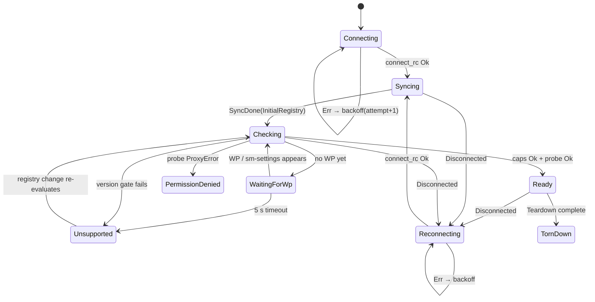
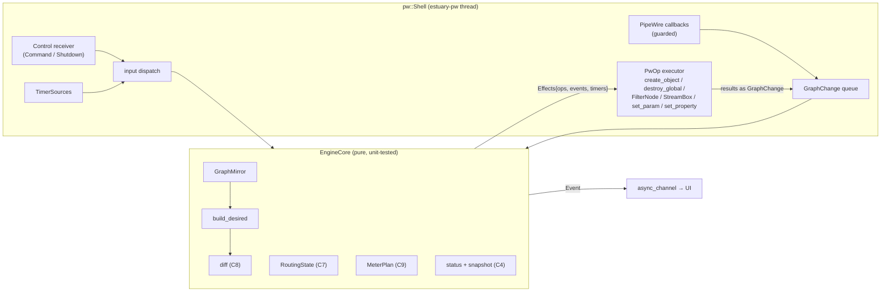
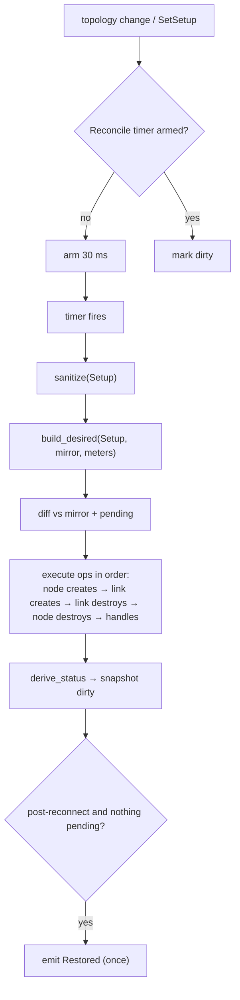
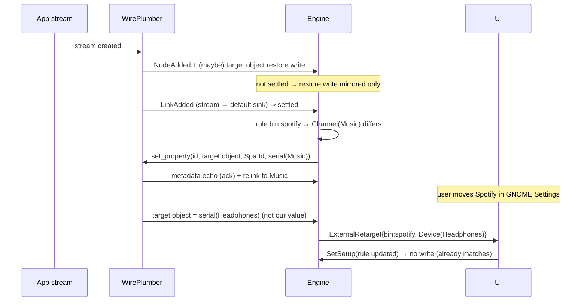

# estuary-engine: PipeWire engine (sub-spec)

> Sub-spec of [`specs/estuary/spec.md`](../estuary/spec.md) (the master). The master's contracts **C1–C14 are binding** and are cited as "per Cn". Nothing here redefines them. Details this spec originally proposed beyond the master are marked **[Δn]**. All of them were adopted into the master (see [Contract amendments](#contract-amendments)).
>
> Detail level: **high**. Covers milestones **M2**, **M4 (engine side)**, **M5 (engine side)**, **M6 (types only)**, **M8** and **M10 (engine side)**. Steps are numbered `M<milestone>.<n>`.
> Date: 2026-10-14. Status: draft for review.

---

## Summary

`estuary-engine` is the UI-agnostic library that owns Estuary's PipeWire connection on a dedicated thread. It does five things:

- mirrors the PipeWire graph into typed snapshots;
- routes app streams by rule through the `default` metadata;
- creates and reconciles all estuary-owned nodes and links (channels, virtual mics, gain cells, denoisers);
- feeds level meters through lock-free slots;
- survives PipeWire restarts by rebuilding from the latest desired `Setup`.

## Problem Statement

The UI needs a stable, high-level view of a constantly changing audio graph, and a way to state *what it wants* (channels, cells, rules) without knowing PipeWire mechanics. PipeWire objects are `!Send` and must live on one thread. Object ids and serials change on every restart. WirePlumber concurrently links and relinks streams. Links and ports appear asynchronously after node creation. Any of these can go wrong mid-operation. Without a dedicated engine with a clear contract, every UI feature would re-implement graph bookkeeping, race against WirePlumber, and break on hotplug or restart.

## Solution Overview

The engine is split into a **pure functional core** and a thin **imperative PipeWire shell**:

- **Core (`EngineCore`, no PipeWire types).** It holds the graph mirror, the latest `Setup`, the routing state, pending operations, the meter plan and the connection state. It consumes inputs (`GraphChange`, `Command`, timer ticks) and returns `Effects`: a list of PipeWire operations to perform, events to emit and timers to arm. This makes rules, reconciliation, status derivation and quit checks unit-testable against a fake graph.
- **Shell (`pw::*`).** It owns `MainLoopRc`/`ContextRc`/`CoreRc`/`RegistryRc`, proxies, listeners, `estuary_dsp::FilterNode`s and meter `StreamBox`es. It turns PipeWire callbacks into `GraphChange`s and executes `PwOp`s.

Reconciliation is **level-triggered** (per C8). After any relevant change (debounced 30 ms) the core recomputes the desired graph from `Setup` + mirror, diffs it against the owned part of the mirror plus in-flight operations, and emits create/destroy operations. App routing is **rule-driven** (per C7): the core writes `target.object` only when a stream's target differs from its rule, and treats foreign writes as user intent (`ExternalRetarget`).

---

## Technical Context

### Binding contracts used

| Contract | Used for |
|---|---|
| C1 | Crate location, dependencies (`pipewire`/`libspa` 0.10.1, `estuary-dsp`, `async-channel`, `serde`, `toml`, `thiserror`, `tracing`, `uuid`, `sha2`), `#![forbid(unsafe_code)]` |
| C2 | Engine thread `estuary-pw`; UI→engine via `pipewire::channel`, engine→UI via `async_channel`; RT code talks only through atomics |
| C3 | Public API: `Engine`, `EngineConfig`, `Command`, `Event`, `ConnectionState`, startup/reconnect semantics |
| C4 | Model types and snapshot ordering |
| C5 | Client props, object props, port matching, retarget writes, meter stream props, forbidden props |
| C6 | `Setup` / `ConfigFile` types and invariants (types live in this crate) |
| C7 | `AppKey` derivation, exclusions, rule semantics |
| C8 | Reconciler ownership rule, debounce, retry policy |
| C9 | `MeterBank`, slots, writer semantics |
| C10 | `PrepareQuit` / `Teardown` sequence |
| C11 | `estuary_dsp::{new_gain_node, new_denoiser_node}`, `FilterNode` (`state`, `stats`, `set_state_listener`), `FilterState`, `GainHandle`, `DenoiseHandle`, extended `NodeStats` |
| C13 | Capability checks, write probe |

### Verified environment (from the master, live-verified 2026-10-14)

- PipeWire 1.5.85 / WirePlumber 0.5.12 on the dev machine.
- Server factories `adapter`, `link-factory` and `metadata` are present.
- The `default` and `sm-settings` metadata objects exist.
- Node id ≠ `object.serial`.
- `pipewire-sys` 0.10.1 binds `pw_filter_*`, which `estuary-dsp` consumes.

### pipewire-rs 0.10.1 API used (names per the master's source-verified table)

| Need | API |
|---|---|
| Init | `pipewire::init()` (once per process, guarded by `std::sync::OnceLock`) |
| Loop | `pipewire::main_loop::MainLoopRc::new(None)`, `.loop_()`, `.run()`, `.quit()` |
| Context / core | `pipewire::context::ContextRc::new(&main_loop, None)`, `ctx.connect_rc(Some(props))` → `CoreRc` |
| Core events | `core.add_listener_local().info(..).done(..).error(..).register()`, `core.sync(0)` |
| Registry | `core.get_registry_rc()` → `RegistryRc`; `.add_listener_local().global(..).global_remove(..).register()`; `registry.bind::<P, _>(&global)`; `registry.destroy_global(id)` |
| Object creation | `core.create_object::<pipewire::node::Node>("adapter", &props)`, `core.create_object::<pipewire::link::Link>("link-factory", &props)` |
| Metadata | `pipewire::metadata::Metadata::set_property(subject, key, type_, value)`; listener `.property(\|subject, key, type_, value\| 0)` |
| Node params | `node.subscribe_params(&[ParamType::Props])`; `node.add_listener_local().info(..).param(..)`; `node.set_param(ParamType::Props, 0, &pod)` |
| Pods | `libspa::pod::serialize::PodSerializer::serialize(Cursor::new(Vec::new()), &Value::Object(Object{..}))`; `libspa::pod::deserialize::PodDeserializer` for parsing; `libspa::pod::Pod::from_bytes` |
| Streams | `pipewire::stream::StreamBox::new(&core, name, props)`; `.add_local_listener_with_user_data(ud).process(..).state_changed(..).param_changed(..).register()`; `.connect(Direction::Input, None, StreamFlags::AUTOCONNECT \| MAP_BUFFERS \| RT_PROCESS, &mut [&pod])`; `.dequeue_buffer()` |
| Timers | `main_loop.loop_().add_timer(cb)` → `TimerSource`; `.update_timer(Some(d), None)` |
| Cross-thread | `pipewire::channel::channel::<Control>()`; `receiver.attach(main_loop.loop_(), cb)` (keep the returned `AttachedReceiver` alive) |
| Keys | `pipewire::keys::{TARGET_OBJECT, STREAM_CAPTURE_SINK, STREAM_MONITOR, NODE_AUTOCONNECT, NODE_PASSIVE, OBJECT_LINGER, FACTORY_NAME, OBJECT_SERIAL}` |

**Important pipewire-rs caveat.** Listener closures are invoked from `extern "C"` trampolines. A Rust panic inside them **aborts the process**, and the thread-level `catch_unwind` cannot catch it. Every callback body is therefore wrapped by `guarded()` (M2.5).

### Crate module layout (`crates/estuary-engine/src/`)

```
lib.rs              # #![forbid(unsafe_code)]; pub use of the C3/C4/C6/C9 API; Engine, EngineConfig, Backoff
error.rs            # C3 (amended) auxiliary types: EngineError, UnsupportedReason, WarnedNode, EngineWarning, SetupIssue (+ key/cell/message), VirtualDeviceUsage, UsageKind, Backoff
model.rs            # C4 types, Volume helpers
setup.rs            # C6 Setup/ConfigFile serde types, validate(), sanitize(), canonical CellKey string, hashes
appkey.rs           # C7 AppKey derivation (pure)
meter.rs            # C9 MeterBank, MeterSlot, MeterSlotId, MeterTarget; SlotAllocator (pure)
core/
  mod.rs            # EngineCore: on_graph / on_command / on_timer → Effects
  effects.rs        # Effects, PwOp, TimerKind, OwnedKey
  conn.rs           # ConnState machine (pure), capability evaluation
  routing.rs        # RoutingState: settle tracking, rule application, external detection
  desired.rs        # DesiredGraph builder (Setup + mirror)
  ports.rs          # port matching (pure)
  diff.rs           # desired vs actual vs pending → PwOps (ownership rule C8)
  pending.rs        # PendingOps, failure accounting
  status.rs         # CellStatus / present flags / recording apps derivation
  snapshot.rs       # mirror + setup + statuses → GraphSnapshot (C4 ordering)
  quit.rs           # VirtualDeviceUsage computation, teardown sequencing
  meters.rs         # MeterPlan: MeterTarget → node ids → slots
graph/
  mod.rs            # GraphMirror, NodeEntry, PortEntry, LinkEntry, ClientEntry, GraphChange
  classify.rs       # media.class / props → NodeKind (pure)
pw/
  mod.rs            # Shell: owns PipeWire objects, dispatches PwOps, feeds GraphChanges
  thread.rs         # thread entry, catch_unwind, guarded(), control receiver, timers
  connection.rs     # connect, core listeners, sync bookkeeping, disconnect detection
  registry.rs       # registry listener, binding nodes/clients/metadata, node info + Props params
  metadata.rs       # default-metadata proxy, writes, property listener
  objects.rs        # adapter (channel/vmic) and link creation/destruction, proxy-id → OwnedKey map
  dsp_nodes.rs      # FilterNode creation (cells, denoisers), handle registry
  params.rs         # Props pod build/parse (channelVolumes, mute), Route fallback (UNVERIFIED-2)
  meter_stream.rs   # meter StreamBox wrapper, format pod, RT process callback
testing/            # #[cfg(any(test, feature = "test-util"))]
  fake_graph.rs     # FakeGraph builder → GraphChange sequences / GraphMirror
  fake_shell.rs     # executes PwOps against FakeGraph to simulate PipeWire responses
examples/
  registry_dump.rs  # M2.1 experiment helper
  meter_probe.rs    # M4 helper
  passive_probe.rs  # M8.1 experiment (UNVERIFIED-1)
  vmic_clock_probe.rs  # M8.2 experiment (UNVERIFIED-4)
tests/
  live_pw.rs        # #![cfg(feature = "live-pw")] integration tests against the running PipeWire
```

`Cargo.toml` features: `live-pw = []` (enables `tests/live_pw.rs` and the examples' live paths) and `test-util = []` (exports `testing::*` for the UI crate's tests).

### Registry → model classification (`graph/classify.rs`)

The input is the node's **info props**, available after binding. Global props are used only until info arrives.

| Condition (evaluated in order) | `NodeKind` |
|---|---|
| `node.name` starts with `estuary.` **and** owned (see [Δ2]) and `estuary.role` = `channel` / `vmic` / `cell` / `denoise` / `meter` | `Owned(OwnedRole)` |
| `node.name` starts with `estuary.` but not owned | `ForeignEstuary` (ignored everywhere) |
| `media.class == "Audio/Sink"` | `Output` [Δ3] |
| `media.class ∈ {"Audio/Source", "Audio/Source/Virtual"}` | `Input` [Δ3] |
| `media.class == "Stream/Output/Audio"` and not excluded per C7 | `AppPlayback` |
| `media.class == "Stream/Input/Audio"` and not owned and `stream.monitor != "true"` | `AppCapture` (used only for vmic `recording_apps` and `QuitCheck`) |
| anything else | `Other` |

Props read per kind:

- **Output/Input:** `node.name` (→ `DeviceKey`), `node.description` → else `node.nick` → else `node.name`, `audio.channels`, `device.id` (Route fallback, UNVERIFIED-2).
- **AppPlayback:** `application.process.binary`, `application.name`, `application.icon-name`, `media.name`, `node.dont-move`, `object.serial`.
- **Ports** (global props; bound only if `audio.channel` is missing, see M2.1): `node.id`, `port.direction` (`in`/`out`), `port.name`, `audio.channel`, `port.monitor`.
- **Links** (global props): `link.output.node`, `link.output.port`, `link.input.node`, `link.input.port`.
- **Clients:** `application.name`, `estuary.instance`, version keys (UNVERIFIED-5).
- **Metadata globals:** `metadata.name`.

---

## Implementation Steps

### Core internal types (referenced by many steps)

```rust
// graph/mod.rs
pub(crate) type Props = std::collections::BTreeMap<String, String>;

pub(crate) struct GraphMirror {
    pub nodes: BTreeMap<u32, NodeEntry>,
    pub ports: BTreeMap<u32, PortEntry>,
    pub links: BTreeMap<u32, LinkEntry>,
    pub clients: BTreeMap<u32, ClientEntry>,
    pub default_meta: BTreeMap<(u32, String), MetaEntry>,   // (subject, key) → value; only the "default" metadata
    pub metadata_names: BTreeSet<String>,                     // e.g. "default", "sm-settings"
    pub own_client_id: Option<u32>,
    pub core: Option<CoreInfo>,
}
pub(crate) struct NodeEntry {
    pub id: u32, pub serial: u64, pub client_id: Option<u32>,
    pub props: Props, pub kind: NodeKind, pub volume: Option<Volume>, pub info_received: bool,
}
pub(crate) enum NodeKind { Owned(OwnedRole), ForeignEstuary, Output, Input, AppPlayback, AppCapture, Other }
pub(crate) enum OwnedRole { Channel(ChannelId), Vmic(VirtualMicId), Cell(String /*hash*/), Denoise(String /*hash*/), Meter(u16) }
pub(crate) struct PortEntry { pub id: u32, pub node_id: u32, pub dir: PortDir, pub name: String, pub channel: String, pub monitor: bool }
pub(crate) enum PortDir { In, Out }
pub(crate) struct LinkEntry { pub id: u32, pub out_node: u32, pub out_port: u32, pub in_node: u32, pub in_port: u32, pub client_id: Option<u32> }
pub(crate) struct ClientEntry { pub id: u32, pub props: Props }
pub(crate) struct MetaEntry { pub type_: Option<String>, pub value: String }
pub(crate) struct CoreInfo { pub version: String }

pub(crate) enum GraphChange {
    CoreInfo(CoreInfo),
    ClientAdded(ClientEntry), ClientRemoved(u32),
    NodeAdded { id: u32, global_props: Props },
    NodeInfo { id: u32, props: Props },
    NodeVolume { id: u32, volume: Volume },
    NodeRemoved(u32),
    PortAdded(PortEntry), PortRemoved(u32),
    LinkAdded(LinkEntry), LinkRemoved(u32),
    MetadataAdded(String), MetadataRemoved(String),
    DefaultMetaProperty { subject: u32, key: String, type_: Option<String>, value: Option<String> },
    ProxyError { key: OwnedKey, res: i32, message: String },
    FilterState { key: OwnedKey, state: estuary_dsp::FilterState, node_id: Option<u32> },   // from FilterNode::set_state_listener
    FilterPoisoned { key: OwnedKey },                          // NodeStats.poisoned observed by the poller (M8.12)
    MeterStreamFailed { slot: MeterSlotId, message: String },
    SyncDone { seq: i32 },
    Disconnected,
}

// core/effects.rs
pub(crate) enum OwnedKey {
    Channel(ChannelId), Vmic(VirtualMicId), Cell(CellKey), Denoiser(DeviceKey),
    Link(LinkKey), MeterLink(MeterSlotId, u32 /*port pair index*/), ProbeMeta,
}
pub(crate) struct LinkKey { pub out_port: u32, pub in_port: u32 }   // ports are unique per connection epoch

pub(crate) enum PwOp {
    CreateAdapter { key: OwnedKey, props: Props },                     // channel / vmic (C5)
    CreateCell { key: CellKey, name: String, props: Props, initial_db: f32 },
    CreateDenoiser { input: DeviceKey, name: String, props: Props, enabled: bool, vad_gate: f32 },
    CreateLink { key: OwnedKey, out_node: u32, out_port: u32, in_node: u32, in_port: u32, passive: bool },
    Destroy { key: OwnedKey, global_id: Option<u32> },                 // destroy_global + drop proxy/FilterNode
    SetGain { key: CellKey, db: f32 },
    SetDenoise { input: DeviceKey, enabled: bool, vad_gate: f32 },   // DenoiseHandle::set_enabled + set_vad_gate
    SetNodeVolume { node_id: u32, volume: Volume },
    SetDeviceVolume { node_id: u32, device_id: Option<u32>, volume: Volume },   // path per UNVERIFIED-2
    MetaWrite { subject: u32, key: &'static str, type_: Option<&'static str>, value: Option<String> },
    CreateMeter { slot: MeterSlotId, target_serial: u64, capture_sink: bool, autoconnect: bool },
    DestroyMeter { slot: MeterSlotId },
    Sync { purpose: SyncPurpose },
}
pub(crate) enum SyncPurpose { InitialRegistry, WriteProbe, Teardown }
pub(crate) enum TimerKind { Reconnect, SnapshotFlush, Reconcile, PendingTimeout, StreamSettle(u32), WpWait, StatsPoll, TeardownTimeout, CellFade(CellKey) }

pub(crate) struct Effects {
    pub ops: Vec<PwOp>,
    pub events: Vec<Event>,
    pub timers: Vec<(TimerKind, Duration)>,   // arm or re-arm
    pub reset_connection: bool,               // shell drops core/registry/proxies and starts a reconnect
    pub quit_loop: bool,
}
```

---

### M2: Engine core (read-only)

**Implementation notes (M2 as built, 2026-10-14).** These deviate from or refine the text above. Where they conflict, the notes are authoritative.

- **Timers.** pipewire-rs `TimerSource<'l>` borrows the loop, so it can't be stored in the shell's `Rc` state next to the loop it borrows. Timers are instead kept by a small `estuary-timers` thread (`pw/timers.rs`) that posts `Control::Timer(kind)` into the loop through the pipewire channel. It's one-shot and armed per kind, with no periodic wakeups. Effects carry `timers` (arm) and `cancel_timers`.
- **Deferred drops.** A connection retired inside a callback (`Disconnected` arrives in the core `error` callback) is moved to a graveyard and dropped on the next `Control::DropGraveyard`, so a listener never drops itself while running.
- **Module layout.** `pw/connection.rs`, `pw/registry.rs` and `pw/metadata.rs` are merged into `pw/mod.rs` (`Shell`) for M2. They split out when M5/M8 add metadata writes and object creation.
- **`Engine::send` liveness.** A pipewire channel keeps accepting messages after its receiver is gone, so `send` checks `JoinHandle::is_finished()` and returns `ThreadGone` (C3).
- **`GraphChange` refinements:** `NodeVolume { id, channels: Option<Vec<f32>>, muted: Option<bool> }` (a partial Props update; missing fields keep the previous value) and `DefaultMetaCleared { subject: Option<u32> }` (a key-less metadata update; `None` clears everything).
- **`ConnState`:** `Syncing` has no attempt counter; `Checking` became `Probing` (capability checks are synchronous, so the state only spans the write probe). There is no `TornDown` state yet, since `Teardown` replies immediately while nothing is owned (M8 adds it).
- **`Restored`** is emitted together with `Connected` after a reconnect, because nothing is owned before M8. The "no pending creations or 5 s" rule applies from M8.
- **Snapshot `current_target`** resolves the stream's `target.object` metadata (serial or `node.name`). No explicit target means `Default`. M5.6 adds link-based resolution.
- **Read-only commands:** `SetSetup` is stored and reflected in snapshots (channels, mics and cells are reported with `present=false` / `Pending`). Fast-path commands are ignored with a debug log until M5/M8. `PrepareQuit` → `QuitCheck([])`, `Teardown` → `TeardownComplete`.
- **Tests:** `testing/` is `#[cfg(test)]` for now (the `test-util` export moves to M3). `FakeGraph` has preset constructors (`standard`, `without_wireplumber`) plus `device`/`app_playing` builders. `FakeShell` moves to M8.13.

#### M2.1 Live experiment: registry props, own-client identification, WirePlumber version (UNVERIFIED-5)

**Why.** Three design inputs must be confirmed before writing the shell.

**Commands** (dev machine, read-only):

```sh
# a) Which keys reach registry GLOBAL props (no binding) vs full info props
pw-cli ls Node     # global props per node
pw-cli ls Port     # check: audio.channel, port.direction, port.name, node.id, port.monitor present?
pw-cli ls Link     # check: link.output.node/port, link.input.node/port present?
pw-dump | python3 -I -c 'import json,sys; [print(o["id"], o["info"]["props"].get("audio.channel")) for o in json.load(sys.stdin) if o["type"].endswith("Port")]'

# b) WirePlumber client props → version key (UNVERIFIED-5)
pw-dump | python3 -I -c 'import json,sys
for o in json.load(sys.stdin):
    p=o.get("info",{}).get("props",{})
    if o["type"].endswith("Client") and p.get("application.name")=="WirePlumber": print(json.dumps(p,indent=1))'

# c) Custom client property visibility: run the M2 skeleton example
cargo run -p estuary-engine --example registry_dump --features live-pw
#   connects with props {application.name=estuary, media.category=Manager, estuary.instance=<uuid>}
#   and prints (i) the Client global whose info props contain estuary.instance, (ii) its id.
```

**Outcomes → actions:**

- (a) If ports' global props carry `audio.channel`, `port.direction` and `node.id`, do not bind ports. Otherwise bind `pipewire::port::Port` proxies and read info props. Record the result in `pw/registry.rs` docs.
- (b) Record the version key, expected `core.version` or `application.version`, and use it for display in `ConnectionState::Connected.wireplumber_version`. The *gate* for WP ≥ 0.5 is the presence of the `sm-settings` metadata [Δ4], independent of this result.
- (c) If `estuary.instance` is visible in our client's info props, `own_client_id` comes from there. Otherwise fall back to ownership by `estuary.instance` on each owned node (props we set at creation, always visible in node info) [Δ2].

**Amends:** C13 (version key), and C5 ownership wording if (c) fails.

#### M2.2 Crate skeleton, errors and public API stubs

`Cargo.toml` per C1 (workspace deps), features `live-pw` and `test-util`. `lib.rs` declares the C3 API with its exact signatures. Bodies are wired up in M2.5. Before that, the crate compiles but `Engine::start` is not exported from the prelude used by the UI.

The auxiliary public types are defined **verbatim per C3 (amended)**: `EngineError` (including `ThreadGone`, `Panicked`, `ShutdownTimeout`, `Spawn`, `PipeWire`), `UnsupportedReason`, `WarnedNode`, `EngineWarning`, `SetupIssue`, `VirtualDeviceUsage`, `UsageKind` and `Backoff`. Engine-specific implementation details:

```rust
// error.rs — derives: Debug, Clone, PartialEq on all; thiserror::Error on EngineError (per C3)
impl Default for Backoff { fn default() -> Self { Self { initial: Duration::from_millis(500), factor: 2, max: Duration::from_secs(5) } } }
impl Backoff { pub fn delay(&self, attempt: u32) -> Duration { /* min(initial * factor^attempt, max), saturating */ } }

impl SetupIssue {
    /// Stable de-duplication key: variant name + subject, e.g. "dangling:cell:channel:5f0c…->output:alsa_output…",
    /// "cell_failed:<canonical_cell_key>", "duplicate_id:<id>", "missing_known_device:<key>".
    pub fn key(&self) -> String;
    /// Some(..) only for CellFailed (the CellKey is known); InvalidGain/DuplicateCell carry the canonical string only.
    pub fn cell(&self) -> Option<&CellKey>;
    /// English, single sentence, no trailing period, e.g. "Cell Music → Headphones failed: no compatible ports".
    pub fn message(&self) -> String;
}

/// Engine-internal mapping used by every warning emitter (WarnedNode per C3).
pub(crate) fn warned_node(key: &OwnedKey) -> Option<WarnedNode>;   // Channel/Vmic/Cell/Denoiser keys map 1:1; links/meters → None
```

Warning emitters (all per C3 amended):

| Emitter | Variant |
|---|---|
| Xrun poller (M8.12) | `Xruns { node: WarnedNode::Cell(..) \| Denoiser(..), per_minute }` |
| Link creation failure (M8.6/M8.7) | `LinkFailed { cell: Some(cell_key) for cell links / None for denoiser input or meter links, description, message }` |
| Node creation failure, poisoned node (M8.7, M8.12) | `NodeCreateFailed { node, message }` |
| Meter failure (M4.4) | `MeterFailed(target)` |
| Volume write failure (M5.7, M8.8) | `VolumeWriteFailed { node: Channel \| VirtualMic \| Device }`. App-stream volume failures are logged only: no `WarnedNode` variant exists for apps |
| Denoiser rate poll (M8.12) | `DenoiseRateUnsupported { input, rate }` |

**Test:** `Backoff::delay` sequence is 0.5, 1, 2, 4, 5, 5 s.

#### M2.3 Model types (per C4) and volume helpers

Implement the C4 types verbatim in `model.rs`, with `Serialize/Deserialize` on the persisted ones (`AppKey`, `DeviceKey`, `ChannelId`, `VirtualMicId`, `RouteTarget`, `MatrixSource`, `MatrixDest`, `CellKey`, `Volume`). The serde shape follows C6 (tagged by `kind`, snake_case), implemented in M6.1 and shared from here. Add:

```rust
impl Volume {
    pub fn unity(channels: usize) -> Self;
    pub fn average(&self) -> f32;                 // for single-slider display
    pub fn with_all(&self, v: f32) -> Self;       // same value on every channel, preserving the channel count
}
pub fn db_to_linear(db: f32) -> f32;              // 10^(db/20); only NEG_INFINITY → 0.0 (same mapping as C11 GainHandle::set_db)
pub fn linear_to_db(lin: f32) -> f32;             // lin <= 0 → f32::NEG_INFINITY
```

**Tests:** round-trip `db_to_linear(linear_to_db(x))` within 1e-5 for x ∈ [0.001, 2]; `-60 dB → 0.001`; `NEG_INFINITY → 0.0`.

#### M2.4 Graph mirror, change application and classification (pure)

`GraphMirror::apply(&mut self, change: &GraphChange, own_instance: &str) -> ChangeImpact`, where

```rust
pub(crate) struct ChangeImpact { pub topology: bool, pub routing: bool, pub snapshot: bool, pub volumes: bool }
```

Rules:

- `NodeAdded` creates an entry with `kind` classified from the global props (provisional).
- `NodeInfo` replaces props and reclassifies.
- Removing a node also removes its ports and links from the mirror, so the mirror stays consistent even if `global_remove` events arrive out of order.
- `DefaultMetaProperty` with `value: None` removes the entry. A `key` of `None` (clear all for a subject) is mapped by the shell into one removal per known key.
- **Ownership:** `kind = Owned(..)` iff `node.name` starts with `estuary.` and (`client_id == own_client_id` or `props["estuary.instance"] == own_instance`) [Δ2].
- Roles are parsed from `estuary.role` plus the name suffix:
  - `estuary.channel.<uuid-simple>` → `ChannelId`;
  - `estuary.vmic.<uuid-simple>` → `VirtualMicId`;
  - `estuary.cell.<hash>` and `estuary.denoise.<hash>` → hash strings, mapped back to keys through the desired graph (M8.3);
  - `estuary.meter.<slot>` → `u16`.

**Tests** (`graph/classify.rs`): a table of props → kind for every row of the classification table, including `ForeignEstuary` and `stream.monitor` exclusion.

#### M2.5 Engine thread, guarded callbacks, control channel, shutdown

```rust
pub(crate) enum Control { Cmd(Command), Shutdown }

impl Engine {
    pub fn start(cfg: EngineConfig) -> Result<(Engine, async_channel::Receiver<Event>), EngineError> {
        PW_INIT.get_or_init(|| pipewire::init());
        let (ev_tx, ev_rx) = async_channel::unbounded();
        let meters = Arc::new(MeterBank::new());
        let (ctl_tx, ctl_rx) = pipewire::channel::channel::<Control>();
        let (done_tx, done_rx) = std::sync::mpsc::sync_channel::<()>(1);
        let join = std::thread::Builder::new().name("estuary-pw".into()).spawn({
            let meters = meters.clone();
            move || {
                let res = std::panic::catch_unwind(AssertUnwindSafe(|| pw::thread::run(cfg, ctl_rx, ev_tx.clone(), meters)));
                if let Err(p) = res { let _ = ev_tx.try_send(Event::Fatal(EngineError::Panicked(panic_msg(p)))); }
                let _ = done_tx.send(());
            }
        }).map_err(|e| EngineError::Spawn(e.to_string()))?;
        Ok((Engine { ctl_tx, join: Some(join), done_rx, meters }, ev_rx))
    }
    pub fn send(&self, cmd: Command) -> Result<(), EngineError> { self.ctl_tx.send(Control::Cmd(cmd)).map_err(|_| EngineError::ThreadGone) }
    pub fn shutdown(mut self, timeout: Duration) -> Result<(), EngineError> {
        let _ = self.ctl_tx.send(Control::Shutdown);
        match self.done_rx.recv_timeout(timeout) {
            Ok(()) => { self.join.take().map(|j| j.join()); Ok(()) }
            Err(_) => Err(EngineError::ShutdownTimeout),   // thread detached; process exit will clean up
        }
    }
}
```

Shutdown stays out of the public `Command` enum: the internal `Control` wrapper keeps C3 unchanged.

**`guarded()` helper** (`pw/thread.rs`), used to wrap **every** listener closure body:

```rust
thread_local! { static PANICKED: Cell<Option<String>> = Cell::new(None); }
pub(crate) fn guarded<R: Default>(ml: &MainLoopRc, f: impl FnOnce() -> R) -> R {
    match std::panic::catch_unwind(AssertUnwindSafe(f)) {
        Ok(r) => r,
        Err(p) => { PANICKED.with(|c| c.set(Some(panic_msg(p)))); ml.quit(); R::default() }
    }
}
```

After `main_loop.run()` returns, `run()` checks `PANICKED`. If it is set, it drops every PipeWire object and **resumes the panic** (`std::panic::resume_unwind`) so the outer `catch_unwind` emits `Fatal` (F5).

**Run loop skeleton** (`pw/thread.rs`):

```rust
pub(crate) fn run(cfg: EngineConfig, ctl_rx: pipewire::channel::Receiver<Control>, ev_tx: async_channel::Sender<Event>, meters: Arc<MeterBank>) {
    let ml = MainLoopRc::new(None).expect("main loop");
    let ctx = ContextRc::new(&ml, None).expect("context");
    let instance = uuid::Uuid::new_v4().simple().to_string();
    let mut shell = Shell::new(ml.clone(), ctx, cfg, instance, ev_tx, meters);   // holds Rc<RefCell<..>> state
    let _ctl = ctl_rx.attach(ml.loop_(), { let s = shell.handle(); move |c| s.on_control(c) });
    shell.start_connect();          // emits Connection(Connecting{attempt:0}) immediately
    ml.run();
    shell.finish();                 // drop proxies, filters, streams, core, registry (in that order)
}
```

The `Shell` stores its state in `Rc<RefCell<ShellState>>`. Callbacks clone the `Rc`. A re-entrancy rule applies: **no `PwOp` execution while a `RefCell` borrow from a callback is held**. Callbacks push `GraphChange`s into a `VecDeque`, and a single `drain()` call processes the queue, executes the resulting ops and re-drains until it is empty.

#### M2.6 Connection and registry shell

Connect (`pw/connection.rs`):

```rust
let props = pipewire::properties::properties! {
    "application.name" => cfg.app_name,          // "estuary"   (C5)
    "application.id"   => cfg.app_id,            // "io.github.abidibo.Estuary" (C5)
    "media.category"   => "Manager",             // C5, mandatory
    "estuary.instance" => instance.as_str(),     // [Δ2]
};
let core: CoreRc = ctx.connect_rc(Some(props))?;  // Err → F1 path (M2.8)
```

Core listener:

- `info` → `GraphChange::CoreInfo { version: info.version() }`;
- `done(id, seq)` → `SyncDone{seq}` when `id == PW_ID_CORE`;
- `error(id, seq, res, msg)`:
  - `id == PW_ID_CORE` and `res == -EPIPE` → `Disconnected`;
  - `id` matches a proxy id in the `proxy_keys: HashMap<u32, OwnedKey>` table → `ProxyError{key,res,msg}`;
  - otherwise log at `warn`.

Registry listener (`pw/registry.rs`):

- `global(g)`:
  - `ObjectType::Node` → push `NodeAdded{id, global_props}`, bind `Node`, subscribe Props, attach `info` (→ `NodeInfo`) and `param` (→ parse Props → `NodeVolume`). Keep the proxy and listener in `bound_nodes: HashMap<u32, (Node, NodeListener)>`.
  - `ObjectType::Port` → `PortAdded` from global props (or bind per M2.1(a)).
  - `ObjectType::Link` → `LinkAdded`.
  - `ObjectType::Client` → bind, `info` → `ClientAdded`. Sets `own_client_id` when `estuary.instance` matches (M2.1(c)).
  - `ObjectType::Metadata` → `MetadataAdded(name)`. If `metadata.name == "default"`, bind it and attach the `property` listener (M5.3).
- `global_remove(id)` → the matching `*Removed`, dropping any bound proxy.

Props param parsing (`pw/params.rs`): deserialize with `PodDeserializer::deserialize_any_from(bytes)` into `Value::Object`, then take the property with key `SPA_PROP_channelVolumes` (`Value::ValueArray(ValueArray::Float(v))`) and `SPA_PROP_mute` (`Value::Bool`). A missing key keeps the previous value.

**Initial sync.** After the registry listener is registered, issue `core.sync(0)` with `SyncPurpose::InitialRegistry`. When it completes, run the capability checks (M2.7).

#### M2.7 Capability checks and write probe (per C13)

Pure evaluation in `core/conn.rs`:

```rust
pub(crate) fn evaluate_capabilities(m: &GraphMirror) -> CapabilityResult;
pub(crate) enum CapabilityResult { Ok { pw: String, wp: Option<String> }, WaitForWp, Unsupported(UnsupportedReason) }
```

1. Parse `core.version` (`major.minor.micro`). Below 1.0.0 → `Unsupported(PipeWireTooOld)`.
2. If `"sm-settings" ∈ metadata_names` → WP ≥ 0.5 (that metadata was introduced in 0.5) [Δ4]. The version string from the WirePlumber client (M2.1(b)) is informational only.
   - If a WirePlumber client exists but there is no `sm-settings` → `Unsupported(WirePlumberTooOld{found})`.
   - If there is no WirePlumber client → `WaitForWp`: arm `TimerKind::WpWait` for 5 s. A WP client or `sm-settings` appearing re-evaluates. On timeout → `Unsupported(NoWirePlumber)`, and the engine keeps re-evaluating on later registry changes (login race: WP may start after Estuary).
3. On `Ok`, run the write probe: `MetaWrite{subject:0, key:"estuary.probe", type_: Some("Spa:String"), value: Some("1")}`, then the same with `value: None`, then `Sync{WriteProbe}`. A `ProxyError` for the metadata proxy before `SyncDone` → `Connection(PermissionDenied)` (F2). Otherwise emit `Connection(Connected{..})` and the first snapshot immediately (bypassing the coalescer).

**Unsupported / PermissionDenied:** the engine stays read-only. It still produces snapshots so the UI could show devices, but ignores `SetSetup` effects (it stores the Setup without acting on it).

#### M2.8 Reconnect state machine

```rust
pub(crate) enum ConnState {
    Connecting { attempt: u32 },
    Syncing { attempt: u32 },
    Checking,                                   // capability checks + write probe
    Ready,
    WaitingForWp,
    Unsupported(UnsupportedReason),
    PermissionDenied,
    Reconnecting { since: Instant, attempt: u32 },
    TornDown,                                   // after Teardown; only Shutdown is honoured
}
```



On `Disconnected`, the core returns `Effects{ reset_connection: true, .. }`. The shell then:

1. drops, in order, meter streams, `FilterNode`s, link/node proxies, the metadata proxy, bound nodes/clients, the registry and the core (keeping `MainLoopRc` and `ContextRc`);
2. clears the `GraphMirror`, the routing written-values map, `PendingOps` and the meter plan, but **keeps the latest `Setup`** and the `MeterTarget` subscription;
3. emits `Connection(Reconnecting{since: now, attempt: 0})`;
4. arms `TimerKind::Reconnect` with `Backoff::delay(attempt)`.

On `Ready` after a reconnect (`had_ready_before == true`), the core emits `Connection(Connected)` and runs a reconcile pass immediately. When a reconcile pass first finds **no pending creations and no `Pending` cell statuses**, or 5 s after `Ready`, whichever comes first, it emits `Event::Restored` exactly once (per C3, F4). The initial connection never emits `Restored`.

#### M2.9 Snapshot builder and 50 ms coalescer

`core/snapshot.rs`:

```rust
pub(crate) fn build_snapshot(m: &GraphMirror, setup: Option<&Setup>, st: &StatusTable, routing: &RoutingState) -> GraphSnapshot;
```

It applies the C4 ordering (apps by case-insensitive `display_name`, devices by `description`, channels/mics/cells in Setup order) and merges `known_devices` that are not present as `present=false`, with `volume: None`. `default_output` / `default_input` come from the `default` metadata keys `default.audio.sink` / `default.audio.source` (JSON `{"name": "<node.name>"}`, as observed live) → `DeviceKey`.

**Coalescer.** Any `ChangeImpact.snapshot`, setup change or status change sets `dirty = true`. If `TimerKind::SnapshotFlush` is not armed, arm it for 50 ms. On fire, if dirty, build, send `Event::Snapshot(Arc::new(snap))` and clear dirty. This guarantees at most one snapshot per 50 ms (per C3) and at most 50 ms staleness. Exception: the first snapshot after `Connected` is sent immediately.

**Tests:** with a fake clock, 100 changes within 40 ms produce exactly 1 snapshot at t = 50 ms; a change at t = 60 ms produces a second snapshot at t = 110 ms.

#### M2.10 Test harness and live smoke test

`testing/fake_graph.rs` builder:

```rust
let g = FakeGraph::new()
    .core("1.5.85").wireplumber("0.5.12")                     // adds WP client + sm-settings + default metadata
    .output("alsa_output.pci-0000_00_1f.3.analog-stereo", "Built-in Audio", &["FL", "FR"])
    .input("alsa_input.pci-0000_00_1f.3.analog-stereo", "Built-in Mic", &["FL", "FR"])
    .app("spotify", Some("Spotify"), &["FL", "FR"])          // AppPlayback with binary + name
    .link_app_to("spotify", "alsa_output.pci-0000_00_1f.3.analog-stereo");
let changes: Vec<GraphChange> = g.changes();                  // replayable sequence with deterministic ids/serials
```

`testing/fake_shell.rs`: `FakeShell::execute(&mut self, op: &PwOp) -> Vec<GraphChange>` simulates PipeWire:

- `CreateAdapter` → node + ports (`playback_*` and `monitor_*` for sinks, `input_*` and `capture_*` for virtual sources);
- `CreateCell`/`CreateDenoiser` → node + `input_FL/FR`, `output_FL/FR`;
- `CreateLink` → link;
- `Destroy` → removals;
- `MetaWrite` → `DefaultMetaProperty`.

Configurable fault injection: fail the Nth create, delay port appearance, drop a link externally.

`tests/live_pw.rs` (feature `live-pw`, `#[ignore]` by default, run with `cargo test -p estuary-engine --features live-pw -- --ignored --test-threads=1`):

- `connects_and_snapshots`: start the engine and expect `Connected` within 3 s and a `Snapshot` whose `outputs` contains the current `default.audio.sink`.

---

### M4 (engine side): Level meters

**Implementation notes (M4 as built, 2026-10-14).**

- **Bug found and fixed: state-only node info wiped props.** When a node goes idle ↔ running, PipeWire sends a node `info` event whose change mask lacks `PROPS`, and `info.props()` comes back empty. Applying it replaced the node's props, so sinks lost `node.name` and became `NodeKind::Other`. Devices vanished from snapshots and their meters were destroyed. The shell now ignores node and client info events without the `PROPS` change-mask bit, and `GraphMirror::apply` ignores `NodeInfo` with empty props as a second line of defence (unit test `empty_info_props_keep_the_node`).
- **Meter streams** use `StreamRc` (`StreamBox<'c>` borrows the core and can't live in `Conn`). Destroyed meters go through a `meter_graveyard`, emptied by `Control::DropGraveyard`, so a stream is never dropped inside its own callback. A synchronous creation failure becomes `MeterStreamFailed`.
- **WirePlumber volume reset** on meter streams uses `Stream::set_control(SPA_PROP_channelVolumes, [1.0, 1.0])` once, on the first Props `param_changed`.
- **`MeterPlan::reconcile(&mirror)`** replaces the separate `set_targets`/`on_graph` deltas. It runs on `SetMeterTargets`, on any topology change and on `Ready`. Meters exist only in `Ready`. A destroyed meter logs "meter no longer wanted" at debug level with the node's kind and name.
- **`Denoised` targets** resolve to no nodes until the denoiser exists (M10). Their test moves to M10.
- **Live test `meter_moves`** plays a 0.5-amplitude 1 kHz tone into a temporary lingering null sink (silent for the user) instead of the default sink, meters both the sink (`Device`) and the stream (`App`), and cleans up. Measured peaks: 0.500 / 0.500. Live tests initialise logs from `ESTUARY_LOG` (`tracing-subscriber` dev-dependency).
- **M4.1** (docs/experiments.md): without the borrowed `application.id`, GNOME Shell shows the microphone indicator for a peak-only monitor stream; with it, it doesn't. C5 is kept.

#### M4.1 Live experiment: meter streams vs the GNOME Shell recording indicator (UNVERIFIED-3)

```sh
SINK=$(wpctl inspect @DEFAULT_AUDIO_SINK@ | awk -F'"' '/node.name/ {print $2; exit}')
# A: monitor stream WITHOUT borrowed application.id
pw-record --target "$SINK" -P '{ stream.capture.sink=true stream.monitor=true resample.peaks=true node.passive=true media.role=DSP }' /dev/null &
#    → observe the GNOME Shell top bar for 10 s: does the microphone/recording indicator appear?
kill %1
# B: same WITH application.id=org.PulseAudio.pavucontrol
pw-record --target "$SINK" -P '{ stream.capture.sink=true stream.monitor=true resample.peaks=true node.passive=true media.role=DSP application.id=org.PulseAudio.pavucontrol }' /dev/null &
kill %1
# Repeat A/B with a hardware input as target (no stream.capture.sink).
```

**Outcome:** if A shows no indicator for both sink and source targets, **drop** the `application.id` line from C5's meter props (amend C5). If A shows the indicator and B does not, keep C5 as written. If both show it, keep C5 and document the limitation.

#### M4.2 `MeterBank` and slot allocator (per C9)

`meter.rs` implements C9 exactly. Additions inside the crate:

```rust
impl MeterBank {
    pub fn new() -> Self;                                       // 64 zeroed slots
    pub fn read(&self, id: MeterSlotId) -> MeterReading;             // per C9 (amended): MeterReading { seq, peak }; seq Acquire, then peaks Relaxed
    pub(crate) fn write(&self, id: MeterSlotId, peaks: [f32; 2]);     // RT side: peaks Relaxed, seq fetch_add Release
    pub(crate) fn reset(&self, id: MeterSlotId);                     // zero peaks, bump seq
}
pub(crate) struct SlotAllocator { free: Vec<u16> }                    // LIFO, 0..64
impl SlotAllocator { pub fn alloc(&mut self) -> Option<MeterSlotId>; pub fn free(&mut self, id: MeterSlotId); }
```

`MeterBank` is `Send + Sync` (atomics only). `read`/`write` never allocate.

#### M4.3 Meter stream wrapper (per C5)

`pw/meter_stream.rs`:

```rust
pub(crate) struct MeterStream { stream: StreamBox<'static>, _listener: StreamListener<MeterUd> }
struct MeterUd { bank: Arc<MeterBank>, slot: MeterSlotId }

pub(crate) fn create_meter(core: &CoreRc, bank: Arc<MeterBank>, slot: MeterSlotId, target_serial: u64,
                           capture_sink: bool, autoconnect: bool) -> Result<MeterStream, EngineError>;
```

- Props exactly per C5: `node.name = "estuary.meter.<slot>"`, `media.type=Audio`, `media.category=Capture`, `media.role=DSP`, `stream.monitor=true`, `resample.peaks=true`, `node.rate=1/25`, `node.latency=1/25`, `node.passive=true`, `target.object=<serial>`, `stream.capture.sink=true` only if `capture_sink`, `application.id` per the M4.1 outcome, `estuary.role=meter`, plus `estuary.instance` [Δ2]. When `autoconnect == false` (Denoised targets [Δ5]): `node.autoconnect=false` and no `target.object`.
- Format pod: `libspa::param::audio::AudioInfoRaw` with `F32LE`, `rate = 50`, `channels = 2`, position `[FL, FR]`. Serialize it as `Object{ type_: SpaTypes::ObjectParamFormat, id: ParamType::EnumFormat }` with `PodSerializer`.
- `connect(Direction::Input, None, AUTOCONNECT (only if autoconnect) | MAP_BUFFERS | RT_PROCESS, &mut [format])`. **Never** `DONT_RECONNECT` (C5).
- `process` (RT thread, no alloc, no log): `if let Some(mut b) = stream.dequeue_buffer() { let d = &mut b.datas_mut()[0]; let n = d.chunk().size() as usize / 4; if let Some(bytes) = d.data() { … } }`. Iterate the interleaved f32 frames (`f32::from_le_bytes` over 4-byte chunks), keep `max(|x|)` per channel (even index = FL, odd = FR), then `bank.write(slot, [l, r])`. A mono buffer (one channel negotiated) writes the same value to both.
- `param_changed(Props)`: if the stream's `channelVolumes` ≠ `[1.0, 1.0]` (WirePlumber's restore-props can apply stored volumes, as pwvucontrol works around), `set_param(Props{channelVolumes:[1.0,1.0]})` once.
- `state_changed(_, _, new)`: on `StreamState::Error(msg)` → push `GraphChange::MeterStreamFailed{slot, message}` (through the shell's queue, from the main-loop-side callback).

#### M4.4 Meter plan: targets → nodes → slots

`core/meters.rs`:

```rust
pub(crate) struct MeterPlan {
    targets: Vec<MeterTarget>,                                   // from SetMeterTargets, priority = order
    active: BTreeMap<u32 /*node id*/, (MeterSlotId, MeterTarget)>,
    alloc: SlotAllocator,
    failed: BTreeSet<u32>,                                       // node ids whose meter failed; retried when the node is re-added
}
impl MeterPlan {
    pub fn set_targets(&mut self, t: Vec<MeterTarget>, m: &GraphMirror) -> MeterDelta;
    pub fn on_graph(&mut self, m: &GraphMirror) -> MeterDelta;   // nodes appeared or disappeared
}
pub(crate) struct MeterDelta { pub create: Vec<PwOp>, pub destroy: Vec<PwOp>, pub assignments_changed: bool }
```

Target → node ids:

- `App(key)` → every `AppPlayback` node in that group, with `capture_sink=false`;
- `Device(key)` → the node with `node.name == key`. `capture_sink = (kind == Output)`;
- `Channel(id)` → the owned channel node, `capture_sink=true`;
- `VirtualMic(id)` → the owned vmic node, `capture_sink=false`;
- `Denoised(key)` → the owned denoiser node, with `autoconnect=false` and two meter links (`output_FL/FR` → the meter's `input_FL/FR`) in the desired graph [Δ5].

Allocation walks `targets` in order and assigns slots until all 64 are taken. Leftover targets get no slot (per C9). On a change, the plan emits `Destroy` for nodes no longer wanted (freeing the slot with `bank.reset`) and `CreateMeter` for new ones. When the assignment map changes it emits `Event::MeterAssignments(Vec<(MeterTarget, Vec<MeterSlotId>)>)`. `MeterStreamFailed` → `Warning(MeterFailed(target))`, free the slot, add to `failed`. The failed set is cleared for a node id when that node is removed.

#### M4.5 Tests

- Unit tests on the allocator and plan with `FakeGraph`: 70 targets → 64 assignments in priority order; an app with 3 streams → 3 slots under one target; a removed stream frees its slot and emits new assignments; the `Denoised` target yields `autoconnect=false` plus meter links.
- `live-pw`: `meter_moves`: play a generated 1 kHz WAV (written by the test into a tempdir, minimal RIFF header) with `pw-play --target <default sink>`. Meter the default output; expect a peak > 0.1 on at least one slot read within 1 s.

---

### M5 (engine side): Per-app routing and rules

**Implementation notes (M5 as built, 2026-10-14).**

- **Device volume (M5.1 outcome B).** The shell binds every `Audio/Device` card and subscribes to its `Route` params. The mirror keeps `routes[card][route.device] = route.index`, and `GraphMirror::route_of(node)` picks the route from the node's `device.id` and `card.profile.device`. `SetDeviceVolume` becomes `PwOp::SetRouteVolume` (`Device::set_param(Route, {index, device, props, save: true})`), falling back to node `Props` for card-less nodes.
- **`core/routing.rs`** follows M5.3–M5.6. `StreamTrack.awaiting_ack` identifies our own echo. An external move sets `external_pending`, which blocks re-applying the old rule until the next `SetSetup` (no ping-pong). Evaluation runs on new or settled streams, on every topology change (so a returning device re-applies rules, F10), on `SetSetup` and on `Ready`. The settle timer is `TimerKind::StreamSettle(id)`, 500 ms.
- **`current_target`** moved from `snapshot.rs` into `routing.rs` (metadata first, then links; the default sink and unlinked streams count as `Default`).
- **Volume write failures.** Node proxy errors become `GraphChange::VolumeWriteFailed { node_id }` and then `Warning(VolumeWriteFailed{Device})` for devices. Route write errors are only logged.
- **Live test `routes_test_app`** uses two temporary null sinks and a silent stream. The rule moved the stream in **10 ms**. A `pw-metadata` move from outside produced `ExternalRetarget` and was not undone.
- The UI was verified by the user: routing, app and device volume, mute, and a remembered rule applied on reopen.

#### M5.1 Live experiment: device volume path (UNVERIFIED-2)

```sh
ID=$(wpctl inspect @DEFAULT_AUDIO_SINK@ | awk '/^id/ {print $2+0; exit}')
wpctl set-volume "$ID" 0.40
pw-dump "$ID" | python3 -I -c 'import json,sys; o=json.load(sys.stdin)[0]; print(o["info"]["params"].get("Props"))'
DEV=$(pw-dump "$ID" | python3 -I -c 'import json,sys; print(json.load(sys.stdin)[0]["info"]["props"]["device.id"])')
pw-dump "$DEV" | python3 -I -c 'import json,sys; o=json.load(sys.stdin)[0]; print(o["info"]["params"].get("Route"))'
# Now write the node Props directly, as estuary would:
pw-cli set-param "$ID" Props '{ channelVolumes: [ 0.125, 0.125 ] }'   # 0.5^3 cubic ≈ what wpctl does for 0.5
pw-dump "$DEV" | …Route…        # did the Route props follow?  check alsamixer / BT headset volume too
wpctl get-volume "$ID"          # did WP observe it?
```

**Outcome A:** writing node Props updates the Route (hardware mixer moves, `wpctl get-volume` reflects it). Then `SetDeviceVolume` uses `Node::set_param(Props)`, same as channels.
**Outcome B:** Route is unchanged. `SetDeviceVolume` binds `pipewire::device::Device` (`device.id`), enumerates `Route` params, and writes `Route{index, device, props:{channelVolumes, mute}, save: true}` for the active route (`pw/params.rs::route_volume_pod`).
Amend C3/C5 documentation with the chosen path. Volume units are linear in both cases. Any cubic mapping happens in the UI (per C4, `Volume` is linear).

#### M5.2 `AppKey` derivation (per C7)

`appkey.rs`:

```rust
pub const GENERIC_BINARIES: &[&str] = &["python", "python3", "java", "node", "electron", "wine", "wine64",
    "wine-preloader", "wine64-preloader", "bwrap", "flatpak-spawn", "pw-play", "pw-cat", "paplay", "aplay", "gst-launch-1.0"];
pub fn derive_app_key(props: &Props) -> AppKey;        // bin:<lower> | name:<as-is> | node:<node.name>
pub fn display_name(props: &Props) -> String;          // application.name, else binary, else node.description, else node.name
pub fn is_excluded(props: &Props, owned: bool) -> bool; // C7 exclusions
```

The binary is compared after lower-casing and stripping any path. Versioned interpreters (`python3.12`) are matched by the prefix rule `^python\d*(\.\d+)?$` [Δ6].

**Tests** (a table): Firefox (`firefox`) → `bin:firefox`; Spotify Flatpak (`spotify`) → `bin:spotify`; a python app with `application.name="Lutris"` → `name:Lutris`; `pw-play` with only `node.name` → `node:…`.

#### M5.3 Default-metadata proxy and write tracking

`pw/metadata.rs` binds the `default` metadata. Its `property(subject, key, type_, value)` callback pushes `DefaultMetaProperty` and returns `0`. `PwOp::MetaWrite` → `metadata.set_property(subject, key, type_, value.as_deref())`.

`core/routing.rs`:

```rust
pub(crate) struct RoutingState {
    written: BTreeMap<u32 /*stream node id*/, Option<String> /*last value we wrote; None = we deleted*/>,
    streams: BTreeMap<u32, StreamTrack>,
}
pub(crate) struct StreamTrack {
    pub key: AppKey,
    pub settled: bool,                  // C7: first link observed OR 500 ms elapsed
    pub first_seen: Instant,
    pub awaiting_ack: Option<String>,   // value written, not yet echoed by a metadata event
}
```

Write format per C5: `MetaWrite{subject: stream_id, key: "target.object", type_: Some("Spa:Id"), value: Some(serial.to_string())}`. For `RouteTarget::Default`: `MetaWrite{.., type_: None, value: None}`. Each write records `written[id]` and `awaiting_ack`.

#### M5.4 Rule application

- **On `NodeAdded`/`NodeInfo` for an `AppPlayback`:** create a `StreamTrack` and arm `TimerKind::StreamSettle(id)` for 500 ms. On the first `LinkAdded` whose `out_node == id`, or on the timer, set `settled = true` and evaluate.
- **Evaluate(stream):**
  1. Skip if `node.dont-move == "true"` (F7), or if the state is not `Ready`.
  2. Look up `setup.app_rules[track.key]`. If there's no rule, do nothing.
  3. Resolve the target serial: `Device(key)` → the node with `node.name == key`; `Channel(id)` → the owned channel node. If it is absent, do nothing (WP keeps default; retry later).
  4. Compute `current_target(stream)` (M5.6). If it differs from the rule target → emit `MetaWrite`.
- **Re-evaluation triggers:** `SetSetup` with changed rules (all live streams of the affected keys); an owned channel or device node appearing (all settled streams whose rule targets it, the F10 auto-restore path); and the rebuild after a reconnect.

#### M5.5 External-change detection

On `DefaultMetaProperty{subject, key: "target.object", value}` for a tracked stream:

- If `value == track.awaiting_ack` → our echo; clear `awaiting_ack`.
- Else if `!track.settled` → **not external** [Δ7]. It is WirePlumber's restore or another tool's initial placement; mirror it only.
- Else → external. Map the value to `RouteTarget` (a numeric value is a serial; a string is a `node.name`, then look up an owned channel or `Output`; unknown or foreign → `Default`; a deleted key → `Default`). Emit `Event::ExternalRetarget{app: track.key, target}` and set `written[subject] = value` so the old rule is **not** re-applied before the UI's `SetSetup` arrives (no ping-pong, per C7). If the UI's next `SetSetup` carries the updated rule, evaluation finds no difference and writes nothing.

**Link-based detection** (C7's "metadata absent" clause), narrowed [Δ7]: when a settled stream has **no** `target.object` entry, its rule target is not `Default`, and its output links move to a node that is neither the rule target nor the current `default.audio.sink`, treat it as external, as above. Following the default sink never counts as external.

#### M5.6 Current-target resolution

```rust
pub(crate) fn current_target(m: &GraphMirror, stream_id: u32) -> RouteTarget;
```

1. If `default_meta[(stream_id, "target.object")]` exists → resolve it as in M5.5. An unresolvable value → `Default`.
2. Else, from links: take the first link with `out_node == stream_id`. If the input node is an owned channel → `Channel(id)`. If it's an `Output` equal to the current default sink → `Default`. If it's another `Output` → `Device(key)`.
3. No links → `Default`.

`AppGroup.current_target` uses the group's first stream (per C4). `AppGroup.movable = false` if any stream has `node.dont-move=true`.

#### M5.7 Volume fast paths and Props pods

`pw/params.rs`:

```rust
pub(crate) fn props_volume_pod(v: &Volume) -> Vec<u8>;   // Object{ObjectParamProps, Props}: channelVolumes Float array + mute Bool
pub(crate) fn parse_props_volume(pod: &Pod) -> Option<(Option<Vec<f32>>, Option<bool>)>;
pub(crate) fn route_volume_pod(route_index: i32, route_device: i32, v: &Volume) -> Vec<u8>;   // only if M5.1 outcome B
```

Commands:

- `SetAppVolume{app, volume}` → `SetNodeVolume` for every stream node of the group. If the Volume's channel count differs from the stream's, apply `volume.with_all(volume.average())` with the stream's channel count. App volume is not persisted (C3).
- `SetDeviceVolume{key, volume}` → `SetDeviceVolume` per M5.1, and update `setup.known_devices` with no field: device volume is not persisted (owned by WP).

A write that results in a `ProxyError` → `Warning(VolumeWriteFailed{node: WarnedNode::Device(key)})` for devices. App-stream volume failures are logged only (C3 has no app variant). Channel and vmic volume failures (M8.8) use `WarnedNode::Channel` / `WarnedNode::VirtualMic`.

#### M5.8 Tests

Fake-graph scenarios in `core/routing.rs`:

- A new Spotify stream with a rule to "Music" (channel present) → exactly one `MetaWrite` with the channel's serial, after settle.
- The same with the channel absent → no write. The channel node appears → write.
- An external write after settle → `ExternalRetarget`, and no `MetaWrite` before the next `SetSetup`. After a `SetSetup` with the updated rule → no write.
- A write before settle (WP restore) → no event.
- `node.dont-move` → never written; `movable == false`.
- Rule changed to `Default` → `MetaWrite` with `value: None`.
- Default-sink change while the rule is `Default` → no event.

`live-pw`: `routes_test_app`: create a channel through `SetSetup` (requires M8; until then, a hardware sink as target). Play a WAV with `pw-play -P '{ application.name=estuary-test }'`, set the rule `name:estuary-test → Device(other sink or channel)`, then assert with `pw-dump` that the link target changed within 200 ms.

---

### M6 (types only): Setup and ConfigFile

#### M6.1 Serde types (per C6)

`setup.rs` mirrors the C6 TOML exactly:

```rust
#[derive(Serialize, Deserialize, Clone, Debug, PartialEq, Default)]
pub struct Setup {
    #[serde(default)] pub channels: Vec<ChannelDef>,
    #[serde(default)] pub virtual_mics: Vec<VirtualMicDef>,
    #[serde(default)] pub denoisers: Vec<DenoiserDef>,
    #[serde(default)] pub cells: Vec<CellDef>,
    #[serde(default)] pub app_rules: Vec<AppRule>,
    #[serde(default)] pub known_devices: Vec<KnownDevice>,
}
#[derive(Serialize, Deserialize, ..)] pub struct ConfigFile { pub schema_version: u32, #[serde(default)] pub settings: Settings, #[serde(flatten)] pub setup: Setup }
#[derive(Serialize, Deserialize, ..)] pub struct Settings {
    #[serde(default = "hide")] pub close_action: CloseAction,       // "hide" | "quit"
    #[serde(default = "yes")]  pub start_at_login: bool,
    #[serde(default)]          pub background_notice_shown: bool,
    #[serde(default)]          pub first_run_done: bool,
}
pub struct ChannelDef    { pub id: ChannelId, pub name: String, #[serde(default = "unity2")] pub volume: Volume, #[serde(default)] pub position: Option<Position> }
pub struct VirtualMicDef { pub id: VirtualMicId, pub name: String, #[serde(default = "unity2")] pub volume: Volume, #[serde(default)] pub position: Option<Position> }
pub struct DenoiserDef   { pub input: DeviceKey, #[serde(default = "yes")] pub enabled: bool, #[serde(default)] pub vad_gate: f32 }
pub struct CellDef       { pub source: MatrixSource, pub dest: MatrixDest, pub gain_db: f32, #[serde(default = "yes")] pub enabled: bool }
pub struct AppRule       { pub app: AppKey, pub target: RouteTarget, #[serde(default)] pub display_name: String }
pub struct KnownDevice   { pub key: DeviceKey, pub kind: DeviceKind, pub description: String, #[serde(default)] pub position: Option<Position> }
pub struct Position { pub x: f64, pub y: f64 }
pub enum DeviceKind { Output, Input }   // serde rename_all = "snake_case"
```

Tagged enums: `#[serde(tag = "kind", rename_all = "snake_case")]` on `MatrixSource` (`channel{id}` / `input{key}` / `denoised{key}`), `MatrixDest` (`output{key}` / `virtual_mic{id}`) and `RouteTarget` (`default` / `device{key}` / `channel{id}`). `ChannelId`/`VirtualMicId` serialize as hyphenated UUID strings. `AppKey`/`DeviceKey` serialize as `#[serde(transparent)]` strings.

**Test:** parse the C6 example TOML verbatim (with the elided ids filled in), re-serialize it, and re-parse to an equal value.

#### M6.2 Validation and sanitizing

```rust
pub fn validate(s: &Setup) -> Vec<SetupIssue>;                  // all C6 invariants; never panics
pub fn sanitize(s: Setup) -> (Setup, Vec<SetupIssue>);          // drops only dangling-reference entries (C12 partial recovery)
pub const GAIN_MIN_DB: f32 = -60.0; pub const GAIN_MAX_DB: f32 = 6.0;
```

`sanitize` also clamps finite gains into range. A non-finite gain → the cell is dropped and reported (`InvalidGain`). The engine runs `validate` on every `SetSetup`. Issues are emitted as `Event::SetupIssues`, and the engine **applies the sanitized setup** so one bad entry never blocks the rest.

#### M6.3 Canonical keys and hashes

```rust
pub fn canonical_cell_key(k: &CellKey) -> String;   // "<src-kind>:<id-or-key>-><dst-kind>:<id-or-key>" (C6)
pub fn cell_hash(k: &CellKey) -> String;            // first 12 hex chars of SHA-256(canonical) (C5)
pub fn input_hash(k: &DeviceKey) -> String;         // first 12 hex chars of SHA-256(key) (C5 denoiser name)
```

Kinds in the canonical form are `channel`, `input`, `denoised`, `output`, `virtual_mic`. Ids are hyphenated UUIDs.

**Tests:** stable known-answer vectors (two fixed CellKeys → fixed hashes).

---

### M8: Channels, virtual mics and the matrix engine

#### M8.1 Live experiment: passive cell links and device suspend (UNVERIFIED-1)

Requires M7 (dsp `new_gain_node`). `examples/passive_probe.rs` (feature `live-pw`) creates:

- channel null sink `estuary.channel.probe` (C5 props);
- a gain `FilterNode` `estuary.cell.probe` with `node.passive=true`;
- links `monitor_FL/FR → input_FL/FR` and `output_FL/FR → <default sink> playback_FL/FR`, with `link.passive=true`.

It then prints the default sink's state every second.

```sh
cargo run -p estuary-engine --example passive_probe --features live-pw -- --passive=both &
watch -n1 "pw-dump $(wpctl inspect @DEFAULT_AUDIO_SINK@ | awk '/^id/ {print \$2+0; exit}') | python3 -I -c 'import json,sys; print(json.load(sys.stdin)[0][\"info\"][\"state\"])'"
# 1) idle 10 s: expect "suspended" (session.suspend-timeout-seconds defaults to 5)
# 2) pw-play --target estuary.channel.probe tone.wav : expect "running" AND audible tone in the sink
# 3) stop playback: expect "suspended" again within ~10 s
# Repeat with --passive=none, --passive=cell-only (node passive, links not), --passive=links-only
```

**Outcomes → amendments to C5:**

- (A) `both` passes steps 1–3 → keep C5.
- (B) `both` fails step 2 (no audio), but `cell-only` or `links-only` passes all steps → adopt the passing variant in C5.
- (C) only `none` passes step 2 → drop all passivity from cell/denoiser nodes and links. Document in C5 and the README that outputs referenced by enabled cells stay awake (power and Bluetooth impact).

#### M8.2 Live experiment: virtual mic clocking (UNVERIFIED-4)

`examples/vmic_clock_probe.rs` builds:

- a channel fed by `pw-play` (drivers: default sink, ideally Bluetooth);
- a gain cell from the channel monitor → vmic `input_*`;
- a second gain cell from the hardware mic capture → the same vmic.

Then:

```sh
pw-record --target estuary.vmic.probe /tmp/vmic.wav &   # 60 s
pw-top -b -n 60 > /tmp/pwtop.txt                         # ERR column / xruns for estuary.* nodes and the vmic
```

**Pass:** the recording has continuous audio (no gaps over 20 ms in an amplitude-envelope scan by the example), and `ERR` stays 0 for all `estuary.*` nodes.
**Fail:** record which node drives the vmic (`pw-top` DRIVER column). Try (i) `node.group="estuary"` on all owned nodes, then (ii) `priority.driver` on the vmic. Amend C5 with the property that fixes it, or escalate to the master as an open risk if none does.

#### M8.3 Desired graph builder (pure)

`core/desired.rs`:

```rust
pub(crate) struct DesiredGraph {
    pub nodes: BTreeMap<DesiredNodeKey, DesiredNode>,
    pub links: Vec<DesiredLink>,
    pub hash_to_key: BTreeMap<String, DesiredNodeKey>,   // maps owned cell/denoise node names back to keys
}
#[derive(Ord, PartialOrd, Eq, PartialEq, Clone, Debug)]
pub(crate) enum DesiredNodeKey { Channel(ChannelId), Vmic(VirtualMicId), Cell(CellKey), Denoiser(DeviceKey) }
pub(crate) enum DesiredNode {
    Channel { name: String, volume: Volume },
    Vmic { name: String, volume: Volume },
    Cell { gain_db: f32 },
    Denoiser { enabled: bool, vad_gate: f32 },
}
pub(crate) struct DesiredLink { pub from: Endpoint, pub to: Endpoint, pub passive: bool }
pub(crate) enum Endpoint { Owned(DesiredNodeKey), Device(DeviceKey), Meter(MeterSlotId) }

pub(crate) fn build_desired(setup: &Setup, m: &GraphMirror, meters: &MeterPlan) -> DesiredGraph;
```

Rules:

- Every `channels[i]` → `Channel`; every `virtual_mics[i]` → `Vmic`. They are always desired, regardless of devices.
- `denoisers[i]` → `Denoiser` **iff** its input device is present. Links: `Device(input) → Owned(Denoiser)`.
- `cells[i]` with `enabled == true` → `Cell` **iff** its source endpoint and destination endpoint are *available*:
  - `Channel` → always available (it is desired and will exist);
  - `Input(k)` → device present;
  - `Denoised(k)` → denoiser desired;
  - `Output(k)` → device present;
  - `VirtualMic(id)` → always available.
  
  Links: `source → Owned(Cell)` and `Owned(Cell) → dest`, both with `passive` per the M8.1 outcome.
- Disabled cells have **no node** [Δ8]. Disabling first sets the gain to −60 dB, then destroys the node after `TimerKind::CellFade` = 50 ms (click-free, per C11 ramp ≈ 10 ms). Enabling creates the node with `initial_db = -60.0` and immediately sets the target gain, so it fades in.
- `Denoised` meter targets add `Owned(Denoiser) → Meter(slot)` links [Δ5].

#### M8.4 Port matching (pure, per C5)

`core/ports.rs`:

```rust
pub(crate) enum PortRole { Monitor, Capture, Playback, FilterIn, FilterOut, VmicIn, MeterIn }
pub(crate) fn source_ports(m: &GraphMirror, node_id: u32, role: PortRole) -> Vec<&PortEntry>;
pub(crate) fn match_ports<'a>(outs: &[&'a PortEntry], ins: &[&'a PortEntry]) -> Vec<(&'a PortEntry, &'a PortEntry)>;
```

Role selection per C5's table:

| Endpoint | Port role |
|---|---|
| Channel as source | `Out`, `monitor == true` |
| Input device | `Out`, not monitor |
| Denoiser/cell output | `Out` with `output_*` names |
| Denoiser/cell input | `In` with `input_*` names |
| Output device | `In`, playback ports |
| Vmic as destination | `In` (`input_*`) |
| Meter | `In` |

`match_ports` algorithm:

1. Normalize channel names. If a side has no `FL`/`FR` but has `AUX0`/`AUX1`, map `AUX0→FL` and `AUX1→FR` [Δ9]. Ignore every other channel (front pair only, per C5).
2. If either side is `MONO`, link the mono port to both `FL` and `FR` of the other side.
3. Otherwise pair equal channels.
4. A result of fewer than one pair → no links. Status `Error("no compatible ports")` after the pending timeout.

**Tests:** stereo↔stereo (2 pairs); mono mic → stereo filter (2 pairs from one out port); 6-channel device (FL/FR only); AUX-only interface; monitor vs playback selection on the same sink.

#### M8.5 Diff and ownership (pure, per C8)

`core/diff.rs`:

```rust
pub(crate) fn diff(desired: &DesiredGraph, m: &GraphMirror, pending: &PendingOps, setup: &Setup) -> DiffResult;
pub(crate) struct DiffResult { pub ops: Vec<PwOp>, pub unresolved: Vec<(DesiredNodeKey, Unresolved)> }
pub(crate) enum Unresolved { WaitingForNode, WaitingForPorts, NoCompatiblePorts }
```

Algorithm, executed in this order:

1. **Nodes to create:** for each desired node key with no owned mirror node (matched by role + id/hash) and no pending creation → a `CreateAdapter`/`CreateCell`/`CreateDenoiser` with C5 props plus `estuary.instance` [Δ2]. The node name follows C5: `estuary.channel.<uuid-simple>`, `estuary.vmic.<uuid-simple>`, `estuary.cell.<cell_hash>`, `estuary.denoise.<input_hash>`.
2. **Nodes to destroy:** each owned mirror node (roles channel/vmic/cell/denoise) whose key is not desired → `Destroy`. A cell inside its fade window is skipped until `CellFade` fires.
3. **Node property drift:** a channel/vmic whose `node.description` ≠ the desired name (rename) → `Destroy` + `Create` (adapter props are immutable after creation) [Δ10]. Volume drift between the desired volume and the mirror's `NodeEntry.volume` is **not** corrected by diff: volumes are applied once after creation (M8.8) and afterwards only via fast paths, so external volume changes are respected.
4. **Links to create:** for each `DesiredLink`, resolve both endpoints to node ids. Unresolved → `WaitingForNode`. Compute `match_ports`; no ports yet → `WaitingForPorts`. For each port pair without an existing mirror link (`out_port`, `in_port`) and without a pending `LinkKey` → `CreateLink{passive}`.
5. **Links to destroy** (ownership rule C8): every mirror link where (a) at least one end is an owned node of role cell, denoise or meter-of-owned, (b) both ends are in {owned nodes} ∪ {devices referenced by desired cells/denoisers}, and (c) the link is not desired → `Destroy`. Links touching a channel's **input** ports or a vmic's **capture** ports are never destroyed (app/WP links, per C8). Links between foreign nodes are never considered.
6. **Handles:** for each existing cell node, if `setup` gain ≠ last applied gain → `SetGain`. For each denoiser, if enabled/vad_gate changed → `SetDenoise`.

Ops are ordered: node creates, link creates, link destroys, node destroys, handle updates. Running `diff` twice without new graph changes yields no ops the second time (idempotency invariant, tested).

#### M8.6 Pending operations, retries and debounce

`core/pending.rs`:

```rust
pub(crate) struct PendingOps {
    nodes: BTreeMap<DesiredNodeKey, Pending>,
    links: BTreeMap<LinkKey, Pending>,
    meter_links: BTreeMap<(MeterSlotId, u32), Pending>,
    failures: BTreeMap<FailureKey, u8>,      // consecutive failures per desired item
}
pub(crate) struct Pending { pub since: Instant, pub proxy_id: Option<u32> }
pub(crate) enum FailureKey { Node(DesiredNodeKey), Cell(CellKey) /* aggregates its links */ }
impl PendingOps {
    pub fn on_node_appeared(&mut self, key: &DesiredNodeKey);       // clears pending + failures
    pub fn on_link_appeared(&mut self, k: LinkKey);
    pub fn on_error(&mut self, key: &OwnedKey) -> u8;               // removes pending, ++failures, returns count
    pub fn expire(&mut self, now: Instant, timeout: Duration) -> Vec<OwnedKey>;   // timeout = 2 s → counted as failure
    pub fn failed_permanently(&self, key: &FailureKey) -> bool;     // failures >= 3 (C8)
    pub fn reset_failures_for(&mut self, changed: &[DesiredNodeKey]);  // SetSetup touching the item resets its count
}
```

The diff skips items that `failed_permanently`. Their cells get `CellStatus::Error(msg)` and an `Event::SetupIssues([CellFailed{..}])`.

**Debounce.** Graph changes with `ChangeImpact.topology` and every `SetSetup` set `reconcile_dirty` and arm `TimerKind::Reconcile` for 30 ms if it is not armed (per C8). `TimerKind::PendingTimeout` runs every 500 ms while any pending item exists.

#### M8.7 Executor: creating and destroying owned objects

`pw/objects.rs` and `pw/dsp_nodes.rs`:

- **`CreateAdapter`:** `core.create_object::<Node>("adapter", &props)`, where `props` contains `factory.name=support.null-audio-sink` and the C5 channel/vmic props. Store the proxy in `owned_nodes: HashMap<OwnedKey, Node>` and record `proxy_keys[proxy.upcast_ref().id()] = key` for error mapping. **The proxy is kept for the object's lifetime.**
- **`CreateCell`:** `let (node, handle) = estuary_dsp::new_gain_node(&core, &name, props, initial_db)?` (per C11 amended; ports are `STEREO_IN`/`STEREO_OUT`), with `props` per C5 (cell) plus `estuary.instance`. Immediately call `node.set_state_listener(..)`, which pushes `GraphChange::FilterState{key, state, node_id}` into the shell queue. Store `(FilterNode, GainHandle, Arc<NodeStats>)` in `cells: HashMap<CellKey, CellHandle>`. An `Err(DspError)` → an immediate failure `GraphChange` (counted toward the 3-failure limit) and `Warning(NodeCreateFailed{node: WarnedNode::Cell(key), message})`.
- **`CreateDenoiser`:** `estuary_dsp::new_denoiser_node(&core, &name, props)?` (it also publishes ProcessLatency, per C11), with the same listener and storage. Then `handle.set_enabled(enabled)` and `handle.set_vad_gate(vad_gate)`.
- **`CreateLink`:** `core.create_object::<Link>("link-factory", &props)` with `link.output.node/port`, `link.input.node/port`, `object.linger=false`, `link.passive` (per M8.1), `estuary.role=link` and `estuary.instance`. Keep the proxy in `owned_links`.
- **`Destroy`:** if `global_id` is known → `registry.destroy_global(id)`, then drop the proxy, `FilterNode` or meter stream. If the creation is still pending (no global yet) → drop the proxy (the server object dies with the proxy or the connection, since nothing is lingering).
- **`SetGain`** → `cell.handle.set_db(db)` (C11). `set_db` maps only `NEG_INFINITY` to 0.0, so −60 dB is 0.001 linear. The engine never relies on −60 dB being silence: disabled cells are destroyed after the fade (M8.3).
- **`SetDenoise`** → `handle.set_enabled(..)` and `handle.set_vad_gate(..)` (the gate is clamped to 0.0..=0.95 by the handle).

`FilterNode` state comes from `set_state_listener` (C11 amended), not polling. `FilterState::Error(msg)` → counted as a failure, the node is destroyed so the next pass recreates it, and `Warning(NodeCreateFailed{node, message})` is emitted. `node_id` from the listener is used only for logging: the authoritative mapping from node to key remains the registry (`node.name` + ownership, M2.4), which also covers adapter nodes that have no listener.

#### M8.8 Volumes, gains and enable/disable

- **After creation**, when an owned channel/vmic node appears with `info_received`: emit `SetNodeVolume{node_id, setup volume}` once (tracked in `initial_volume_applied: BTreeSet<DesiredNodeKey>`, cleared on destroy or reconnect).
- **`SetChannelVolume{id, volume}`** / **`SetVirtualMicVolume{..}`**: update `setup` (engine copy). If the node exists → `SetNodeVolume`.
- **`SetCellGain{cell, gain_db}`**: clamp to [−60, +6], update `setup`. If the cell node exists → `SetGain`. No reconcile.
- **`SetVadGate{input, gate}`** (C3 amended): clamp to [0.0, 0.95] and fold into the engine's `setup.denoisers[input].vad_gate`. If the denoiser node exists, the core emits `PwOp::SetDenoise{input, enabled, vad_gate: gate}`, which the shell executes as `DenoiseHandle::set_vad_gate` (an atomic store, no reconcile). An unknown `input` → ignored with a `debug` log.
- **`SetSetup` where a cell flips enabled:** handled via desired/diff plus the fade timer (M8.3).

#### M8.9 Status derivation and snapshot integration

`core/status.rs`:

```rust
pub(crate) struct StatusTable {
    pub cells: BTreeMap<CellKey, CellStatus>,
    pub channels_present: BTreeSet<ChannelId>,
    pub vmics_present: BTreeSet<VirtualMicId>,
    pub denoisers_active: BTreeSet<DeviceKey>,
    pub recording_apps: BTreeMap<VirtualMicId, Vec<String>>,
}
pub(crate) fn derive_status(setup: &Setup, desired: &DesiredGraph, diff: &DiffResult, m: &GraphMirror, p: &PendingOps) -> StatusTable;
```

`CellStatus` precedence for an enabled cell:

1. `Error(msg)` if the item failed permanently or has no compatible ports.
2. `SourceMissing` if the source is an absent `Input`, or a `Denoised` whose input is absent.
3. `DestinationMissing` if the destination is an absent `Output`.
4. `Pending` if the node or any of its desired links is pending or unresolved.
5. `Active` otherwise.

Disabled cells report `Active` (status is irrelevant; the UI shows them off).

`recording_apps[vmic]` = display names of `AppCapture` nodes linked from the vmic's `capture_*` ports.

#### M8.10 Rebuild after reconnect

There is no special code path. After `reset_connection`, the mirror is empty and the latest `Setup` is retained. On `Ready`, the desired graph is recomputed and diff creates everything. Rules re-apply as streams reappear (M5.4). Meters are recreated from the retained subscription (M4.4). `Restored` follows the M2.8 rule.

#### M8.11 PrepareQuit and Teardown (per C10)

`core/quit.rs`:

```rust
pub(crate) fn usages(m: &GraphMirror, setup: &Setup) -> Vec<VirtualDeviceUsage>;
```

A usage is either an `AppPlayback` linked into an owned channel's input ports (`PlayingToChannel`, `device_name` = channel name), or an `AppCapture` linked from an owned vmic's capture ports (`RecordingFromVirtualMic`). Results are deduplicated by (app display name, device).

- **`PrepareQuit`** → `Event::QuitCheck(usages)`. No state change.
- **`Teardown`:**
  1. Set the state to `TornDown`. Reconciliation, rules and meter plan updates stop.
  2. For each stream id in `routing.written` whose written value resolves to an owned node → `MetaWrite{.., value: None}`.
  3. Destroy all meter streams, then cells, denoisers, vmics and channels, in that order (each class in one batch).
  4. `Sync{Teardown}` and arm `TeardownTimeout` for 2 s.
  5. On `SyncDone(Teardown)` or the timeout → `Event::TeardownComplete`. On timeout the engine logs `warn!("teardown timed out")`. No `EngineWarning` is emitted: none fits, and F17 says the user sees nothing beyond a normal quit.

After `TornDown`, `SetSetup` is stored but ignored. `Shutdown` follows.

#### M8.12 Node stats polling (xruns, poisoning, underruns, unsupported rate)

`TimerKind::StatsPoll` runs every 1 s while any cell or denoiser exists. It reads each node's `Arc<NodeStats>` (extended per C11 amended), using `Relaxed` loads:

| Field | Engine reaction |
|---|---|
| `xruns` | Keep a 60-entry ring per node. If the increase over the last 60 s exceeds 10 → `Warning(Xruns{node: WarnedNode::Cell(..) \| Denoiser(..), per_minute})`, at most once per minute per node. `DenoiserState.xruns` = the cumulative count (F12). |
| `poisoned` | `true` → `GraphChange::FilterPoisoned{key}`. The core emits `Destroy` for that node (the next reconcile pass recreates it), counts one failure toward C8's 3-failure limit, and emits `Warning(NodeCreateFailed{node, message: "processing panicked; node recreated"})`. |
| `underruns` (denoiser) | Should stay 0. An increase is logged at `warn` with the delta, at most once per minute. No event is emitted (no matching variant; the condition is diagnostic). |
| `unsupported_rate` (denoiser) | When it changes from 0 or a previous value to a non-zero `rate` → `Warning(DenoiseRateUnsupported{input, rate})`, once per distinct value. A change back to 0 clears the remembered value. `DenoiserState.active` stays true (the node bypasses, per C11). |
| `max_process_ns` | Logged at `debug` every 60 s, then reset with `store(0)`. |

#### M8.13 Tests

Fake-graph reconciler suite, driving `EngineCore` and `FakeShell` until quiescent:

1. Empty graph + preset Setup → 3 channels, 1 vmic, 3 cells, 1 denoiser and all links. A second pass produces **zero ops** (idempotency).
2. A foreign link added to a cell's input → destroyed. A foreign link from an app into a channel → untouched. A WP link vmic → recording app → untouched.
3. Output device removed → its cells' nodes destroyed, status `DestinationMissing`, device still listed with `present=false`. Device re-added → nodes and links recreated, status `Active`, rules targeting it re-applied (F10).
4. Delayed ports → `Pending`, then links created when the ports arrive (F8).
5. Fault injection: a cell create fails 3× → `Error`, `SetupIssues(CellFailed)`, no 4th attempt. A `SetSetup` changing that cell resets the count.
6. Rename a channel → destroy + create, and the app rule re-applies to the new serial.
7. Disable a cell → `SetGain(-60)`, then `Destroy` after 50 ms. Enable → create with `initial_db -60`, then `SetGain(target)`.
8. `Disconnected` → state reset. Replaying the graph after reconnect → full rebuild, then `Restored` exactly once.
9. `PrepareQuit` with an app playing into "Music" and a recorder on the vmic → 2 usages. `Teardown` → metadata cleared for the targeted streams and destroy order respected, then `TeardownComplete`.

`live-pw` integration (sequential): `preset_builds` (`pw-dump` shows the expected `estuary.*` nodes, the vmic is `Audio/Source/Virtual`); `cell_gain_audible` (record the vmic while playing a tone into the channel, compare RMS at 0 dB vs −18 dB: ratio ≈ 0.126 ± 10 %); `teardown_leaves_nothing`; `sigkill_leaves_nothing` (spawn the example in a child process, kill it, `pw-dump` shows no `estuary.*`).

---

### M10 (engine side): Noise suppression

#### M10.1 Desired denoisers and links

This is already defined in M8.3 (the `Denoiser` node exists iff its `[[denoisers]]` entry exists and the input is present, with links `Device(input) capture_* → input_FL/FR` following the mono rule of M8.4). This step adds the `Denoised(key)` source endpoint resolution in `match_ports` (role `FilterOut`) and the `DenoisedWithoutDenoiser` validation in M6.2.

#### M10.2 Executor and handle updates

`CreateDenoiser` per M8.7. `SetSetup` changing `enabled` or `vad_gate` → `SetDenoise` (handle stores, no node recreation: per C11 the denoiser keeps its ~20 ms latency constant whether enabled or bypassed, with a crossfaded toggle). The live voice-gate slider uses the `SetVadGate` fast path (M8.8). `vad_gate` is clamped to [0.0, 0.95].

#### M10.3 Denoised meters and `DenoiserState`

Meter streams for `Denoised(key)` targets are created with `autoconnect=false`. The desired graph includes `Owned(Denoiser) output_FL/FR → Meter(slot) input_*` links, resolved through the meter stream node's ports once it appears in the registry (`estuary.meter.<slot>`) [Δ5]. `DenoiserState{input, enabled, active: node present && FilterState::Streaming|Paused, xruns}` goes into the snapshot.

#### M10.4 Tests

Fake: a denoiser entry with the input absent → no node, `active=false`; the input appears → node and two links (mono mic → two links from one port). A toggle → `SetDenoise` only. `Command::SetVadGate` → one `SetDenoise` with the new gate, the engine's Setup copy updated, no reconcile ops. A Denoised meter → meter links desired and created, not destroyed by the C8 rule.
`live-pw`: `denoise_attenuates`: play pink noise (generated) into a null sink used as a fake "input" (`Audio/Source/Virtual` probe) with the denoiser attached. Compare the vmic recording's RMS with the denoiser enabled vs disabled: expect ≥ 10 dB attenuation on stationary noise. The assertion threshold is UNVERIFIED and tuned during M10.

---

## Visual Aids

### Functional core / imperative shell



### Reconcile pass



### Rule application sequence



---

## Failure Modes & Recovery

| # | Engine-level failure | Handling in code | Observable |
|---|---|---|---|
| F1 | PipeWire socket missing at start | `ctx.connect_rc` Err → `ConnState::Connecting{attempt+1}`, `TimerKind::Reconnect` with `Backoff::delay`, indefinitely | `Connection(Connecting{attempt})` events |
| F2 | Write access denied | M2.7 probe: `ProxyError` on the metadata proxy before `SyncDone(WriteProbe)` → `PermissionDenied`; core stays read-only | `Connection(PermissionDenied)` |
| F3 | WP missing / < 0.5, PW < 1.0 | `evaluate_capabilities`; 5 s WP wait; re-evaluation on registry change | `Connection(Unsupported{reason})` |
| F4 | PipeWire/WP restart | Core error `-EPIPE` → `Disconnected` → `reset_connection`; backoff reconnect; rebuild from retained Setup; `Restored` once | `Reconnecting{since}`, then `Connected`, then `Restored` |
| F5 | Panic | `guarded()` in every callback → quit loop → `resume_unwind` → outer `catch_unwind` → `Event::Fatal(Panicked)`; all PipeWire objects dropped (owned nodes die with the connection) | `Fatal`; UI may call `Engine::start` again |
| F6 | Channel deleted while targeted | UI rewrites rules (C7). Engine: the rule→`Default` change triggers `MetaWrite(None)`; streams whose metadata points at a destroyed serial are also cleared when the node disappears | Streams on default output |
| F7 | `node.dont-move` | `movable=false`, never written | — |
| F8 | Ports not ready | `Unresolved::WaitingForPorts`; level-triggered reconcile on `PortAdded`; `Pending` status | `CellStatus::Pending` |
| F9 | Foreign link tampering | C8 rule in diff step 5; desired links recreated | Logged at `info` |
| F10 | Device disappears | Desired graph excludes cells/denoisers on absent devices; known device kept `present=false`; rules retried on reappearance | `SourceMissing` / `DestinationMissing`; `present=false` |
| F11 | Graph rate ≠ 48 kHz | Resampling inside `DenoiseProcessor` (dsp sub-spec). Rates outside C11's supported list → the node bypasses and sets `NodeStats.unsupported_rate`; the M8.12 poller emits `Warning(DenoiseRateUnsupported{input, rate})` | Warning on the denoised row |
| F12 | xruns / RT panic | M8.12 polling of `NodeStats.xruns` and `poisoned` (poisoned → destroy and recreate, counted as a failure) | `Warning(Xruns)`, `Warning(NodeCreateFailed)`; `DenoiserState.xruns` |
| F13 | Meter failure / budget | `MeterStreamFailed` → `Warning(MeterFailed)`; 64-slot budget by priority | Missing slot in `MeterAssignments` |
| F17 | Teardown stalls | 2 s `TeardownTimeout` → `TeardownComplete` anyway + warning | Quit proceeds |
| F18 | Estuary killed | Nothing lingers (no `object.linger=true`, C5); verified by `sigkill_leaves_nothing` | No `estuary.*` nodes remain |
| — | `create_object` returns `Err` synchronously | Treated as an immediate failure (`PendingOps::on_error`) | Counts toward the 3-failure limit |
| — | Event receiver dropped (UI gone) | `try_send` errors are ignored; the engine keeps running until `Shutdown` or the process exits | — |
| — | Command sent after the thread exits | `Engine::send` → `Err(ThreadGone)` | UI shows Fatal page |

---

## Acceptance Criteria

- [ ] `cargo test -p estuary-engine` passes, with ≥ 90 % line coverage of `core/`, `graph/`, `appkey.rs`, `setup.rs` and `meter.rs` (`cargo llvm-cov`).
- [ ] `estuary-engine` builds with `#![forbid(unsafe_code)]`, has no gtk/relm4/adw dependency (`cargo tree -p estuary-engine | grep -E 'gtk|relm4|adw'` is empty), and passes `cargo clippy -p estuary-engine -- -D warnings`.
- [ ] UNVERIFIED-1, -2, -3, -4 and -5 each have a recorded outcome (commit message or `docs/experiments.md`) and the resulting contract amendment applied to the master.
- [ ] `Engine::start` returns in < 50 ms with PipeWire stopped, emits `Connecting` at once, and reaches `Connected` within 2 s of `systemctl --user start pipewire wireplumber`.
- [ ] Snapshots are never emitted more often than once per 50 ms (asserted in tests with a fake clock and in `live-pw` by timestamping events during a burst of 20 `pw-play` starts).
- [ ] With a rule present, a matching new stream is retargeted ≤ 600 ms after creation (settle ≤ 500 ms + write), with exactly one metadata write per stream (`pw-mon` shows one `target.object` update from Estuary).
- [ ] An external move (`pactl move-sink-input` or GNOME Settings) produces exactly one `ExternalRetarget` and no counter-write by estuary.
- [ ] The preset Setup on the dev machine produces the expected `estuary.*` nodes and links, and a second reconcile pass emits zero ops (logged at `debug`: "reconcile: 0 ops").
- [ ] Unplugging and replugging a USB or Bluetooth output restores all its cells within 1 s of reappearance without a `SetSetup`.
- [ ] `systemctl --user restart pipewire wireplumber` → `Reconnecting` → `Connected` → `Restored` within 5 s, and `pw-dump` shows the full setup again.
- [ ] `Teardown` → no `estuary.*` nodes and no `target.object` entries written by Estuary remain in the `default` metadata (`pw-metadata -n default`).
- [ ] With 16 meter targets and the preset active, the `estuary-pw` thread plus the RT callbacks use < 3 % of one core (`pidstat -t`).

---

## Alternatives Considered

| Alternative | Why considered | Why rejected |
|---|---|---|
| Imperative engine (callbacks mutate state and call PipeWire directly) | Less indirection | Rules/reconciler/quit logic untestable without a live PipeWire; re-entrancy hazards with `RefCell` inside callbacks. The functional core lets us test all C7/C8 behaviour against `FakeGraph` |
| Edge-triggered reconciler (react to individual events) | Fewer computations | Fragile under event reordering (global_remove before link remove, ports late); level-triggered recompute is cheap for graphs of this size (< 500 objects) and matches C8 |
| Keep disabled cells as nodes with gain 0 | Instant re-enable | Wastes RT callbacks and keeps passive-link questions open for unused routes; a 50 ms fade + destroy is click-free and keeps the graph minimal |
| Ownership by `client.id` only | Matches C5 literally | Own client id may be unobservable in some setups (M2.1(c)); adding `estuary.instance` costs nothing and makes ownership robust ([Δ2]) |
| Meter links for Denoised targets via WP autoconnect | Uniform meter code | A `pw_filter` without `media.class` is likely not a WP link target (UNVERIFIED), and C8 would destroy WP links touching a denoiser; engine-owned links are deterministic ([Δ5]) |

---

## Contract amendments

All of this spec's proposed amendments, Δ1–Δ10, were **adopted** into the master. See the master's [Amendment log](../estuary/spec.md#amendment-log), entries C3, C4, C5, C7, C8 and C13. The `[Δn]` markers in the text above now point at amended contract text, kept only for traceability:

- Δ1 → C3 types
- Δ2 → C5 `estuary.instance`
- Δ3 → C4 outputs/inputs
- Δ4 → C13 `sm-settings`
- Δ5 → C5/C8 denoised meter links
- Δ6/Δ7 → C7
- Δ8 → C8 disabled cells
- Δ9/Δ10 → C5

Still open (no contract change requested; resolved by experiments in this spec):

- UNVERIFIED-1 (M8.1), -2 (M5.1), -3 (M4.1), -4 (M8.2) and -5 (M2.1). Each outcome may amend C5 or C13 as described in its step.
- Whether a `pw_filter` without `media.class` can be a WirePlumber link target at all. This is moot given Δ5, and recorded only for v2 design.

## Assumed APIs from other sub-specs

**estuary-dsp** (everything below is now in C11 amended, except where noted):

- `new_gain_node(core, name, props, initial_db) -> Result<(FilterNode, GainHandle), DspError>` and `new_denoiser_node(core, name, props) -> Result<(FilterNode, DenoiseHandle), DspError>`. `&CoreRc` derefs to `&Core`.
- `FilterNode::set_state_listener(FnMut(&FilterState, Option<u32>))`, `state()`, `node_id()`, `stats() -> Arc<NodeStats>`. `FilterState { Unconnected, Connecting, Paused, Streaming, Error(String) }`.
- `NodeStats { xruns, processed_blocks, max_process_ns, poisoned, underruns, unsupported_rate }`.
- `GainHandle::{set_db, set_linear, linear}`. `set_db` maps only `NEG_INFINITY` to 0.0.
- `DenoiseHandle::{set_enabled, set_vad_gate}` (the gate is clamped by the handle).
- Dropping a `FilterNode` on the engine thread is synchronous.
- *Not stated in C11, assumed:* the node's info props include the `props` passed to the constructor, so `estuary.role` and `estuary.instance` are visible to the registry. Ports carry `port.name` and `audio.channel` from `PortSpec`. `DspError: std::error::Error + Display`.

**Estuary (UI):**

- Sends `SetMeterTargets` ordered by priority (visible rows first).
- Calls `estuary_engine::setup::{validate, sanitize}` before persisting.
- Adds referenced devices to `known_devices` (C6).
- Answers `ExternalRetarget` by updating the rule and sending `SetSetup`.
- Rewrites rules to `Default` when deleting a channel (C7).
- Builds the preset Setup (C10).
- Calls `Engine::start` again on `Fatal`.
