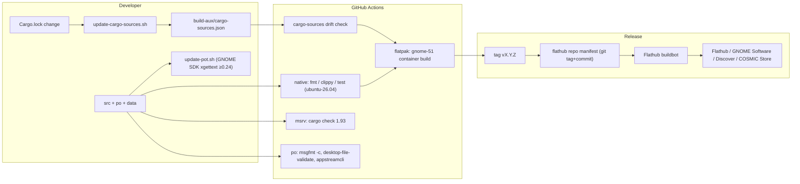

# estuary-packaging: Workspace scaffold, CI, Flatpak and release

> Sub-spec of [`specs/estuary/spec.md`](../estuary/spec.md). Covers milestones **M1** (workspace scaffold) and **M12** (Flatpak and release).
> The master contracts are binding: **C1** (workspace and crate layout) and **C14** (packaging identity) above all, plus C10 (start-at-login) and C12 (config path). This document cites them and never redefines them. Where this spec needs a contract change, it is listed in [Contract amendments requested](#contract-amendments-requested) and **not** applied unilaterally.
> Detail level: **high**. Date: 2026-10-14.

---

## Summary

This sub-spec defines how Estuary is laid out, built, linted, tested in CI, translated, packaged as a Flatpak and submitted to Flathub. It covers every file outside `crates/*/src` that a developer or Flathub reviewer touches.

## Problem Statement

A greenfield Rust + GTK4 + PipeWire project needs a reproducible foundation before any feature work:

- **A workspace with enforced conventions.** It must match C1 exactly (crate split, dependency direction, `unsafe` confinement). Later milestones must not argue about formatting, lints or versions.
- **CI that catches regressions.** It must compile against system libraries **at least as new** as the C1 feature flags (`gtk4 v4_14`, `libadwaita v1_5`, `gnome_46`) without pretending to test live PipeWire behaviour, which CI cannot host.
- **A Flatpak build that Flathub accepts.** That means offline (vendored) cargo builds, valid MetaInfo, a desktop file, icons, translations, minimal justified permissions, and a manifest that passes `flatpak-builder-lint`.
- **Translations (en, it).** They must work for Rust sources, the desktop file and MetaInfo, both in the Flatpak and in a native `cargo run`.

Getting any of these wrong late is expensive: Flathub rejects submissions on lint errors, wrong IDs or unjustified permissions, and vendoring drift breaks every release build.

## Solution Overview

- **M1.** A Cargo workspace exactly per C1, with workspace-level `[workspace.lints]` (so every crate inherits one lint policy), `rust-toolchain.toml` pinned to `stable`, `rustfmt.toml`, and a `clippy.toml` carrying `msrv`.
  - The binary crate starts as a minimal Relm4 component that opens an empty `adw::ApplicationWindow`. The UI sub-spec (M3) grows this component instead of replacing it.
  - CI on GitHub Actions has three jobs:
    1. **native** on `ubuntu-26.04` (pinned): fmt, clippy `-D warnings`, test;
    2. **msrv** on the same image: `cargo check` with Rust 1.93;
    3. **flatpak** (from M12) inside `ghcr.io/flathub-infra/flatpak-github-actions:gnome-51`.
- **M12.** Plain cargo inside flatpak-builder (`buildsystem: simple`) plus one shell script, `build-aux/install-data.sh`, that installs every data file. The same script serves Flatpak builds and native installs (`--prefix`).
  - Translations are extracted with GNU gettext ≥ 0.24, which has native Rust support (`xgettext --language=Rust`), run inside the GNOME SDK. The host's gettext 0.21 on Ubuntu 24.04 can't parse Rust.
  - Cargo dependencies are vendored with `flatpak-cargo-generator.py` into `build-aux/cargo-sources.json`, and CI checks it for drift against `Cargo.lock`.
  - Runtime: `org.gnome.Platform//51` with `org.freedesktop.Sdk.Extension.rust-stable//26.08`. That is the latest on Flathub, and Flathub requires the latest runtime at submission. **This needs an amendment to C14 (A1).**

**Why simple + script instead of meson.** Meson is the GNOME convention, but with Rust it means a `custom_target` wrapping cargo and a known `CARGO_HOME` conflict with flatpak-cargo-generator: meson sets its own `CARGO_HOME`, cargo then misses the vendored config and tries the network (documented in flatpak-builder-tools' cargo README). The data-install surface is small: one desktop file, one MetaInfo, two icons, `.mo` files and licences. A ~60-line POSIX script is easier to audit, works identically for native installs, and keeps cargo the single build system that developers already use.

## Technical Context

### Verified facts (2026-10-14)

| Fact | Status | Source |
|---|---|---|
| Flathub serves `org.gnome.Platform` branches **49, 50, 51**. Helvum (`org.pipewire.Helvum`) is already on **51** | live-verified (`flatpak remote-ls flathub`, Flathub API) | flathub remote, `https://flathub.org/api/v2/appstream/org.pipewire.Helvum` |
| `org.freedesktop.Sdk.Extension.rust-stable` has branch **26.08** (first commit 2026-09-03). GNOME 51 is built on freedesktop-sdk 26.08 | live-verified (`flatpak remote-info`) | flathub remote |
| CI container image `ghcr.io/flathub-infra/flatpak-github-actions:gnome-51` exists (tags gnome-44 … gnome-51) | live-verified (GHCR tag list) | ghcr.io |
| `flatpak/flatpak-github-actions` latest release **v6.8** (action ref `flatpak-builder@v6`). `actions/checkout` latest **v7** | live-verified (GitHub API) | github.com/flatpak/flatpak-github-actions |
| GitHub `ubuntu-26.04` runner GA on 2026-09-17. `ubuntu-latest` migrates to it gradually from 2026-10-19 to 2026-11-19 | source-verified | https://github.blog/changelog/2026-09-17-ubuntu-26-generally-available-and-latest-migration |
| `ubuntu-24.04` runner ships GTK 4.14, libadwaita 1.5, **WirePlumber 0.4** | source-verified (Ubuntu archive; matches dev host's GTK/adw) | master Technical Context |
| Ubuntu 26.04 ships GTK ≥ 4.20, libadwaita ≥ 1.8, PipeWire ≥ 1.4, WirePlumber 0.5 | **UNVERIFIED** (exact versions; only the "≥ C1 minimums" property matters) | – |
| GNU gettext **0.24** (2025-02-25) added Rust to xgettext. **0.26** recognises `gettextrs::gettext` calls | source-verified | https://savannah.gnu.org/news/?id=10730, https://fossies.org/linux/gettext/NEWS |
| gettext version inside GNOME SDK 51 (freedesktop-sdk 26.08) is ≥ 0.24 | **UNVERIFIED** (very likely; checked in M12.4 with a version guard) | – |
| Flathub ID rules: GitHub-hosted apps use `io.github.<user>.<repo>`, ≥ 4 components, last component may differ in case from repo; ID must equal the MetaInfo `<id>` | source-verified (case handling **UNVERIFIED**) | https://docs.flathub.org/docs/for-app-authors/requirements |
| Flathub: no network during build; all sources public; runtime must be latest at submission; manifest at top of the flathub repo, named `<app-id>.{json,yml,yaml}`; licence files installed to `$FLATPAK_DEST/share/licenses/$FLATPAK_ID/` | source-verified | same |
| Linter: `flatpak run --command=flatpak-builder-lint org.flatpak.Builder manifest <manifest>` and `… repo repo`. `finish-args-arbitrary-autostart-access` (`--filesystem=xdg-config/autostart[:create]`) is **never granted** ("an Autostart portal exists"). `finish-args-wildcard-kde-talk-name` (`org.kde.*`) is never granted; a specific `org.kde.StatusNotifierWatcher` talk-name is not a listed error | source-verified | https://docs.flathub.org/docs/for-app-authors/linter |
| MetaInfo mandatory elements: `id`, `metadata_license`, `project_license` (SPDX), `name`, `summary`, `developer id=…` + `name`, `description`, `launchable`, `content_rating type="oars-1.1"`, `url type="homepage"`, `screenshots`, `releases` (no future dates). `appstreamcli` warnings are fatal | source-verified | https://docs.flathub.org/docs/for-app-authors/metainfo-guidelines |
| flatpak-cargo-generator: `python3 flatpak-cargo-generator.py Cargo.lock -o cargo-sources.json` (needs `aiohttp`, `tomlkit`). Manifest: `CARGO_HOME=/run/build/<module>/cargo`, `CARGO_NET_OFFLINE=true`, `append-path: /usr/lib/sdk/rust-stable/bin`, `cargo --offline fetch` then `cargo build --offline --release`. The rust-stable branch must match the SDK base version | source-verified | https://github.com/flatpak/flatpak-builder-tools/tree/master/cargo |
| Latest crate versions vs C1: `toml` **1.1.8** (C1: 0.9), `rubato` **5.0.1** (C1: 0.16), `gettext-rs` **0.8.0** (C1: 0.7; feature `gettext-system` still exists), `sha2` **0.11.1** (C1: 0.10), `uuid` 1.28.0, `thiserror` 2.0.21, `async-channel` 2.5.0. relm4 0.11.0 features include `gnome_42`…`gnome_50`, `libadwaita`, `macros`, `css` | live-verified (crates.io API) | crates.io |

### Existing repository state

`/home/abidibo/Dev/abidibo/amatrix` contains only `specs/`. It is not yet a git repository. The GitHub repository `https://github.com/abidibo/Estuary` (C1 `repository`) is assumed and must exist and be public before M12 (Flathub ID verification).

### Dev host

Pop!_OS 24.04 (GNOME session), GTK 4.14.5, libadwaita 1.5.0, PipeWire 1.5.85, rustc 1.94.0, and `flatpak` with the `flathub` remote configured (live-verified). The dev headers are **not** installed yet.

---

## Implementation Steps

### M1: Workspace scaffold

#### M1.1 Install development dependencies

Document these in `README.md` (M1.6) and install them on the dev host.

| Distro | Command |
|---|---|
| Pop!_OS / Ubuntu ≥ 24.04 / Debian 13 | `sudo apt install build-essential pkg-config clang libpipewire-0.3-dev libgtk-4-dev libadwaita-1-dev gettext` |
| Fedora ≥ 42 | `sudo dnf install gcc pkgconf-pkg-config clang pipewire-devel gtk4-devel libadwaita-devel gettext` |
| Arch / Manjaro | `sudo pacman -S --needed base-devel clang pipewire gtk4 libadwaita gettext` |

Why each one:

- `clang` / `libclang` is required by `bindgen` in `pipewire-sys` and `libspa-sys`.
- `pkg-config` lets the `*-sys` crates find system libraries.
- `gettext` provides `msgfmt` for local `.mo` builds. Extraction (`xgettext` ≥ 0.24) runs inside the GNOME SDK, see M12.4.

Verification:

```sh
pkg-config --modversion libpipewire-0.3 gtk4 libadwaita-1   # expect ≥ 1.0, ≥ 4.14, ≥ 1.5
```

Flatpak tooling for M12 (optional at M1):

```sh
flatpak install --user flathub org.gnome.Sdk//51 org.gnome.Platform//51 \
  org.freedesktop.Sdk.Extension.rust-stable//26.08 org.flatpak.Builder
```

#### M1.2 Root workspace files

**`Cargo.toml`** (root). The dependency table is copied verbatim from C1, except for the versions listed in amendment A2, which apply only once the master is amended. Until then, use the C1 values.

```toml
[workspace]
resolver = "3"
members = ["crates/estuary-dsp", "crates/estuary-engine", "crates/estuary"]

[workspace.package]
version = "0.1.0"
edition = "2024"
rust-version = "1.93"
license = "MIT OR Apache-2.0"
repository = "https://github.com/abidibo/Estuary"
authors = ["abidibo"]

[workspace.dependencies]
# --- verbatim from master C1 (see amendment A2 for version bumps) ---
pipewire      = "0.10.1"
libspa        = "0.10.1"
libspa-sys    = "0.10.1"
pipewire-sys  = "0.10.1"
relm4         = { version = "0.11.0", default-features = false, features = ["libadwaita", "gnome_46", "macros"] }
gtk           = { package = "gtk4", version = "0.11.5", features = ["v4_14"] }
adw           = { package = "libadwaita", version = "0.9.2", features = ["v1_5"] }
ashpd         = { version = "0.13.13", default-features = false, features = ["tokio", "background"] }  # NEVER enable "pipewire"
ksni          = "0.3.6"
nnnoiseless   = { version = "0.5.2", default-features = false }   # defaults pull clap/hound/anyhow/dasp
rubato        = "5.0.1"  # resampling around the denoiser; API per estuary-dsp M10.2
log           = { version = "0.4", features = ["release_max_level_debug"] }  # compiles out rubato RT-path trace! in release
sha2          = "0.11"   # cell/denoiser node-name hashes (C5)
async-channel = "2"
serde         = { version = "1", features = ["derive"] }
toml          = "1"
thiserror     = "2"
tracing       = "0.1"
tracing-subscriber = { version = "0.3", features = ["env-filter"] }
uuid          = { version = "1", features = ["v4", "serde"] }
gettext-rs    = { version = "0.8", features = ["gettext-system"] }
# --- internal crates ---
estuary-dsp    = { path = "crates/estuary-dsp" }
estuary-engine = { path = "crates/estuary-engine" }

[workspace.lints.rust]
unsafe_op_in_unsafe_fn = "deny"
missing_debug_implementations = "warn"
unused_must_use = "deny"

[workspace.lints.clippy]
all = { level = "warn", priority = -1 }
undocumented_unsafe_blocks = "deny"     # every unsafe block in estuary-dsp carries a // SAFETY: comment
unwrap_used = "warn"                    # allowed in tests via #[cfg_attr(test, allow(clippy::unwrap_used))]
expect_used = "allow"
dbg_macro = "warn"
todo = "warn"
print_stdout = "warn"                   # use tracing
large_futures = "warn"
needless_pass_by_value = "warn"
semicolon_if_nothing_returned = "warn"
cast_possible_truncation = "warn"       # matters for sample/frame arithmetic in DSP

[profile.release]
lto = "thin"
codegen-units = 1
debug = "line-tables-only"              # usable backtraces from Flatpak crash reports
panic = "unwind"                        # REQUIRED: master F5 relies on catch_unwind at the engine thread boundary

[profile.dev.package."*"]
opt-level = 2                           # DSP and nnnoiseless are unusably slow at opt-level 0
```

Notes:

- `panic = "unwind"` is load-bearing for F5 (master). It must never be switched to `abort`.
- Internal crates are declared as workspace deps so that the dependency direction in C1 (`estuary` → `estuary-engine` → `estuary-dsp`) is visible in one place.

**`rust-toolchain.toml`**:

```toml
[toolchain]
channel = "stable"
components = ["rustfmt", "clippy"]
profile = "minimal"
```

This file is ignored inside flatpak-builder, which has no rustup and uses the SDK extension's toolchain. MSRV is enforced separately (M1.7).

**`rustfmt.toml`**:

```toml
edition = "2024"
style_edition = "2024"
max_width = 100
use_field_init_shorthand = true
```

**`clippy.toml`**:

```toml
msrv = "1.93"
avoid-breaking-exported-api = false
```

**`.gitignore`**:

```
/target
/.flatpak-builder
/build-dir
/repo
/_build
*.flatpak
/po/*.mo
/po/*~
```

**`.editorconfig`**: UTF-8, LF, 4-space indentation for `*.rs`/`*.toml`, and 2-space for `*.yml`/`*.json`/`*.xml`.

**Licences.** `LICENSE-MIT` (MIT text, "Copyright (c) 2026 abidibo") and `LICENSE-APACHE` (the unmodified Apache-2.0 text), satisfying C1 `license = "MIT OR Apache-2.0"`.

#### M1.3 `crates/estuary-dsp` skeleton

`crates/estuary-dsp/Cargo.toml`:

```toml
[package]
name = "estuary-dsp"
description = "Realtime PipeWire filter nodes for estuary (pw_filter wrapper, gain, denoise)"
version.workspace = true
edition.workspace = true
rust-version.workspace = true
license.workspace = true
repository.workspace = true
publish = false

[dependencies]
pipewire.workspace = true
pipewire-sys.workspace = true
libspa.workspace = true
libspa-sys.workspace = true
nnnoiseless.workspace = true
rubato.workspace = true
thiserror.workspace = true

[features]
live-pw = []          # enables #[ignore]-free live tests that need a running PipeWire (never in CI)

[lints]
workspace = true
```

`crates/estuary-dsp/src/lib.rs` (M1 content only; the DSP sub-spec fills it in):

```rust
//! Realtime DSP nodes for estuary. `unsafe` is permitted in this crate only (master C1),
//! confined to the pw_filter FFI and always behind a safe API.
#![deny(unsafe_code)] // individual FFI modules opt in with #[allow(unsafe_code)] + SAFETY comments
```

`#![deny]` (not `forbid`) lets FFI modules opt in locally, which is the narrowest reading of C1's "unsafe confined here".

#### M1.4 `crates/estuary-engine` skeleton

`crates/estuary-engine/Cargo.toml`: same `[package]` pattern (`description = "PipeWire graph engine for estuary"`), with dependencies `estuary-dsp`, `pipewire`, `libspa`, `async-channel`, `serde`, `toml`, `thiserror`, `tracing`, `uuid`, `sha2` (all `.workspace = true`), the feature `live-pw = ["estuary-dsp/live-pw"]`, and `[lints] workspace = true`.

`src/lib.rs`:

```rust
//! estuary PipeWire engine (master C2–C9, C13).
#![forbid(unsafe_code)]
```

C1 forbids any gtk/relm4/libadwaita dependency here. CI enforces it with the `cargo tree` check in M1.7.

#### M1.5 `crates/estuary` binary skeleton (empty window)

`crates/estuary/Cargo.toml`:

```toml
[package]
name = "estuary"
description = "Audio matrix and isolator for PipeWire"
version.workspace = true
edition.workspace = true
rust-version.workspace = true
license.workspace = true
repository.workspace = true
publish = false

[[bin]]
name = "estuary"          # C14: binary name
path = "src/main.rs"

[dependencies]
estuary-engine.workspace = true
relm4.workspace = true
gtk.workspace = true
adw.workspace = true
ashpd.workspace = true
ksni.workspace = true
gettext-rs.workspace = true
tracing.workspace = true
tracing-subscriber.workspace = true
serde.workspace = true
toml.workspace = true
async-channel.workspace = true
uuid.workspace = true
thiserror.workspace = true

[lints]
workspace = true
```

`crates/estuary/src/config_build.rs` holds the build-time constants (see M12.6 for how they're set):

```rust
pub const APP_ID: &str = "io.github.abidibo.Estuary";            // C14
pub const GETTEXT_PACKAGE: &str = "estuary";                       // C14
/// Set by the Flatpak / install build via `ESTUARY_LOCALEDIR`; falls back to the
/// in-tree `target/locale` produced by `build-aux/compile-mo.sh` for `cargo run`.
pub const LOCALEDIR: &str = match option_env!("ESTUARY_LOCALEDIR") {
    Some(dir) => dir,
    None => concat!(env!("CARGO_MANIFEST_DIR"), "/../../target/locale"),
};
```

`crates/estuary/src/main.rs` (M1 content; M3 of the UI sub-spec replaces `AppModel` with the real root component and keeps `main`):

```rust
#![forbid(unsafe_code)]

mod config_build;

use config_build::{APP_ID, GETTEXT_PACKAGE, LOCALEDIR};
use gettextrs::{bind_textdomain_codeset, bindtextdomain, setlocale, textdomain, LocaleCategory};
use relm4::{adw, gtk, ComponentParts, ComponentSender, RelmApp, SimpleComponent};
use adw::prelude::*;

struct AppModel;

#[relm4::component]
impl SimpleComponent for AppModel {
    type Init = ();
    type Input = ();
    type Output = ();

    view! {
        adw::ApplicationWindow {
            set_title: Some("estuary"),
            set_default_size: (960, 640),
            #[wrap(Some)]
            set_content = &adw::ToolbarView {
                add_top_bar = &adw::HeaderBar {},
                #[wrap(Some)]
                set_content = &adw::StatusPage {
                    set_icon_name: Some(APP_ID),
                    set_title: "estuary",
                },
            },
        }
    }

    fn init(_: (), root: Self::Root, _sender: ComponentSender<Self>) -> ComponentParts<Self> {
        let model = AppModel;
        let widgets = view_output!();
        ComponentParts { model, widgets }
    }
}

fn init_i18n() {
    setlocale(LocaleCategory::LcAll, "");
    // Failures are non-fatal: the UI falls back to English source strings.
    let _ = bindtextdomain(GETTEXT_PACKAGE, LOCALEDIR);
    let _ = bind_textdomain_codeset(GETTEXT_PACKAGE, "UTF-8");
    let _ = textdomain(GETTEXT_PACKAGE);
}

fn init_tracing() {
    // C14: ESTUARY_LOG, EnvFilter syntax, default "warn,estuary=info".
    let filter = tracing_subscriber::EnvFilter::try_from_env("ESTUARY_LOG")
        .unwrap_or_else(|_| tracing_subscriber::EnvFilter::new("warn,estuary=info"));
    tracing_subscriber::fmt().with_env_filter(filter).init();
}

fn main() {
    init_tracing();
    init_i18n();
    let app = adw::Application::builder().application_id(APP_ID).build();
    RelmApp::from_app(app).run::<AppModel>(());
}
```

The relm4 0.11 re-exports (`relm4::adw`, `relm4::gtk`) and the `#[wrap(Some)]` view-macro syntax are the documented relm4 idioms. The exact macro surface must be confirmed by `cargo build` (**UNVERIFIED** until M1.8). If relm4 does not re-export `adw` under `default-features = false`, import from the workspace `adw` crate instead.

**Implementation notes (verified at M1.8, 2026-10-14).** The code as built differs from the snippet above in two places:

1. **No `setlocale` call.** In gettext-rs 0.8, `setlocale` is an `unsafe fn` (it isn't thread-safe), which `#![forbid(unsafe_code)]` rejects. It isn't needed, because GTK's initialization calls `setlocale(LC_ALL, "")` before any UI string is translated. `init_i18n()` only calls `bindtextdomain`, `bind_textdomain_codeset` and `textdomain`.
2. **Single-instance guard before relm4.** relm4 0.11's `RelmApp::run` ends with a blocking `glib::MainContext::ref_thread_default().iteration(true)` (`relm4-0.11.0/src/app.rs:199`). A remote (second) instance has nothing pending there, so it hangs instead of exiting. `main()` therefore checks `org.freedesktop.DBus.NameHasOwner(APP_ID)` on the session bus first. If the name is owned, it calls plain `app.run()`, which as a remote instance forwards `activate`, flushes, unregisters and returns. Only otherwise does it call `RelmApp::from_app(app).run::<AppModel>(())`. The app must **not** be registered before relm4's run on the primary path: `register()` emits `startup` before relm4 connects the handler that builds the window, and the primary then exits with no window.

The relm4 view-macro surface in the snippet (`#[wrap(Some)]`, `relm4::adw`/`relm4::gtk` re-exports) compiled unchanged, so that UNVERIFIED item is resolved.

#### M1.6 `README.md`

Sections:

1. What Estuary is (one paragraph, linking to `specs/estuary/spec.md`).
2. Requirements: PipeWire ≥ 1.0, WirePlumber ≥ 0.5 (C13).
3. Dev setup: the M1.1 table.
4. Run: `cargo run -p estuary`, `ESTUARY_LOG=debug cargo run -p estuary`.
5. Tests: `cargo test --workspace` (unit), `cargo test --workspace --features estuary-engine/live-pw -- --include-ignored` (needs a running PipeWire session; never in CI).
6. Translations: `build-aux/update-pot.sh`, `build-aux/compile-mo.sh` (M12.4).
7. Flatpak: `flatpak run org.flatpak.Builder --user --install --force-clean build-dir build-aux/io.github.abidibo.Estuary.Devel.yml` (M12.8).
8. Licence: dual MIT/Apache-2.0, with the standard contribution clause ("Unless you explicitly state otherwise, any contribution … shall be dual licensed as above, without any additional terms or conditions").

#### M1.7 CI workflow

**Runner decision.** The `native` and `msrv` jobs run directly on **`ubuntu-26.04` (pinned)**, not `ubuntu-latest` and not a container.

- `ubuntu-latest` is mid-migration (2026-10-19 → 11-19), so pinning avoids a silent environment change.
- `ubuntu-24.04` would build fine (GTK 4.14 / adw 1.5 match C1's minimum features exactly), but it ships WirePlumber 0.4, which looks wrong to anyone reading CI logs, even though no live test runs.
- Ubuntu 26.04 headers are newer than C1's minimum feature flags. That is safe because the gtk4/libadwaita feature flags select the *minimum* API we compile against. Newer system libraries never break the build.
- A Fedora container was considered (it has newest libs too), but it adds a container pull per job for no extra coverage.
- The GNOME SDK container is used for the Flatpak job, where it is mandatory.

**What CI never does:** run live-PipeWire tests. They need a session bus, a PipeWire daemon and WirePlumber. `live-pw` features are never enabled in CI, and tests that need PipeWire are `#[ignore]` with a `// live-pw:` reason. The engine and DSP sub-specs keep logic testable without a daemon.

`.github/workflows/ci.yml`:

```yaml
name: CI
on:
  push:
    branches: [main]
  pull_request:

concurrency:
  group: ci-${{ github.ref }}
  cancel-in-progress: true

env:
  CARGO_TERM_COLOR: always
  RUSTFLAGS: -D warnings

jobs:
  native:
    name: fmt / clippy / test
    runs-on: ubuntu-26.04
    steps:
      - uses: actions/checkout@v7
      - name: System dependencies
        run: |
          sudo apt-get update
          sudo apt-get install -y --no-install-recommends \
            build-essential pkg-config clang \
            libpipewire-0.3-dev libgtk-4-dev libadwaita-1-dev gettext
      - uses: dtolnay/rust-toolchain@stable
        with:
          components: rustfmt, clippy
      - uses: Swatinem/rust-cache@v2
      - run: cargo fmt --all --check
      - run: cargo clippy --workspace --all-targets -- -D warnings
      - run: cargo test --workspace
      - name: Engine and DSP must not depend on GTK (C1)
        run: |
          for c in estuary-engine estuary-dsp; do
            if cargo tree -p "$c" -e normal --prefix none | grep -Eq '^(gtk4|libadwaita|relm4) '; then
              echo "::error::$c depends on a UI crate (forbidden by master C1)"; exit 1
            fi
          done

  msrv:
    name: MSRV 1.93
    runs-on: ubuntu-26.04
    steps:
      - uses: actions/checkout@v7
      - run: |
          sudo apt-get update
          sudo apt-get install -y --no-install-recommends \
            build-essential pkg-config clang libpipewire-0.3-dev libgtk-4-dev libadwaita-1-dev
      - uses: dtolnay/rust-toolchain@1.93
      - uses: Swatinem/rust-cache@v2
      - run: cargo check --workspace --all-targets
        env:
          RUSTFLAGS: ""   # do not fail MSRV on lints added in newer compilers

  # Added in M12.9:
  # cargo-sources: (drift check)
  # flatpak:       (GNOME 51 container build + lint)
```

#### M1.8 First build and lockfile

1. `git init`; add everything from M1.2–M1.7.
2. `cargo build --workspace`, `cargo clippy --workspace --all-targets -- -D warnings`, `cargo test --workspace` (zero tests is fine).
3. `cargo run -p estuary` opens a 960×640 window with a header bar and an "estuary" status page.
4. **Commit `Cargo.lock`.** It's a binary application, and Flatpak vendoring (M12.7) is generated from it.

### M12: Flatpak and release

**Implementation notes (M12 as built, 2026-10-15).** These deviate from or refine the text below. Where they conflict, the notes are authoritative.

- **Icons** are hand-written SVGs: an indigo rounded square with a 3×3 matrix (two lit crosspoints) and a waveform through the middle row, a 16 px symbolic, and a striped Devel variant. `install-data.sh` installs the Devel icon under the regular name when `ESTUARY_PROFILE=devel` (the app ID never changes). The tray renders the symbolic, recoloured `#dedede`, via GdkPixbuf.
- **Extraction keywords** are our wrappers, not raw gettext: `i18n`, `i18n_f`, `ni18n_f:1,2`, `pi18n:1c,2` (plus the gettext-rs names). Assumption S1 is amended accordingly. `update-pot.sh` uses the GNOME 51 SDK's xgettext 1.0 (Rust parser) when the SDK is installed, else the host's (C fallback below 0.24); its temp dir sits under `po/` so the SDK sandbox can see it. `POTFILES.in` lists every `.rs` with translatable strings (23 files) plus the two data templates. 159 messages; **`it.po` fully translated** (158 + header).
- **`format_db`'s decimal separator** is the `pgettext("decimal separator", ".")` entry; Italian sets ",".
- **Manifest** adds `org.freedesktop.Sdk.Extension.llvm22` with `LIBCLANG_PATH=/usr/lib/sdk/llvm22/lib`: `pipewire-sys` runs bindgen. The release manifest needs the same.
- **Local build:** succeeds (9.2 MB). On hosts that export `SSL_CERT_FILE`/`SSL_CERT_DIR`, unset them for flatpak-builder (see docs/experiments.md). The sandboxed app connects with write access, creates its nodes and quits cleanly.
- **Screenshots** `data/screenshots/{matrix,apps}.png`: 1000×700, light theme, English, taken from a default-profile Flatpak build with the dev aids (`ESTUARY_SNAPSHOT`, `ESTUARY_DEV_SIZE`, `ESTUARY_PAGE`, `ADW_DEBUG_COLOR_SCHEME=prefer-light`). The demo apps play silent tones into a temporary null sink called "Headphones".
- **Lint gate (M12.10):** `appstreamcli validate --pedantic` passes (one pedantic note, the uppercase in the C14 app ID); `desktop-file-validate` passes; `msgfmt -c --check-format` passes. `flatpak-builder-lint` reports only publishing-dependent errors: `appid-url-not-reachable` (repo not public yet), `appid-filename-mismatch` (Devel manifest name only), and `appstream-missing-screenshots` / `appstream-screenshots-not-mirrored-in-ostree` (URLs point at the unpublished `v0.1.0` tag; Flathub mirrors them at build). No permission findings.
- **CI** gains `cargo-sources`, `po` (now also running `check-i18n.sh`) and `flatpak` jobs; `upload-artifact` is omitted, since bundles are uploaded by default.
- MetaInfo release date set to 2026-10-15 (to be confirmed at tagging, M12.11).

#### M12.1 Icons

| File | Purpose |
|---|---|
| `data/icons/hicolor/scalable/apps/io.github.abidibo.Estuary.svg` | App icon (GNOME HIG, 128×128 canvas, full colour) |
| `data/icons/hicolor/symbolic/apps/io.github.abidibo.Estuary-symbolic.svg` | 16×16 symbolic (monochrome `#2e3436`, recolourable) |
| `data/icons/hicolor/scalable/apps/io.github.abidibo.Estuary.Devel.svg` | Devel variant (striped "nightly" background), installed only by the Devel manifest |

Design brief: a 3×3 grid of rounded squares (the matrix) with two lit crosspoints and a waveform in one row. No third-party trademarks. Validate with `flatpak-builder-lint` and with `appstreamcli validate --pedantic` (icon presence is checked through `launchable`).

#### M12.2 Desktop file

`data/io.github.abidibo.Estuary.desktop.in`. It's a template so translations can be merged with `msgfmt --desktop`:

```ini
[Desktop Entry]
Type=Application
Name=Estuary
GenericName=Audio Matrix
Comment=Route, mix and clean up your PipeWire audio
Exec=estuary
Icon=io.github.abidibo.Estuary
Terminal=false
Categories=AudioVideo;Audio;Mixer;GTK;
# Translators: search keywords, semicolon separated, keep the trailing semicolon
Keywords=audio;sound;mixer;routing;matrix;pipewire;microphone;noise;virtual;
StartupNotify=true
SingleMainWindow=true
X-GNOME-UsesNotifications=true
```

- `Exec=estuary` without `--background`. The background flag is used only by autostart (C10 and the desktop sub-spec).
- No `DBusActivatable`: GApplication single-instance works without a D-Bus service file, and DBus activation would need an extra `.service` file and `--own-name` reasoning.
- Validate with `desktop-file-validate`.

#### M12.3 MetaInfo

`data/io.github.abidibo.Estuary.metainfo.xml.in`, merged with `msgfmt --xml`:

```xml
<?xml version="1.0" encoding="UTF-8"?>
<!-- Copyright 2026 abidibo -->
<component type="desktop-application">
  <id>io.github.abidibo.Estuary</id>
  <metadata_license>CC0-1.0</metadata_license>
  <project_license>MIT OR Apache-2.0</project_license>

  <name>Estuary</name>
  <summary>Route, mix and clean up your audio</summary>

  <developer id="io.github.abidibo">
    <name translate="no">abidibo</name>
  </developer>

  <description>
    <p>Estuary is an audio matrix for PipeWire. Send each application to the output or virtual channel you choose, mix channels to your headphones, speakers and virtual microphones with a volume on every crosspoint, and remove background noise from your microphone.</p>
    <ul>
      <li>Per-application routing that is remembered across restarts</li>
      <li>Virtual channels and virtual microphones for calls and streaming</li>
      <li>A routing matrix with an independent level on every crosspoint</li>
      <li>Neural noise suppression for microphones</li>
      <li>Live level meters for every application, channel and device</li>
    </ul>
    <p>Requires PipeWire 1.0 or newer with WirePlumber 0.5 or newer.</p>
  </description>

  <launchable type="desktop-id">io.github.abidibo.Estuary.desktop</launchable>
  <translation type="gettext">estuary</translation>

  <url type="homepage">https://github.com/abidibo/Estuary</url>
  <url type="bugtracker">https://github.com/abidibo/Estuary/issues</url>
  <url type="vcs-browser">https://github.com/abidibo/Estuary</url>
  <url type="translate">https://github.com/abidibo/Estuary/tree/main/po</url>

  <branding>
    <color type="primary" scheme_preference="light">#c7d2fe</color>
    <color type="primary" scheme_preference="dark">#312e81</color>
  </branding>

  <content_rating type="oars-1.1" />

  <requires>
    <display_length compare="ge">360</display_length>
  </requires>
  <supports>
    <control>pointing</control>
    <control>keyboard</control>
  </supports>

  <screenshots>
    <screenshot type="default">
      <image>https://raw.githubusercontent.com/abidibo/Estuary/v0.1.0/data/screenshots/matrix.png</image>
      <caption>The routing matrix with per-crosspoint levels</caption>
    </screenshot>
    <screenshot>
      <image>https://raw.githubusercontent.com/abidibo/Estuary/v0.1.0/data/screenshots/apps.png</image>
      <caption>Choose where each application plays</caption>
    </screenshot>
  </screenshots>

  <releases>
    <release version="0.1.0" date="YYYY-MM-DD">
      <description>
        <p>First release.</p>
      </description>
    </release>
  </releases>
</component>
```

Rules:

- `<content_rating type="oars-1.1" />` stays empty: no violence, no in-app purchases, no chat or user-generated content shared with others. Estuary processes the microphone locally and sends nothing anywhere, so no `social-*` attributes apply.
- Screenshot URLs **must point at the release tag**, never at `main` (Flathub rule). Screenshots are taken at 1000×700 from the Flatpak build in the default (light) theme with English UI and committed to `data/screenshots/` before tagging.
- `YYYY-MM-DD` is replaced at release time (M12.11) and must not be in the future.
- Validate with `appstreamcli validate --pedantic --explain` (warnings are fatal on Flathub).

#### M12.4 Translations (gettext)

Layout:

```
po/
├── LINGUAS          # "it"
├── POTFILES.in      # source files with translatable strings, one per line
├── estuary.pot      # generated, committed
└── it.po
build-aux/
├── update-pot.sh    # regenerates estuary.pot and merges it.po
└── compile-mo.sh    # builds .mo + translated desktop/metainfo into a staging dir
```

`po/POTFILES.in` (grows as the UI sub-spec adds files):

```
crates/estuary/src/main.rs
data/io.github.abidibo.Estuary.desktop.in
data/io.github.abidibo.Estuary.metainfo.xml.in
```

**Extraction decision.** Use `xgettext --language=Rust` (GNU gettext ≥ 0.24) run inside the GNOME SDK, so contributors don't depend on their distro's gettext. Ubuntu 24.04 has 0.21, which has no Rust parser. If the SDK's xgettext is older than 0.24 (UNVERIFIED, guarded below), fall back to `--language=C` with explicit keywords. That fallback is the long-standing GNOME-Rust practice: Rust string literals and call syntax are close enough to C for gettext calls.

Keyword set (mirrors the `gettextrs` API that the UI sub-spec uses): `gettext`, `pgettext:1c,2`, `ngettext:1,2`, `npgettext:1c,2,3`. The UI sub-spec must use only these four functions (assumption S1).

`build-aux/update-pot.sh`:

```sh
#!/bin/sh
# Regenerate po/estuary.pot and merge into all languages. Runs xgettext inside the GNOME SDK.
set -eu
cd "$(dirname "$0")/.."
SDK="org.gnome.Sdk//51"
run() { flatpak run --filesystem="$PWD" --cwd="$PWD" --command=sh "$SDK" -c "$*"; }

VER=$(run 'xgettext --version | head -n1 | sed "s/.* //"')
case "$VER" in
  0.2[4-9]*|0.[3-9]*|[1-9]*) LANG_RS="--language=Rust" ;;
  *) echo "xgettext $VER < 0.24: falling back to C parser" >&2; LANG_RS="--language=C" ;;
esac
KW="--keyword=gettext --keyword=pgettext:1c,2 --keyword=ngettext:1,2 --keyword=npgettext:1c,2,3"

grep -E '\.rs$' po/POTFILES.in > /tmp/estuary-rs.list || true
run "xgettext $LANG_RS $KW --from-code=UTF-8 --add-comments=Translators \
      --package-name=estuary --msgid-bugs-address=https://github.com/abidibo/Estuary/issues \
      -f /tmp/estuary-rs.list -o po/rust.pot"
run "xgettext --language=Desktop -k -kName -kGenericName -kComment -kKeywords \
      data/io.github.abidibo.Estuary.desktop.in -o po/desktop.pot"
run "xgettext --its=/usr/share/gettext/its/metainfo.its \
      data/io.github.abidibo.Estuary.metainfo.xml.in -o po/metainfo.pot"
run "msgcat --use-first po/rust.pot po/desktop.pot po/metainfo.pot -o po/estuary.pot"
rm -f po/rust.pot po/desktop.pot po/metainfo.pot /tmp/estuary-rs.list
for l in $(cat po/LINGUAS); do run "msgmerge --update --backup=none po/$l.po po/estuary.pot"; done
```

The ITS path for MetaInfo is shipped by appstream (`/usr/share/gettext/its/metainfo.its`). It must exist in the GNOME SDK (**UNVERIFIED**, checked in this step). The fallback is `itstool`-free `xgettext` with the `appdata.its` that gettext itself ships.

`build-aux/compile-mo.sh <stagedir>`. It needs only `msgfmt`, which is available on the host and in the SDK, and produces:

- `<stagedir>/share/locale/<lang>/LC_MESSAGES/estuary.mo` for each language in LINGUAS;
- `<stagedir>/share/applications/io.github.abidibo.Estuary.desktop` (`msgfmt --desktop --template=… -d po`);
- `<stagedir>/share/metainfo/io.github.abidibo.Estuary.metainfo.xml` (`msgfmt --xml --template=… -d po`).

For `cargo run`, the default stagedir is `target/` → `target/locale/...`. That matches the `LOCALEDIR` fallback in M1.5, so `LANGUAGE=it cargo run -p estuary` shows Italian after `build-aux/compile-mo.sh target`.

`msgfmt -c --check-format` runs in CI (`native` job) over `po/*.po` (added in M12.9).

#### M12.5 Data install script

`build-aux/install-data.sh <prefix> [destdir]`. POSIX sh. The single source of truth for data layout:

```sh
#!/bin/sh
set -eu
PREFIX=${1:?prefix}; DEST=${2:-}
ID=io.github.abidibo.Estuary
ROOT="$(cd "$(dirname "$0")/.." && pwd)"
STAGE=$(mktemp -d); trap 'rm -rf "$STAGE"' EXIT
"$ROOT/build-aux/compile-mo.sh" "$STAGE"

install -Dm0644 "$STAGE/share/applications/$ID.desktop"        "$DEST$PREFIX/share/applications/$ID.desktop"
install -Dm0644 "$STAGE/share/metainfo/$ID.metainfo.xml"       "$DEST$PREFIX/share/metainfo/$ID.metainfo.xml"
install -Dm0644 "$ROOT/data/icons/hicolor/scalable/apps/$ID.svg" \
                "$DEST$PREFIX/share/icons/hicolor/scalable/apps/$ID.svg"
install -Dm0644 "$ROOT/data/icons/hicolor/symbolic/apps/$ID-symbolic.svg" \
                "$DEST$PREFIX/share/icons/hicolor/symbolic/apps/$ID-symbolic.svg"
( cd "$STAGE/share/locale" && find . -name '*.mo' -exec \
    install -Dm0644 {} "$DEST$PREFIX/share/locale/{}" \; )
install -Dm0644 "$ROOT/LICENSE-MIT"    "$DEST$PREFIX/share/licenses/$ID/LICENSE-MIT"
install -Dm0644 "$ROOT/LICENSE-APACHE" "$DEST$PREFIX/share/licenses/$ID/LICENSE-APACHE"
```

In Flatpak, `PREFIX=/app`, so licences land in `$FLATPAK_DEST/share/licenses/$FLATPAK_ID/`, which is the Flathub requirement. Native install (documented in the README, optional): `cargo build --release` with `ESTUARY_LOCALEDIR=/usr/local/share/locale`, then `install -Dm0755 target/release/estuary /usr/local/bin/estuary && build-aux/install-data.sh /usr/local`.

#### M12.6 Build-time constants contract

| Env var at `cargo build` | Consumer | Flatpak value | Native default |
|---|---|---|---|
| `ESTUARY_LOCALEDIR` | `config_build::LOCALEDIR` (M1.5) | `/app/share/locale` | unset → `target/locale` (dev) |
| `ESTUARY_PROFILE` | optional: `"devel"` turns on the Devel icon/app-id suffix in the UI | `default` (release manifest), `devel` (Devel manifest) | unset → `default` |

The Devel manifest builds with `ESTUARY_PROFILE=devel`, but it keeps the **same** app ID (`io.github.abidibo.Estuary`). A separate `.Devel` app ID would also need its own PipeWire client `application.id` and config dir, which C5/C12 don't define. So the Devel build only changes the window style class (`devel`) and nothing else. **No app-ID change.**

#### M12.7 Cargo vendoring

`build-aux/update-cargo-sources.sh`:

```sh
#!/bin/sh
# Regenerates build-aux/cargo-sources.json from Cargo.lock (flatpak-builder-tools, cargo/).
set -eu
cd "$(dirname "$0")/.."
TOOLS=${FLATPAK_BUILDER_TOOLS:-"$HOME/.cache/flatpak-builder-tools"}
[ -d "$TOOLS" ] || git clone --depth 1 https://github.com/flatpak/flatpak-builder-tools "$TOOLS"
python3 -m venv "$TOOLS/.venv" 2>/dev/null || true
"$TOOLS/.venv/bin/pip" install --quiet aiohttp tomlkit
"$TOOLS/.venv/bin/python" "$TOOLS/cargo/flatpak-cargo-generator.py" Cargo.lock -o build-aux/cargo-sources.json
```

- Run it every time `Cargo.lock` changes, and commit the result together with the lockfile.
- No git dependencies are allowed in `Cargo.lock`. flatpak-cargo-generator supports them, but they complicate Flathub review. If a fork is ever needed (for example a pipewire-rs fix), vendor it as a path crate or wait for a crates.io release. Any exception must be justified in the PR.

#### M12.8 Flatpak manifests

Two manifests share one module definition:

- **`build-aux/io.github.abidibo.Estuary.Devel.yml`**: in-repo, `type: dir` source, used locally and in CI.
- **`io.github.abidibo.Estuary.yml`** in the separate `flathub/io.github.abidibo.Estuary` repository (M12.12): `type: git` with `tag` + `commit`, and `cargo-sources.json` copied from the tag.

`build-aux/io.github.abidibo.Estuary.Devel.yml`:

```yaml
id: io.github.abidibo.Estuary
runtime: org.gnome.Platform
runtime-version: '51'                 # amendment A1 (C14 says //50 "or newer at release time")
sdk: org.gnome.Sdk
sdk-extensions:
  - org.freedesktop.Sdk.Extension.rust-stable   # branch auto-matched to the SDK base (26.08)
command: estuary

finish-args:
  - --share=ipc
  - --socket=wayland
  - --socket=fallback-x11
  - --device=dri
  - --filesystem=xdg-run/pipewire-0
  - --talk-name=org.kde.StatusNotifierWatcher
  # NOT included: --filesystem=xdg-config/autostart:create  (never granted on Flathub; amendment A3)
  # NOT included: --socket=pulseaudio (C14: no PulseAudio API usage)

build-options:
  append-path: /usr/lib/sdk/rust-stable/bin
  env:
    CARGO_HOME: /run/build/estuary/cargo
    CARGO_NET_OFFLINE: 'true'
    RUSTFLAGS: --remap-path-prefix =../
    ESTUARY_LOCALEDIR: /app/share/locale
    ESTUARY_PROFILE: devel

cleanup:
  - /share/doc

modules:
  - name: estuary
    buildsystem: simple
    build-commands:
      - cargo --offline fetch --manifest-path Cargo.toml --verbose
      - cargo --offline build --release --locked -p estuary
      - install -Dm0755 target/release/estuary /app/bin/estuary
      - build-aux/install-data.sh /app
    sources:
      - type: dir
        path: ..
        skip:
          - target
          - .flatpak-builder
          - build-dir
          - repo
      - cargo-sources.json            # relative to this manifest: build-aux/cargo-sources.json
```

The release manifest is identical except for:

- `ESTUARY_PROFILE: default`;
- `sources[0]` is `type: git`, `url: https://github.com/abidibo/Estuary.git`, `tag: v<version>`, `commit: <sha>`, plus an `x-checker-data` block (`type: git`, `tag-pattern: ^v([\d.]+)$`), so the Flathub external-data checker opens update PRs automatically.

**Runtime parity with C5/C13.** Nothing in the runtime is needed beyond `libpipewire-0.3`, which GNOME runtimes ship as a client library. Approach A loads no PipeWire modules (master UNVERIFIED-6 is moot). `media.category=Manager` is set in code (C5), and no manifest permission can replace it.

Local commands:

```sh
build-aux/update-cargo-sources.sh
flatpak run org.flatpak.Builder --user --install --force-clean --repo=repo \
    build-dir build-aux/io.github.abidibo.Estuary.Devel.yml
flatpak run io.github.abidibo.Estuary
```

#### M12.9 CI additions

Append to `.github/workflows/ci.yml`:

```yaml
  cargo-sources:
    name: cargo-sources.json up to date
    runs-on: ubuntu-26.04
    steps:
      - uses: actions/checkout@v7
      - run: build-aux/update-cargo-sources.sh
      - run: git diff --exit-code build-aux/cargo-sources.json

  po:
    name: translations compile
    runs-on: ubuntu-26.04
    steps:
      - uses: actions/checkout@v7
      - run: sudo apt-get update && sudo apt-get install -y --no-install-recommends gettext appstream desktop-file-utils
      - run: for f in po/*.po; do msgfmt -c --check-format -o /dev/null "$f"; done
      - run: build-aux/compile-mo.sh "$RUNNER_TEMP/stage"
      - run: desktop-file-validate "$RUNNER_TEMP/stage/share/applications/io.github.abidibo.Estuary.desktop"
      - run: appstreamcli validate --pedantic --no-net "$RUNNER_TEMP/stage/share/metainfo/io.github.abidibo.Estuary.metainfo.xml"

  flatpak:
    name: Flatpak (GNOME 51)
    runs-on: ubuntu-26.04
    needs: [native, cargo-sources]
    container:
      image: ghcr.io/flathub-infra/flatpak-github-actions:gnome-51
      options: --privileged
    steps:
      - uses: actions/checkout@v7
      - uses: flatpak/flatpak-github-actions/flatpak-builder@v6
        with:
          manifest-path: build-aux/io.github.abidibo.Estuary.Devel.yml
          bundle: estuary-devel.flatpak
          cache-key: flatpak-builder-${{ hashFiles('Cargo.lock') }}
          upload-artifact: true
      - name: Lint manifest
        run: flatpak run --command=flatpak-builder-lint org.flatpak.Builder manifest build-aux/io.github.abidibo.Estuary.Devel.yml || true   # Devel manifest uses type: dir (expected lint noise); the release manifest is linted strictly in M12.10
```

The `upload-artifact` input name is **UNVERIFIED** for v6.8. Remove it if the action rejects it, since bundles are uploaded by default.

#### M12.10 Lint gate

Before every release, and locally in M12:

```sh
flatpak run --command=flatpak-builder-lint org.flatpak.Builder manifest <flathub-repo>/io.github.abidibo.Estuary.yml
flatpak run --command=flatpak-builder-lint org.flatpak.Builder repo repo
appstreamcli validate --pedantic --explain data/…(staged)…/io.github.abidibo.Estuary.metainfo.xml
desktop-file-validate (staged desktop file)
```

Expected outcome: **zero errors**. Warnings are triaged. Anything that needs an exception goes through the flathub/flatpak-builder-lint `exceptions.json` PR process, written by a human (Flathub forbids LLM-written exception PRs).

Linter rules most likely to fire, with mitigations:

| Linter rule | Mitigation |
|---|---|
| `finish-args-arbitrary-autostart-access` | Never request `xdg-config/autostart` (A3) |
| `finish-args-wildcard-kde-talk-name` | Use exactly `org.kde.StatusNotifierWatcher`, never `org.kde.*`. ksni's `disable_dbus_name(true)` avoids `--own-name` (desktop sub-spec) |
| `appid-url-not-reachable` | The repository `github.com/abidibo/Estuary` must be public before submission |
| `module-*-build-network-access` | None: offline cargo |
| `appstream-*` (screenshots on a branch, missing release) | M12.3 rules |

#### M12.11 Release procedure

1. Update the `version` in `[workspace.package]`.
2. Add a `<release version="X.Y.Z" date="today">` with notes at the **top** of `<releases>` (newest first; check the order with `appstreamcli vercmp`).
3. Refresh `data/screenshots/*.png` if the UI changed, run `build-aux/update-pot.sh`, commit, and tag `vX.Y.Z` (annotated). Push the tag.
4. The Flathub external-data checker (or a manual PR) updates `tag`/`commit` in the flathub repo manifest, and `cargo-sources.json` is copied from the tag.
5. The Flathub buildbot builds; test the build from the PR (`flatpak install --user https://dl.flathub.org/build-repo/<id>/io.github.abidibo.Estuary.flatpakref`) before merging.

#### M12.12 Flathub submission (first release)

Checklist:

- [ ] The repository `https://github.com/abidibo/Estuary` is public; tag `v0.1.0` exists; MetaInfo, desktop file and icons are in the upstream repo (not only in the submission).
- [ ] App ID `io.github.abidibo.Estuary` has 4 components and matches the MetaInfo `<id>`, the manifest `id` and `application_id` in code (C14). GitHub URL matching is case-insensitive (`Estuary` ↔ `estuary`), **UNVERIFIED** against Flathub's verifier. If it is rejected, rename the GitHub repo to `Estuary`; the URL redirects keep working.
- [ ] Fork `flathub/flathub`, branch from `new-pr`, add `io.github.abidibo.Estuary.yml` (release manifest) + `cargo-sources.json`, and open the PR against `new-pr`. Follow the PR template, then answer the reviewer and run `bot, build`.
- [ ] Runtime is the latest at submission time (51 today; re-check before submitting).
- [ ] Both lint commands pass (M12.10).
- [ ] After merge: log in to Flathub with GitHub and complete **app verification** for `io.github.abidibo` (GitHub-account-based for `io.github.*` IDs).
- [ ] Permission justification text for the PR description, written by a human from these notes:
  - `--filesystem=xdg-run/pipewire-0`: Estuary is a PipeWire graph manager. It needs the native PipeWire socket to read the audio graph, create virtual channels and microphones, link its own DSP nodes, and set routing metadata. There is no portal for audio-graph management. Same permission as Helvum and pwvucontrol on Flathub.
  - `--talk-name=org.kde.StatusNotifierWatcher`: optional tray icon (Show / Quit) so the user can reach an app that keeps running in the background (master C10). Used where the desktop provides a StatusNotifier host (KDE, COSMIC, GNOME with the AppIndicator extension). No `--own-name` is requested.
  - `--device=dri`: GTK4 GPU rendering.
  - No autostart filesystem access. Start at login uses the Background portal.

---

## Visual Aids

### Build and release pipeline



### Installed file layout (Flatpak, `PREFIX=/app`)

| Path | Source |
|---|---|
| `/app/bin/estuary` | `cargo build --release -p estuary` |
| `/app/share/applications/io.github.abidibo.Estuary.desktop` | `data/*.desktop.in` + `po/` via `msgfmt --desktop` |
| `/app/share/metainfo/io.github.abidibo.Estuary.metainfo.xml` | `data/*.metainfo.xml.in` + `po/` via `msgfmt --xml` |
| `/app/share/icons/hicolor/scalable/apps/io.github.abidibo.Estuary.svg` | `data/icons/...` |
| `/app/share/icons/hicolor/symbolic/apps/io.github.abidibo.Estuary-symbolic.svg` | `data/icons/...` |
| `/app/share/locale/it/LC_MESSAGES/estuary.mo` | `po/it.po` |
| `/app/share/licenses/io.github.abidibo.Estuary/LICENSE-{MIT,APACHE}` | repo root |

## Failure Modes & Recovery

| # | Where | Failure | Recovery | Observed as |
|---|---|---|---|---|
| P1 | M12.7 | `cargo-sources.json` out of sync with `Cargo.lock` (vendoring drift) | CI `cargo-sources` job fails on `git diff`; the developer reruns `update-cargo-sources.sh` | Red CI; the Flatpak build would otherwise fail offline with "failed to download" |
| P2 | M12.8 | Flatpak build tries the network (`CARGO_HOME` not honoured) | Keep `buildsystem: simple` with `CARGO_HOME=/run/build/estuary/cargo` (module name must equal `estuary`). If the module name changes, update the path | Build error "failed to get … as a dependency … offline" |
| P3 | M12.10 | Linter error on Flathub | Fix the root cause. Exceptions only via the documented human-written PR; autostart access is never granted (A3) | Flathub PR bot comment |
| P4 | Runtime | GNOME runtime reaches EOL (each branch ~1 year; Flathub warns on EOL runtimes) | Bump `runtime-version` with every GNOME release (March/September), together with the rust-stable branch. Test the Flatpak CI job on the new `gnome-NN` image first. C1 feature flags are minimums, so no code change is needed | Flathub EOL warning, CI image tag missing |
| P5 | Runtime | rust-stable 26.08 compiler < 1.93 (MSRV) | The extension tracks latest stable; if older, bump `rust-version` down only with matching relm4/gtk4 support (impossible, as relm4 needs 1.93) and wait for or force an extension update | Build error "package requires rustc 1.93" (**UNVERIFIED**: very unlikely) |
| P6 | M12.4 | SDK xgettext < 0.24 | `update-pot.sh` auto-falls back to `--language=C` with the same keywords | stderr notice; POT still generated |
| P7 | M12.4 | Translated `.po` has a broken format string | CI `po` job (`msgfmt -c --check-format`) fails | Red CI |
| P8 | M1.7 | `ubuntu-26.04` image package set changes | Image pinned by label; failures are visible and fixed by adjusting the apt list. Fallback: `ubuntu-24.04` (still satisfies C1 minimums) | Red CI on apt step |
| P9 | M12.3 | Screenshot URLs point at a branch or 404 | Rule: tag-pinned URLs, committed before tagging; `appstreamcli validate` (with net) in the release checklist | Flathub lint / website shows no screenshots |
| P10 | M12.12 | ID verification fails (repo case or visibility) | Make the repo public; rename it to `Estuary` if needed | Flathub verification page |
| P11 | M1.5 | Locale dir wrong in the Flatpak (strings stay English) | `ESTUARY_LOCALEDIR=/app/share/locale` in manifest env; acceptance test with `LANGUAGE=it flatpak run …` | English UI under Italian locale |

## Acceptance Criteria

**M1:**

- [ ] The tree matches C1 (`crates/estuary-dsp`, `crates/estuary-engine`, `crates/estuary`, `data/`, `build-aux/`, `specs/`, both licence files).
- [ ] `cargo build --workspace`, `cargo clippy --workspace --all-targets -- -D warnings`, `cargo fmt --all --check` and `cargo test --workspace` pass on the dev host (Rust 1.94) and in CI.
- [ ] `cargo check --workspace` passes with Rust 1.93 (msrv job).
- [ ] `estuary-engine` has `#![forbid(unsafe_code)]`, `estuary` has `#![forbid(unsafe_code)]`, and `estuary-dsp` has `#![deny(unsafe_code)]`.
- [ ] The CI check shows neither `estuary-engine` nor `estuary-dsp` depends on `gtk4`, `libadwaita` or `relm4`.
- [ ] `cargo run -p estuary` opens an `adw::ApplicationWindow` titled "estuary" with a header bar. A second `cargo run` while the first is open activates the first instead of opening a second window (GApplication single instance, C10.1).
- [ ] `ESTUARY_LOG=debug cargo run -p estuary` prints debug logs. Without it, only `warn` plus `estuary=info`.
- [ ] `Cargo.lock` is committed; the release profile has `panic = "unwind"`.

**M12:**

- [ ] `flatpak-builder` builds `build-aux/io.github.abidibo.Estuary.Devel.yml` offline. `flatpak run io.github.abidibo.Estuary` starts the app, which connects to PipeWire with write access (verified by the engine's C13 write probe reaching `Connected`, not `PermissionDenied`).
- [ ] `flatpak-builder-lint manifest` (release manifest) and `flatpak-builder-lint repo repo` report zero errors.
- [ ] `appstreamcli validate --pedantic` and `desktop-file-validate` pass on the installed files.
- [ ] `finish-args` equal exactly: `--share=ipc --socket=wayland --socket=fallback-x11 --device=dri --filesystem=xdg-run/pipewire-0 --talk-name=org.kde.StatusNotifierWatcher`.
- [ ] `LANGUAGE=it flatpak run io.github.abidibo.Estuary` shows Italian for all strings in `po/it.po`. GNOME Shell shows the Italian `Comment` for the desktop entry under an Italian locale.
- [ ] The icon appears in the GNOME app grid and the symbolic icon in the window/tray contexts.
- [ ] CI jobs `native`, `msrv`, `cargo-sources`, `po` and `flatpak` are green on `main`.
- [ ] The Flathub submission checklist (M12.12) is complete. The app is published and verified.

## Alternatives Considered

| Alternative | Why considered | Why rejected |
|---|---|---|
| **Meson wrapper** (GNOME template style: meson builds data, `custom_target` runs cargo) | GNOME convention; built-in `i18n` module merges desktop/metainfo translations | Documented `CARGO_HOME` conflict with flatpak-cargo-generator (needs a shell-source workaround); two build systems for developers; the data surface is tiny and a script covers it |
| **CI on `ubuntu-24.04`** | Mirrors the dev host's GTK 4.14 / adw 1.5 exactly | Ships WirePlumber 0.4 (confusing even if unused); being superseded by 26.04 as `ubuntu-latest`. Kept as fallback (P8) |
| **CI in a Fedora container or the GNOME SDK container for native jobs** | Newest libraries, matches the Flatpak environment | Extra image pull per job with no extra coverage for compile and unit tests; the SDK container is used where it matters (Flatpak job) |
| **Separate `.Devel` app ID** | Lets the dev and stable Flatpaks coexist | Would also need a separate PipeWire `application.id` and config dir that C5/C12 don't define; Estuary as a graph manager must not run twice anyway (two instances would fight over owned objects, mitigated by C5's `client.id` ownership check) |
| **`xgettext --language=C` only** | Works with any gettext version | Less accurate for Rust syntax (raw strings, macros); native Rust parsing is available in the SDK. Kept as automatic fallback (P6) |
| **GNOME 50 runtime (as written in C14)** | Matches the master text | Flathub requires the latest runtime at submission (51 is published and used by Helvum); C14 explicitly allows "or newer at release time" |

## Contract amendments requested

All five (A1 GNOME 51 runtime, A2 dependency versions, A3 no autostart filesystem permission, A4 `panic = "unwind"`, A5 `ESTUARY_LOCALEDIR`/`ESTUARY_PROFILE`) were adopted into the master during reconciliation. See the master's Amendment log, C1 and C14. Nothing is open.

## Assumptions about other sub-specs

- **S1 (ui):** translatable strings use only `gettextrs::{gettext, pgettext, ngettext, npgettext}` (or the `gettext`/`pgettext` names re-exported). No custom macros. New UI source files are added to `po/POTFILES.in` in the same PR.
- **S2 (ui):** the UI keeps `main.rs`'s `init_tracing`/`init_i18n`/`adw::Application` + `RelmApp::from_app` structure from M1.5 and `config_build::{APP_ID, LOCALEDIR}`. The window adds the `devel` CSS class when `ESTUARY_PROFILE == "devel"`.
- **S3 (desktop):** the tray uses ksni with `disable_dbus_name(true)` (no `--own-name`). Its icon is provided as a **pixmap** (ARGB32 rendered from the symbolic SVG), not an icon name, because a host tray can't resolve icon names installed only under `/app` inside the sandbox (**UNVERIFIED** for COSMIC's status area; pixmap is the safe default).
- **S4 (desktop):** start-at-login follows amendment A3: no autostart-file fallback in the Flatpak build.
- **S5 (engine, dsp):** tests needing a live PipeWire are gated behind the `live-pw` feature and/or `#[ignore]`. Default `cargo test --workspace` passes without any audio stack (CI hosts have none).
- **S6 (engine):** the PipeWire client `application.id` stays `io.github.abidibo.Estuary` in all build profiles (C5).
