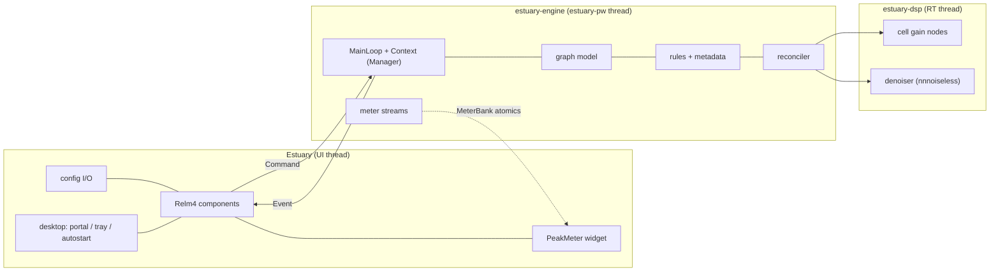
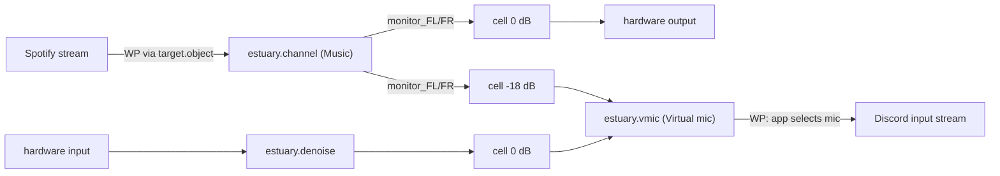

# Estuary: Audio Matrix & Isolator for PipeWire (master spec)

> Master spec. It defines the architecture, the cross-component **contracts (C1–C14)**, the milestone order and the system-wide acceptance criteria. Component details live in the sub-specs listed in [Sub-specs](#sub-specs). Sub-specs **cite** contracts and never redefine them. A sub-spec that needs a contract change must flag it so the master can be amended.
>
> Detail level: **high**. Target reader: a senior Rust developer or an AI agent implementing the system.
> Date: 2026-10-14. Status: reconciled with sub-specs (see [Amendment log](#amendment-log)); awaiting final review.

---

## Summary

Estuary is a Linux desktop app written in Rust (Relm4 + GTK4 + libadwaita) that runs on native PipeWire. It lets the user:

- route each application's audio to a chosen output or virtual channel;
- build virtual channels and virtual microphones;
- mix them through a source × destination matrix with a gain on every crosspoint;
- clean up microphones with RNNoise-based noise suppression;
- watch live level meters for every app, channel and device.

## Problem Statement

On a stock Linux desktop the user picks one output device and one input device, and every app shares them. Common needs are impossible or need several expert tools (pavucontrol, qpwgraph/Helvum, EasyEffects, hand-written PipeWire config):

- **Isolation.** Music goes to headphones, but not into the microphone feed sent to a call. Game audio goes to speakers while voice chat goes to the headset.
- **Sub-mixing.** "Music", "Games" and "Chat" each get one fader, plus independent send levels to each output or virtual mic. Example: music at 0 dB in the headphones but −18 dB in the stream mic.
- **Clean microphone.** Keyboard, fan and street noise are removed before the voice reaches Meet or Discord.
- **Visibility.** The user can see which app is producing sound and confirm that a route actually carries signal.

Existing tools each solve a slice of this, use different mental models, and do not share state. Sonusmix, the closest prior art, is dormant (last update 2025-11). It has no per-crosspoint gain, no noise suppression and no meters. Estuary gives one coherent "matrix" tool that keeps working in the background and survives reboots, device hotplug and PipeWire restarts.

### In scope (v1)

1. Per-app output routing: one target per app (an output device, a virtual channel, or the default), remembered by app-identity rules.
2. Virtual channels (null sinks) and virtual microphones (virtual sources).
3. A routing matrix with **per-cell gain**. Sources are channels, hardware inputs and denoised inputs. Destinations are hardware outputs and virtual mics.
4. Noise suppression per hardware input (pure-Rust RNNoise, `nnnoiseless`).
5. Level meters on every app, channel, virtual mic, device and denoised input.
6. Background mode, explicit Quit with clean teardown and a warning, start at login, tray icon where supported.
7. A first-run welcome dialog: recommended preset or empty.
8. Persistence to a versioned TOML config, and auto-rebuild after a PipeWire restart.
9. Flatpak packaging for Flathub. UI translations: English and Italian.

### Out of scope (v1)

- Parametric EQ (**v2**).
- Node-graph view of the matrix (**v2**). Node positions are already persisted (C6), so v2 needs no schema migration.
- Routing of *recording* apps, i.e. which source Discord records from. Users pick the virtual mic inside the app. Estuary only *detects* apps recording from its virtual mics (quit warning, C10).
- Channel → channel chaining, and multiple targets per app (decision R1).
- Support for WirePlumber < 0.5 or PipeWire < 1.0.
- MIDI, video and JACK-specific features.

## Solution Overview

The chosen design is **Approach A: estuary-owned Rust audio nodes.**

- **Apps** are never wired by estuary. Their target is changed the WirePlumber-sanctioned way: `target.object` in the `default` metadata. WirePlumber 0.5 then links them (decision R1).
- **Channels** are daemon-side `support.null-audio-sink` adapter nodes (`Audio/Sink`). Apps target them like any device. Their monitor ports carry the post-volume signal (`monitor.channel-volumes=true`).
- **Virtual mics** are daemon-side null-sink adapter nodes with `media.class=Audio/Source/Virtual`. Apps see them as microphones, and Estuary links cell outputs into their `input_*` ports.
- **Matrix cells** are tiny in-process DSP nodes built on `pw_filter` (stereo in → smoothed gain → stereo out). PipeWire sums multiple links arriving at one input port, so a destination naturally mixes all its cells.
- **Noise suppression** is another in-process `pw_filter` node running `nnnoiseless`.
- **Owned wiring** (source → cell → destination, input → denoiser) is created by a **reconciler**. It compares the desired setup with the live graph after every graph change and creates or destroys links idempotently. All owned nodes set `node.autoconnect=false`, so WirePlumber never links them.
- **Meters** are monitor capture streams (`stream.monitor=true`, `resample.peaks=true`). They write peak values into lock-free atomic slots that the UI reads on its frame clock.
- **Lifetime.** Nothing is `object.linger`. Every owned node dies with Estuary's PipeWire connection. That gives clean teardown on quit and no leftovers after a crash. The setup is rebuilt from config on every start and after PipeWire restarts.

**Why A.**

- The GNOME Flatpak runtimes ship neither `libpipewire-module-filter-chain` nor the `filter-graph` SPA plugins, which rules out filter-chain/LADSPA without fragile version-pinned bundling.
- pipewire-rs 0.10.1 cannot load modules in-process (`pw_context_load_module` is not bound).
- `pw_filter_*` *is* bound in `pipewire-sys` 0.10.1 (live-verified: `wrapper.h` includes `pipewire/pipewire.h`, which includes `pipewire/filter.h`, and the bindgen allowlist is `pw_.*`).
- Keeping all DSP in Rust leaves nothing to bundle, avoids version drift and stays licence-compatible (nnnoiseless is BSD-3-Clause).

## Technical Context

Greenfield project: `/home/abidibo/Dev/abidibo/amatrix` contains only `specs/`. There are no existing code conventions, so ecosystem best practices apply (Rust 2024 edition, rustfmt defaults, clippy pedantic-lite, `thiserror` for library errors, `tracing` for logs, GNOME HIG for UI).

### Live-verified on the development machine (2026-10-14)

| Fact | Value |
|---|---|
| OS / session | Pop!_OS 24.04 LTS, **GNOME Wayland** (`XDG_CURRENT_DESKTOP=GNOME`) |
| PipeWire / WirePlumber | 1.5.85 / 0.5.12 |
| GTK / libadwaita (host) | 4.14.5 / 1.5.0 → relm4 feature `gnome_46` for native builds |
| Rust | rustc 1.94.0 (relm4 0.11 MSRV is 1.93) |
| Server factories | `adapter`, `link-factory`, `metadata`, `spa-node-factory`, `client-node` |
| Metadata objects | `default`, `settings`, `sm-settings`, `schema-sm-settings`, `route-settings` |
| WP settings relevant to us | `linking.allow-moving-streams=true`, `node.stream.restore-target=true`, `node.stream.restore-props=true`, `linking.follow-default-target=true` |
| Node id vs serial | Differ (e.g. id 98 / `object.serial` 257). **Never use ids as persistent keys.** |
| `pipewire-sys` 0.10.1 | Binds `pw_filter_*`; does **not** bind `pw_context_load_module` |
| RNNoise LADSPA on host | Not installed (irrelevant under Approach A) |
| Dev headers | `libpipewire-0.3-dev`, `libgtk-4-dev`, `libadwaita-1-dev`, `clang` **not installed yet** (needed for M1) |

### Source-verified (docs and repositories, 2026-10-14)

| Fact | Source |
|---|---|
| Crate versions: `pipewire`/`libspa` 0.10.1 (MSRV 1.80), `relm4` 0.11.0 (MSRV 1.93, gtk4 ^0.11.2, libadwaita ^0.9.1), `gtk4` 0.11.5, `libadwaita` 0.9.2, `ashpd` 0.13.13, `ksni` 0.3.6, `nnnoiseless` 0.5.2 (BSD-3-Clause) | crates.io |
| pipewire-rs 0.10 types: `MainLoopRc`, `ContextRc`, `CoreRc`, `RegistryRc`, `StreamBox`/`StreamRc`, `PropertiesBox`; `Core::create_object::<P>(factory, props)`; `Metadata::set_property(subject, key, type, value)`; `Node::set_param(ParamType, flags, &Pod)`; `pipewire::channel::channel()` | docs.rs/pipewire/0.10.1, crate source |
| `ashpd` `pipewire` feature pulls `pipewire ^0.9`, which conflicts (`links = "pipewire-0.3"`). **Never enable it.** | crates.io deps |
| Flatpak clients get read/execute only unless they connect with `media.category=Manager` | WirePlumber 0.5.18 `client/find-flatpak-access.lua`; pwvucontrol `src/backend/manager.rs` |
| `target.object` numeric value = `object.serial`, string = `node.name`; `node.dont-move` disables retargeting | WirePlumber `linking/find-defined-target.lua` |
| `node.dont-reconnect=true` → a stream is never relinked once its target is gone. **Must not be used.** | WirePlumber `linking/prepare-link.lua` |
| `stream.monitor=true` implies `resample.peaks=true`: the stream receives peak values instead of audio | PipeWire 1.6.9 `src/pipewire/stream.c`; pwvucontrol `src/ui/levelprovider.rs` |
| WirePlumber will **not** auto-link playback streams to `Audio/Source/Virtual` nodes (they must be linked manually) | PipeWire wiki "Virtual Devices"; WP `canLink` |
| GNOME runtimes 49/50/51 exclude filter-chain and filter-graph from the runtime | freedesktop-sdk `pipewire-base.bst` |
| COSMIC has no Background portal (issue pop-os/xdg-desktop-portal-cosmic#49 open), but serves `org.kde.StatusNotifierWatcher` | pop-os repos |
| Sonusmix (MPL-2.0, Relm4 + pipewire-rs) handles foreign link changes by "locking" (re-creating or removing links on graph change). Reference for the reconciler idea only; no code reuse. | codeberg.org/sonusmix/sonusmix |

### Reference projects (study only, never copy GPL code)

- **pwvucontrol** (GPL-3.0-or-later): meter streams (`src/ui/levelprovider.rs`, `src/ui/peakmeter.rs`), Manager category.
- **Helvum** (GPL-3.0): custom GTK4 graph widget, relevant for v2.
- **EasyEffects** (GPL-3.0): `pw_filter`-based effect nodes.
- **Sonusmix** (MPL-2.0): Relm4 app structure, link locking.

---

## Contracts

Contracts are binding for all sub-specs. Identifiers in `code` are normative.

### C1. Workspace and crate layout

```
estuary/
├── Cargo.toml                 # [workspace], resolver = "3"
├── rust-toolchain.toml        # channel = "stable"
├── rustfmt.toml               # edition = "2024"
├── clippy.toml
├── LICENSE-MIT
├── LICENSE-APACHE
├── crates/
│   ├── estuary-dsp/           # lib: safe pw_filter wrapper + DSP processors (unsafe confined here)
│   ├── estuary-engine/        # lib: PipeWire thread, graph model, routing, reconciler, meters, setup types
│   └── estuary/               # bin: Relm4 UI, config I/O, desktop integration
├── data/                      # .desktop, metainfo, icons, gschema (none planned), po/
├── build-aux/                 # Flatpak manifest(s)
└── specs/
```

Note: the architecture visual named the DSP crate `estuary-pwfilter`. It is renamed `estuary-dsp` to match its sub-spec.

Workspace-wide settings (root `Cargo.toml`):

```toml
[workspace]
resolver = "3"
members = ["crates/estuary-dsp", "crates/estuary-engine", "crates/estuary"]

[workspace.package]
version = "0.1.0"
edition = "2024"
rust-version = "1.93"
license = "MIT OR Apache-2.0"
repository = "https://github.com/abidibo/estuary"

[workspace.dependencies]
pipewire      = "0.10.1"
libspa        = "0.10.1"
libspa-sys    = "0.10.1"
pipewire-sys  = "0.10.1"
relm4         = { version = "0.11.0", default-features = false, features = ["libadwaita", "gnome_46", "macros"] }
gtk           = { package = "gtk4", version = "0.11.5", features = ["v4_14"] }
adw           = { package = "libadwaita", version = "0.9.2", features = ["v1_5"] }
ashpd         = { version = "0.13.13", default-features = false, features = ["tokio", "background"] }  # NEVER enable "pipewire"
ksni          = "0.3.6"
nnnoiseless   = { version = "0.5.2", default-features = false }   # defaults pull clap/hound/anyhow/dasp
rubato        = "5.0.1"  # resampling around the denoiser; API per estuary-dsp M10.2
log           = { version = "0.4", features = ["release_max_level_debug"] }  # compiles out rubato RT-path trace! in release
sha2          = "0.11"   # cell/denoiser node-name hashes (C5)
async-channel = "2"
serde         = { version = "1", features = ["derive"] }
toml          = "1"
thiserror     = "2"
tracing       = "0.1"
tracing-subscriber = { version = "0.3", features = ["env-filter"] }
uuid          = { version = "1", features = ["v4", "serde"] }
gettext-rs    = { version = "0.8", features = ["gettext-system"] }
```

Dependency direction: `estuary` → `estuary-engine` → `estuary-dsp`. `estuary-dsp` and `estuary-engine` **must not** depend on gtk, relm4 or libadwaita. The minimum GTK/libadwaita feature flags (`v4_14`, `v1_5`, `gnome_46`) follow the dev machine. The Flatpak runtime (C14) is newer and satisfies them. Exact patch versions above are minimums; sub-specs may bump patch levels and must not bump minor versions without amending this contract.

`unsafe` code is allowed **only** in `estuary-dsp` (pw_filter FFI) and must sit behind a safe API. `estuary-dsp` uses `#![deny(unsafe_code)]` with local `#[allow(unsafe_code)]` on its FFI modules. `estuary-engine` and `estuary` use `#![forbid(unsafe_code)]`.

**Panic strategy (amended):** every profile keeps `panic = "unwind"`. `panic = "abort"` is forbidden, because F5 (engine `catch_unwind`) and DSP panic isolation (C11) depend on unwinding. Panics must never unwind across `extern "C"` callbacks: pipewire-rs listener bodies are wrapped by the engine's `guarded()` helper, and `pw_filter` callbacks by `catch_unwind` in `estuary-dsp`.

**Build-time inputs (amended):** `ESTUARY_LOCALEDIR` (gettext catalog directory; plain `cargo run` falls back to `target/locale`) and `ESTUARY_PROFILE` (`default` | `devel`; devel adds the `devel` style class only, with the same app ID and the same PipeWire `application.id`).

### C2. Threading model

| Thread | Owner | Runs | Rules |
|---|---|---|---|
| UI (main) | `estuary` | GTK main loop, Relm4 components, config I/O, portal and tray futures (tokio runtime managed by relm4) | Never touches PipeWire objects |
| Engine (`estuary-pw`) | `estuary-engine` | `pipewire::main_loop::MainLoopRc`, context, core, registry, every proxy and listener, every `FilterNode` and meter `StreamBox` | The only thread that creates or destroys PipeWire objects. Not `Send`, so it never leaves the thread |
| PipeWire data/RT threads | libpipewire | `pw_filter` process callbacks (`PW_FILTER_FLAG_RT_PROCESS`) and meter stream process callbacks | No allocation, no locks, no syscalls, no logging. Communicate **only** through atomics (C9, C11) |

- **UI → engine:** `pipewire::channel::Sender<Command>`, attached to the engine loop.
- **Engine → UI:** `async_channel::Sender<Event>` (unbounded). The UI forwards events into its root component with `relm4::spawn_local` + `sender.input(AppMsg::Engine(ev))`.
- **Meters:** `Arc<MeterBank>` (C9), shared read-only by the UI. No channel traffic per meter update.
- **DSP control:** `Arc` handles to atomics created by the engine (C11), with no channel traffic per gain change.

### C3. Engine public API

Crate `estuary-engine`, module root:

```rust
pub struct EngineConfig {
    pub app_id: &'static str,          // "io.github.abidibo.Estuary"
    pub app_name: &'static str,        // "Estuary" (PipeWire application.name)
    pub reconnect_backoff: Backoff,    // default: 500 ms → ×2 → max 5 s
}

pub struct Engine { /* cmd sender, join handle, meters */ }

impl Engine {
    /// Spawns the engine thread and starts connecting. Never blocks on PipeWire availability.
    pub fn start(cfg: EngineConfig) -> Result<(Engine, async_channel::Receiver<Event>), EngineError>;
    pub fn send(&self, cmd: Command) -> Result<(), EngineError>;   // Err only if the engine thread is gone
    pub fn meters(&self) -> Arc<MeterBank>;
    /// Stops the loop, drops all PipeWire objects (owned nodes die with the connection), joins the thread.
    pub fn shutdown(self, timeout: Duration) -> Result<(), EngineError>;
}

pub enum Command {
    /// Full desired state. Idempotent. The engine diffs against the previous Setup and reconciles.
    SetSetup(Setup),
    // Fast paths: no reconcile, also folded into the engine's copy of the current Setup.
    SetCellGain { cell: CellKey, gain_db: f32 },
    SetChannelVolume { id: ChannelId, volume: Volume },
    SetVirtualMicVolume { id: VirtualMicId, volume: Volume },
    SetDeviceVolume { key: DeviceKey, volume: Volume },
    SetAppVolume { app: AppKey, volume: Volume },       // applied to every stream in the group; not persisted (WP restores it)
    SetVadGate { input: DeviceKey, gate: f32 },         // amended: live feedback while dragging the voice-gate slider
    SetMeterTargets(Vec<MeterTarget>),                  // replaces the current subscription set (visible rows only)
    PrepareQuit,                                        // replies Event::QuitCheck
    Teardown,                                           // replies Event::TeardownComplete
}

pub enum Event {
    Connection(ConnectionState),
    Snapshot(Arc<GraphSnapshot>),                       // coalesced: at most one per 50 ms
    MeterAssignments(Vec<(MeterTarget, Vec<MeterSlotId>)>),
    ExternalRetarget { app: AppKey, target: RouteTarget },   // the UI updates the app rule (R3)
    SetupIssues(Vec<SetupIssue>),                       // after each reconcile pass that ends with problems
    Restored,                                           // setup rebuilt after a PipeWire reconnect → toast
    QuitCheck(Vec<VirtualDeviceUsage>),
    TeardownComplete,
    Warning(EngineWarning),                             // xruns, link failures, meter failures
    Fatal(EngineError),                                 // engine thread panicked or cannot continue
}

pub enum ConnectionState {
    Connecting { attempt: u32 },
    Connected { pipewire_version: String, wireplumber_version: Option<String> },
    Unsupported { reason: UnsupportedReason },          // WP missing or < 0.5, PW < 1.0
    PermissionDenied,                                   // write probe failed (F2)
    Reconnecting { since: Instant, attempt: u32 },
}
```

Auxiliary public types (amended; previously used but undefined):

```rust
#[derive(Debug, Clone, thiserror::Error)]
pub enum EngineError {
    #[error("engine thread is not running")] ThreadGone,
    #[error("engine thread panicked: {0}")] Panicked(String),
    #[error("shutdown timed out")] ShutdownTimeout,
    #[error("failed to spawn engine thread: {0}")] Spawn(String),
    #[error("pipewire error: {0}")] PipeWire(String),
}
pub enum UnsupportedReason { PipeWireTooOld { found: String }, NoWirePlumber, WirePlumberTooOld { found: Option<String> } }

/// Identity of the node a warning is about, so the UI can badge the right row/cell.
pub enum WarnedNode { Cell(CellKey), Denoiser(DeviceKey), Channel(ChannelId), VirtualMic(VirtualMicId), Device(DeviceKey) }
pub enum EngineWarning {
    Xruns { node: WarnedNode, per_minute: u32 },
    LinkFailed { cell: Option<CellKey>, description: String, message: String },
    NodeCreateFailed { node: WarnedNode, message: String },
    MeterFailed(MeterTarget),
    VolumeWriteFailed { node: WarnedNode },
    DenoiseRateUnsupported { input: DeviceKey, rate: u32 },
}
pub enum SetupIssue {
    DuplicateId(String),
    DanglingReference { what: String, missing: String },
    DuplicateCell(String),
    InvalidGain { cell: String, value: f32 },
    MissingKnownDevice(DeviceKey),
    DenoisedWithoutDenoiser(DeviceKey),
    CellFailed { cell: CellKey, message: String },     // runtime: 3 consecutive failures (C8)
}
impl SetupIssue {
    pub fn key(&self) -> String;                       // stable de-duplication key (UI toasts)
    pub fn cell(&self) -> Option<&CellKey>;
    pub fn message(&self) -> String;                   // English text; the UI wraps known variants in gettext
}
pub struct VirtualDeviceUsage { pub app_display_name: String, pub device_name: String, pub kind: UsageKind }
pub enum UsageKind { PlayingToChannel, RecordingFromVirtualMic }
pub struct Backoff { pub initial: Duration, pub factor: u32, pub max: Duration }   // Default: 500 ms, ×2, 5 s
```

Semantics:

- **Startup.** The engine emits `Connection(Connecting)` immediately. After the registry's initial sync (core `done` for a `sync` issued after binding) it runs the capability checks (C13), then emits `Connected` and the first `Snapshot`. Until the first `SetSetup` arrives the engine is read-only: it creates no objects and writes no metadata (apart from the C13 probe).
- **`SetSetup`** may arrive at any time, including before `Connected`. The engine keeps the latest one and applies it when connected.
- **Reconnects.** On PipeWire disconnect the engine emits `Reconnecting`, retries with backoff, re-applies the latest Setup on reconnect, and then emits `Restored`. `Restored` is never emitted for the initial connection.
- **Banner.** The UI shows a banner with Retry when `Reconnecting.since` is more than 30 s old (F4).

### C4. Model types (identity and snapshot)

Crate `estuary-engine`, module `model`. All types are `Clone + Debug + PartialEq`. Persisted types are also `Serialize + Deserialize`. Enum variants that carry data are **struct variants** (`RouteTarget::Device { key }`, `RouteTarget::Channel { id }`, `MatrixSource::Channel { id }` / `Input { key }` / `Denoised { key }`, `MatrixDest::Output { key }` / `VirtualMic { id }`), because serde's internally tagged form used by C6 (`{ kind = "channel", id = "…" }`) can't serialize tuple variants holding strings (amended at M2). Identity types (`AppKey`, `DeviceKey`, `ChannelId`, `VirtualMicId`, `RouteTarget`, `MatrixSource`, `MatrixDest`, `CellKey`, `MeterTarget`, `WarnedNode`) are additionally `Eq + Hash` (amended: used as map keys by the UI and engine).

```rust
/// Stable application identity (C7). Serialized as a plain string: "bin:spotify", "name:Firefox".
pub struct AppKey(String);

/// Stable device identity: the device node's `node.name` (stable across reboots for ALSA/BlueZ nodes).
pub struct DeviceKey(String);

pub struct ChannelId(uuid::Uuid);      // serialized as hyphenated string
pub struct VirtualMicId(uuid::Uuid);

pub enum RouteTarget { Default, Device(DeviceKey), Channel(ChannelId) }

pub enum MatrixSource {
    Channel(ChannelId),
    Input(DeviceKey),        // hardware capture device
    Denoised(DeviceKey),     // output of the denoiser attached to that input
}

pub enum MatrixDest {
    Output(DeviceKey),       // hardware playback device
    VirtualMic(VirtualMicId),
}

pub struct CellKey { pub source: MatrixSource, pub dest: MatrixDest }

/// Linear per-channel volume as used by PipeWire `channelVolumes`, plus mute.
pub struct Volume { pub channels: Vec<f32>, pub muted: bool }

pub struct GraphSnapshot {
    pub apps: Vec<AppGroup>,                 // playback streams only (Stream/Output/Audio), grouped by AppKey
    pub outputs: Vec<DeviceInfo>,            // all non-estuary Audio/Sink nodes (hardware and foreign virtual, e.g. EasyEffects), present and known-offline (C6 known_devices)
    pub inputs: Vec<DeviceInfo>,             // all non-estuary Audio/Source and Audio/Source/Virtual nodes, present and known-offline
    pub channels: Vec<ChannelState>,
    pub virtual_mics: Vec<VirtualMicState>,
    pub denoisers: Vec<DenoiserState>,
    pub cells: Vec<CellState>,
    pub default_output: Option<DeviceKey>,
    pub default_input: Option<DeviceKey>,
}

pub struct AppGroup {
    pub key: AppKey,
    pub display_name: String,                // application.name, else binary, else node.description
    pub icon_name: Option<String>,           // application.icon-name
    pub streams: Vec<StreamInfo>,
    pub current_target: RouteTarget,         // resolved from the actual links/metadata of the first stream
    pub movable: bool,                       // false if any stream has node.dont-move=true (F7)
    pub volume: Volume,                      // of the first stream
}

pub struct StreamInfo { pub node_id: u32, pub serial: u64, pub media_name: Option<String> }

pub struct DeviceInfo {
    pub key: DeviceKey,
    pub description: String,                 // node.description / node.nick
    pub present: bool,                       // false → keep-and-restore offline column (F10)
    pub channels: u32,
    pub volume: Option<Volume>,              // None when offline
}

pub struct ChannelState    { pub id: ChannelId, pub name: String, pub present: bool, pub volume: Volume }
pub struct VirtualMicState { pub id: VirtualMicId, pub name: String, pub present: bool, pub volume: Volume,
                             pub recording_apps: Vec<String> }   // display names of apps linked to it
pub struct DenoiserState   { pub input: DeviceKey, pub enabled: bool, pub active: bool, pub xruns: u64 }

pub struct CellState { pub key: CellKey, pub gain_db: f32, pub enabled: bool, pub status: CellStatus }
pub enum CellStatus { Active, Pending, SourceMissing, DestinationMissing, Error(String) }
```

Ordering: `apps` by `display_name` (case-insensitive). Devices by `description`. Channels, mics and cells in Setup order.

### C5. PipeWire object conventions

All owned objects carry `estuary.role` (a custom property), `estuary.instance = <per-process UUID>` (also set on the client connection), and a `node.name` with the prefix `estuary.`. An object is owned **iff** its `node.name` has the prefix **and** (its `client.id` equals Estuary's client id **or** its `estuary.instance` equals the current instance). The instance check covers daemon-side adapter nodes whose `client.id` may not be reported. Foreign `estuary.*` names, such as a second instance, are ignored.

**Rename (amended):** adapter properties are immutable after creation, so renaming a channel or virtual mic destroys and recreates its node. Rules and cells re-apply automatically through C7/C8. The audible gap for apps on that channel is accepted, since renames are rare.

**Client connection** (`ContextRc::connect_rc(Some(props))`):

```
application.name = "Estuary"
application.id   = "io.github.abidibo.Estuary"
media.category   = "Manager"          # mandatory: Flatpak write access (verified)
```

**Channel** (`core.create_object::<Node>("adapter", props)`):

```
factory.name            = "support.null-audio-sink"
node.name               = "estuary.channel.<uuid-simple>"
node.description        = "<user name>"
media.class             = "Audio/Sink"
audio.position          = "[ FL FR ]"
monitor.channel-volumes = "true"      # monitor ports carry the post-volume signal → channel fader affects all sends
monitor.passthrough     = "true"
node.virtual            = "true"
object.linger           = "false"
estuary.role            = "channel"
```

**Virtual mic**: same factory and keys, except:

```
node.name    = "estuary.vmic.<uuid-simple>"
media.class  = "Audio/Source/Virtual"   # input_FL/FR (linked by estuary) + capture_FL/FR (apps record)
estuary.role = "vmic"
```

**Cell node** (`estuary_dsp::FilterNode`, C11):

```
node.name          = "estuary.cell.<cell-hash>"   # cell-hash = first 12 hex chars of SHA-256 over the canonical CellKey string (C6 form)
node.description   = "Estuary send: <source> → <dest>"
media.type         = "Audio"
media.category     = "Filter"
media.role         = "DSP"
node.autoconnect   = "false"
node.passive       = "true"          # see UNVERIFIED-1
estuary.role       = "cell"
ports: input_FL, input_FR, output_FL, output_FR   (audio.channel = FL / FR, format "32 bit float mono audio")
```

**Denoiser node**: same as a cell except `node.name = "estuary.denoise.<input-hash>"` and `estuary.role = "denoise"`. Ports are the same four.

**Links** (`core.create_object::<Link>("link-factory", props)`):

```
link.output.node = "<node id>"    link.output.port = "<port id>"
link.input.node  = "<node id>"    link.input.port  = "<port id>"
link.passive     = "true"         # for links touching a cell or denoiser; see UNVERIFIED-1
object.linger    = "false"
estuary.role     = "link"
```

**Port matching rule.** Match by `audio.channel`. If one side is `MONO`, link it to both `FL` and `FR` of the other side. If a device has more than two channels, link only `FL`/`FR` (front pair). If a node has no `FL`/`FR` ports but has `AUX0`/`AUX1`, treat `AUX0` as `FL` and `AUX1` as `FR` (amended). Port roles per object:

| Object | Ports used as source | Ports used as sink |
|---|---|---|
| Channel | `monitor_FL/FR` (port.monitor=true) | (apps, via WP) |
| Hardware input | `capture_*` | none |
| Denoiser | `output_FL/FR` | `input_FL/FR` ← hardware input `capture_*` |
| Cell | `output_FL/FR` | `input_FL/FR` |
| Hardware output | none | `playback_*` |
| Virtual mic | (apps record `capture_*`) | `input_FL/FR` |

**App retargeting** (decision R1): on the `default` metadata, subject = stream node id, key `target.object`, type `"Spa:Id"`, value = target node's current `object.serial` as a decimal string. `RouteTarget::Default` deletes the key (`set_property(id, "target.object", None, None)`). The engine records every value it writes so it can tell its own writes from external ones (C7).

**Meter stream** (`pipewire::stream::StreamBox`, `Direction::Input`, flags `AUTOCONNECT | MAP_BUFFERS | RT_PROCESS`, never `DONT_RECONNECT`):

```
node.name          = "estuary.meter.<slot>"
media.type         = "Audio"
media.category     = "Capture"
media.role         = "DSP"
stream.monitor     = "true"           # implies resample.peaks=true (verified)
resample.peaks     = "true"
node.rate          = "1/25"
node.latency       = "1/25"
node.passive       = "true"
target.object      = "<target serial>"
stream.capture.sink= "true"           # only when the target is an Audio/Sink (channel or hardware output)
application.id     = "org.PulseAudio.pavucontrol"   # keeps GNOME Shell's recording indicator off; same approach as pwvucontrol (UNVERIFIED-3)
estuary.role       = "meter"
format: F32LE, channels = 2 (FL, FR), rate = 50
```

**Denoised meters (amended):** meter streams whose target is `MeterTarget::Denoised` are created with `node.autoconnect=false`, without the `AUTOCONNECT` flag and without `target.object`. Their links (denoiser `output_FL/FR` → meter inputs) are created by the reconciler and belong to the desired set (C8). This removes the conflict with C8's rule of destroying undesired links on DSP nodes.

**Forbidden properties** on anything Estuary creates: `node.dont-reconnect` (verified: prevents relinking forever) and `object.linger=true` (contradicts the lifecycle decision).

### C6. Configuration schema v1

Persisted desired state. The types live in `estuary_engine::setup` (serde), so the engine consumes exactly what is persisted. File I/O lives in `estuary::config` (C12).

```toml
schema_version = 1

[settings]
close_action = "hide"              # "hide" | "quit"
start_at_login = true
background_notice_shown = false
first_run_done = true

[[channels]]
id = "5f0c7c2e-1a2b-4c3d-9e8f-001122334455"
name = "Music"
volume = { channels = [1.0, 1.0], muted = false }
position = { x = 120.0, y = 80.0 } # optional; reserved for the v2 graph view

[[virtual_mics]]
id = "8a1d..."
name = "Virtual mic"
volume = { channels = [1.0, 1.0], muted = false }
position = { x = 520.0, y = 300.0 } # optional

[[denoisers]]
input = "alsa_input.pci-0000_00_1f.3.analog-stereo"   # DeviceKey
enabled = true
vad_gate = 0.0                     # 0.0 = off; 0.0–0.95: mute frames whose voice probability < gate

[[cells]]
source = { kind = "channel", id = "5f0c7c2e-..." }    # kind: channel{id} | input{key} | denoised{key}
dest   = { kind = "output", key = "bluez_output.88_0E_85_5C_98_1B.1" }   # kind: output{key} | virtual_mic{id}
gain_db = -18.0                    # clamp [-60.0, +6.0]
enabled = true

[[app_rules]]
app = "bin:spotify"
target = { kind = "channel", id = "5f0c7c2e-..." }    # kind: default | device{key} | channel{id}
display_name = "Spotify"           # last seen, for showing rules of apps not currently running

[[known_devices]]                  # keep-and-restore (F10); removed by "Forget device"
key = "bluez_output.88_0E_85_5C_98_1B.1"
kind = "output"                    # "output" | "input"
description = "WH-1000XM4"
position = { x = 800.0, y = 80.0 } # optional

[[known_devices]]                  # the denoiser's input above must be known too (invariant below; example fixed at M6)
key = "alsa_input.pci-0000_00_1f.3.analog-stereo"
kind = "input"
description = "Built-in Microphone"
```

Rust shape:

```rust
pub struct Setup {
    pub channels: Vec<ChannelDef>,
    pub virtual_mics: Vec<VirtualMicDef>,
    pub denoisers: Vec<DenoiserDef>,
    pub cells: Vec<CellDef>,
    pub app_rules: Vec<AppRule>,
    pub known_devices: Vec<KnownDevice>,
}
pub struct ConfigFile { pub schema_version: u32, pub settings: Settings, #[serde(flatten)] pub setup: Setup }
```

Invariants (validated on load and before every `SetSetup`; violations are `SetupIssue`s, never panics):

- ids are unique;
- a cell references an existing channel, mic, `known_device` or denoiser;
- a `denoised{key}` source requires a `[[denoisers]]` entry for `key`;
- at most one cell per `CellKey`;
- `gain_db` is finite and clamped;
- every device referenced anywhere also appears in `known_devices`. The UI adds it automatically when a cell or rule first references it.

**Canonical CellKey string** (for hashing and logs): `"<source-kind>:<source-id-or-key>-><dest-kind>:<dest-id-or-key>"`.

**Evolution.** New optional fields may be added without bumping `schema_version`, using `#[serde(default)]`. Per-cell gain is already present (R2). Graph positions are already present (R4). EQ in v2 will add optional `[[eq]]` tables.

### C7. App identity and rules

`AppKey` derivation, in order, from a playback stream's properties:

1. `application.process.binary`, lower-cased, if present **and not** in the generic-binary list → `"bin:<binary>"`.
   Generic binaries: `python`, `python3`, versioned `python3.N` (amended), `java`, `node`, `electron`, `wine`, `wine64`, `wine-preloader`, `wine64-preloader`, `bwrap`, `flatpak-spawn`, `pw-play`, `pw-cat`, `paplay`, `aplay`, `gst-launch-1.0`.
2. `application.name` → `"name:<application.name>"` (case preserved).
3. `node.name` → `"node:<node.name>"`.

Excluded from `apps` entirely: streams owned by Estuary (C5); streams with `stream.monitor=true`; `media.class` other than `Stream/Output/Audio`; and streams whose `node.name` starts with `estuary.`.

Rules (decision R3):

- **New stream.** When a stream appears and has finished its initial WP linking (first link observed, or 500 ms elapsed), the engine looks up `app_rules[app]`. If the rule exists and its target is present, the engine writes `target.object` (C5) when the current target differs. If the target is absent (offline device, channel not yet created), no write happens: WP keeps the stream on default and the rule is retried when the target appears.
- **Rule change** (via `SetSetup`): applied immediately to every live stream of that app.
- **External change.** A `default` metadata update for a stream subject whose value differs from the last value the engine wrote is external, as is a change to the stream's actual output link to a different target when the metadata is absent. Amended narrowing: metadata writes for a stream **before it is settled** (first link observed or 500 ms) are never external, and link-based detection applies only when the rule target is not `Default` **and** the new link target is neither the rule target nor the current default sink. Following the default sink is never treated as external. The engine maps the new target to a `RouteTarget` (or `Default` if it is unknown or foreign) and emits `ExternalRetarget`. The UI updates the rule and sends `SetSetup`. The engine does **not** re-apply the old rule in between, which prevents ping-pong.
- **Unmovable.** Streams with `node.dont-move=true` are never written (F7).
- **Deleted channel** with apps targeting it: the UI rewrites those rules to `Default` in the same `SetSetup` that removes the channel and shows a toast (F6).

### C8. Reconciler ownership rule

The reconciler manages **only** objects and links in the *owned set*:

- owned nodes (C5);
- links where **both** ends are in {owned nodes, hardware devices referenced by the desired cells or denoisers} **and** at least one end is an owned node.

Within that set, after every relevant graph change (debounced 30 ms):

- **Desired link missing** (both ports present) → create it.
- **Present link not desired**, where one end is a cell or denoiser node → destroy it (F9: undoes WP or foreign tampering with owned DSP nodes).
- **Desired node missing** → create it. **Present owned node not desired** → destroy it.
- **Never touched:** app-stream → channel links (WP's), virtual-mic → recording-app links, links between foreign nodes, and links from foreign nodes into channel sinks.

**Disabled cells (amended):** only cells with `enabled=true` are in the desired set. A disabled cell has no node. Disabling ramps its gain to −60 dB and destroys the node 50 ms later. Enabling creates the node at −60 dB and ramps to `gain_db`. Disabled cells stay in the Setup with their stored gain and are still reported in `GraphSnapshot.cells` (status irrelevant, `enabled=false`).

**Denoised meter links** (C5 amendment) are part of the desired set while the meter subscription exists.

Reconciliation is idempotent and level-triggered (it recomputes from scratch). Pending creations are tracked by proxy, so the same link is never requested twice while one is in flight. A failed creation is retried on the next pass, with at most 3 consecutive failures per item before it is marked `CellStatus::Error`.

### C9. Meter data path

```rust
pub const METER_SLOTS: usize = 64;

pub struct MeterBank { slots: Box<[MeterSlot; METER_SLOTS]> }
pub struct MeterSlot {
    peak: [AtomicU32; 2],     // f32 bits, linear amplitude 0.0..=1.0+ (FL, FR); writer: RT thread
    seq: AtomicU32,           // incremented on every write; reader detects staleness
}
pub struct MeterSlotId(u16);

pub struct MeterReading { pub seq: u32, pub peak: [f32; 2] }
impl MeterBank {
    /// UI-side read (amended): `seq` with Acquire, then peaks with Relaxed. Slot fields stay private.
    pub fn read(&self, id: MeterSlotId) -> MeterReading;
}

pub enum MeterTarget { App(AppKey), Device(DeviceKey), Channel(ChannelId), VirtualMic(VirtualMicId), Denoised(DeviceKey) }
```

- The engine allocates one slot per metered *node*. An `App` target gets one slot per stream, and the UI displays the max across them.
- The process callback writes the **max of all samples per channel** in the received buffer (peak values) with `Ordering::Relaxed`, then bumps `seq` (`Release`).
- The UI reads on the GTK frame clock (`add_tick_callback`): `seq` (`Acquire`), then peaks. Display ballistics (UI-side): instant attack, 20 dB/s release, 1.5 s peak hold. Colors: < −12 dBFS normal, −12…−3 warning, > −3 (or peak ≥ 1.0) clip.
- If `seq` does not change for 500 ms, the UI decays to silence. A failed meter is reported as `Warning(MeterFailed(target))` and the UI shows "—" (F13).
- The subscription set (`SetMeterTargets`) contains only rows visible on screen, at most 64 slots. When there are more, the lowest-priority targets (scrolled-off first) get no slot.

### C10. Lifecycle

**Startup** (`estuary [--background]`):

1. `adw::Application` with id `io.github.abidibo.Estuary` (GApplication single instance). A second launch activates the existing window. `--background` only means "do not present the window on this activation".
2. Load the config (C12). If the file is missing, or `first_run_done=false`, mark the welcome dialog as pending.
3. `Engine::start`, then send `SetSetup` with the loaded setup (an empty Setup if the welcome dialog is pending).
4. Present the window unless `--background`. If the welcome dialog is pending, show it modally, then build the preset or empty Setup, send `SetSetup`, set `first_run_done=true` and save.

**Recommended preset** (welcome dialog):

- channels "Music", "Games", "Chat" (localized), and one virtual mic "Virtual mic";
- cells: each channel → current default output at 0 dB;
- if a default input exists: a denoiser on it, enabled, plus a cell `denoised(default_input)` → "Virtual mic" at 0 dB;
- no app rules.

**Window close (✕).**

- `close_action=hide`: if `background_notice_shown=false`, first show a one-time `adw::AlertDialog` ("estuary keeps running in the background so your audio keeps working. Use Quit to stop it.") **while the window is still visible** (a dialog on a hidden window is invisible), set the flag on response, then hide the window. Otherwise hide immediately.
- `close_action=quit`: run Quit.
- **Background permission denied (amended):** when running sandboxed and the Background portal answered `run_in_background=false`, ✕ acts as Quit regardless of `close_action`, with a one-time-per-session explanation. Otherwise the portal would kill the hidden app.

**Ownership of the lifecycle code (amended):** the desktop sub-spec owns the decision logic: `decide_close()`, the pure `QuitController` state machine, its effect executor and `finish()`. The UI sub-spec owns the dialogs those effects present (background notice, quit confirmation, background-denied notice), the preset and the preferences page. Exactly one quit state machine exists (`desktop/quit.rs`).

**Quit** (menu, `Ctrl+Q`, tray, or the Background portal stop):

1. `Command::PrepareQuit`, which replies `QuitCheck(usages)`. A `VirtualDeviceUsage` (C3) is either an app stream linked to an Estuary channel (`PlayingToChannel`), or a recording stream linked to an Estuary virtual mic (`RecordingFromVirtualMic`). If no reply arrives within **1 s**, quitting continues as if the list were empty (fail-open, amended). If the engine is absent or not connected, steps 1–3 are skipped.
2. If `usages` is non-empty, show an `adw::AlertDialog` listing them ("Discord is using 'Virtual mic'. Quitting will switch it back to your default microphone."), with Cancel / Quit.
3. `Command::Teardown`. The engine clears `target.object` for every stream it targeted at an owned node, destroys cells, denoisers, virtual mics and channels in that order, waits for a core `sync`, then emits `TeardownComplete`. Timeout: 2 s (F17).
4. `Engine::shutdown(1 s)`, flush the config, drop the hold guard, shut down the tray, then `app.quit()`.

**Signals (amended):** SIGTERM and SIGINT start Quit **without** the confirmation dialog (a dialog that's already open is closed). A second signal during an in-flight quit finishes immediately.

**Start at login (amended).**

- **Sandboxed (Flatpak):** Background portal only, with `auto_start=true` and command `["estuary", "--background"]`. The Flatpak build has **no** autostart-directory permission, because Flathub does not grant `xdg-config/autostart` and its linter points to the portal. Where no Background portal exists (COSMIC today), start at login is shown as **unavailable** in Preferences, with an explanation. The tray still works there.
- **Native builds:** always an XDG autostart file `$XDG_CONFIG_HOME/autostart/io.github.abidibo.Estuary.desktop` (`Exec=estuary --background`) carrying the marker key `X-Estuary-Autostart=true`. The Background portal only works for sandboxed apps. Estuary never modifies or deletes an autostart file without the marker.

### C11. DSP node interface (`estuary-dsp`)

```rust
pub const MAX_QUANTUM: usize = 8192;

/// Realtime processor. Called on the PipeWire RT thread. MUST NOT allocate, lock, block or log.
pub trait Processor: Send + 'static {
    /// `inputs[i]` / `outputs[i]` are mono f32 DSP buffers of `n_samples` frames at `rate` Hz.
    /// Missing/unlinked input buffers are passed as silence; outputs must always be fully written.
    /// Guarantee (amended): `1 <= n_samples <= MAX_QUANTUM` and `rate > 0`; FilterNode chunks larger quanta.
    fn process(&mut self, inputs: &[&[f32]], outputs: &mut [&mut [f32]], n_samples: usize, rate: u32);
    /// Called once by FilterNode::new before connect (amended).
    fn attach_stats(&mut self, _stats: Arc<NodeStats>) {}
}

pub struct NodeStats {                 // all fields amended except xruns / processed_blocks
    pub xruns: AtomicU64,              // cycles whose own processing time exceeded the quantum period (n / rate)
    pub processed_blocks: AtomicU64,
    pub max_process_ns: AtomicU64,     // engine may reset with store(0)
    pub poisoned: AtomicBool,          // a panic occurred; node outputs silence until the engine recreates it
    pub underruns: AtomicU64,          // denoiser output FIFO underruns (should stay 0)
    pub unsupported_rate: AtomicU32,   // last graph rate the denoiser could not handle (0 = none) → bypass
}

pub enum FilterState { Unconnected, Connecting, Paused, Streaming, Error(String) }   // amended

pub struct PortSpec { pub name: &'static str, pub channel: &'static str }   // e.g. ("input_FL", "FL")
// Guarantee (amended): the props passed to FilterNode::new appear unchanged in the node's registry info
// (so estuary.role / estuary.instance are visible), and every port carries port.name = PortSpec.name,
// audio.channel = PortSpec.channel and format.dsp = "32 bit float mono audio".

pub struct FilterNode { /* owns pw_filter*, listener hook, boxed processor; !Send */ }

impl FilterNode {
    /// Must be called on the engine thread. Connects with PW_FILTER_FLAG_RT_PROCESS.
    pub fn new<P: Processor>(core: &pipewire::core::Core, name: &str, props: pipewire::properties::PropertiesBox,
                             inputs: &[PortSpec], outputs: &[PortSpec], processor: P) -> Result<FilterNode, DspError>;
    pub fn node_id(&self) -> Option<u32>;          // available after the filter reaches the Paused/Streaming state
    pub fn state(&self) -> FilterState;
    pub fn stats(&self) -> Arc<NodeStats>;
    /// Amended: called on the engine thread on every state change, with node_id once known.
    pub fn set_state_listener(&self, f: impl FnMut(&FilterState, Option<u32>) + 'static);
}   // Drop: pw_filter_disconnect + pw_filter_destroy on the engine thread (synchronous)

// Amended convenience constructors (preferred by the engine; the denoiser variant also publishes ProcessLatency):
pub const STEREO_IN: [PortSpec; 2];  pub const STEREO_OUT: [PortSpec; 2];
pub fn new_gain_node(core: &Core, name: &str, props: PropertiesBox, initial_db: f32) -> Result<(FilterNode, GainHandle), DspError>;
pub fn new_denoiser_node(core: &Core, name: &str, props: PropertiesBox) -> Result<(FilterNode, DenoiseHandle), DspError>;
pub fn latency_frames(rate: u32) -> usize;

pub struct GainHandle(Arc<AtomicU32>);             // target linear gain (f32 bits); cloneable
impl GainHandle { pub fn set_db(&self, db: f32); pub fn set_linear(&self, g: f32); pub fn linear(&self) -> f32; }
pub fn gain_processor(initial_db: f32) -> (GainProcessor, GainHandle);   // 2 in / 2 out, starts at initial_db (no ramp), ~10 ms linear ramp on changes

pub struct DenoiseHandle { pub enabled: Arc<AtomicBool>, pub vad_gate: Arc<AtomicU32> }
impl DenoiseHandle { pub fn set_enabled(&self, on: bool); pub fn set_vad_gate(&self, g: f32); }   // gate clamped 0.0..=0.95
pub fn denoise_processor() -> (DenoiseProcessor, DenoiseHandle);
// 2 in / 2 out: downmix (L+R)/2 → resample to 48 kHz if rate != 48000 → nnnoiseless 480-frame blocks
// (samples scaled to ±32768) → resample back → identical signal on both outputs.
// enabled=false → delayed passthrough of the downmix (same latency, crossfaded toggle, no clicks).
// Supported graph rates (amended): 8, 11.025, 16, 22.05, 24, 32, 44.1, 48, 88.2, 96, 176.4, 192 kHz; resamplers prebuilt off-RT.
// Other rates → bypass + NodeStats.unsupported_rate.
```

Latency budget (amended): a cell adds 0 samples. The denoiser adds `DENOISE_BLOCK + NN_DELAY` frames at 48 kHz, expected 960 frames = **20 ms** (RNNoise's own algorithmic delay of 480 samples on top of the 480-frame block; `NN_DELAY` is measured and pinned by a test). This is constant whether enabled or bypassed. At other graph rates the resampler delays add to it, expected ≈ 30–35 ms at 44.1 kHz.

### C12. Config I/O (`estuary::config`)

- **Path:** `glib::user_config_dir()/estuary/config.toml`. Under Flatpak this resolves to `~/.var/app/io.github.abidibo.Estuary/config/estuary/config.toml` automatically.
- **Save:** serialize, write `config.toml.tmp`, `fsync`, rename over `config.toml`. Debounced 500 ms after the last change, and flushed synchronously on Quit. On failure: keep the in-memory state, show a toast, retry on the next change (F15).
- **Load:**
  - missing → defaults plus welcome pending;
  - parse error or invariant-breaking structure → rename to `config.toml.broken-<YYYY-MM-DDTHH-MM-SS>`, start with defaults plus welcome pending, and show a notice with the file name and the error, including its line (F14);
  - `schema_version > 1` → load what is understood, set **read-only mode** (no saves, persistent banner) (F16);
  - semantic invariant violations (C6) → drop the offending entries, log them, and show one toast listing the drops. This is the only partial recovery allowed, and it is limited to dangling references.

### C13. Capability checks and errors

At connect, before `Connected`:

1. **PipeWire version** from the core info. If < 1.0 → `Unsupported(PipeWireTooOld)`.
2. **WirePlumber ≥ 0.5 (amended):** detected by the presence of the `sm-settings` metadata (introduced in WP 0.5). The WirePlumber client's version property (`application.version`, live-verified at M2.1; its `core.version` is the libpipewire version and must not be used) is informational only, used for display. If neither the WirePlumber client nor `sm-settings` is present at initial sync, wait up to 5 s before reporting `Unsupported(NoWirePlumber)`, and re-evaluate on later registry changes. A WirePlumber client without `sm-settings` → `Unsupported(WirePlumberTooOld)`.
3. **Write probe:** on the `default` metadata, `set_property(0, "estuary.probe", Some("Spa:String"), Some("1"))`, then delete it with `set_property(0, "estuary.probe", None, None)`, followed by a core `sync`. A core error for the metadata proxy before the `done` reply → `PermissionDenied` (F2). Metadata writes are the narrowest permission Estuary needs; node creation is exercised implicitly later and reported as `SetupIssue` on failure.

The UI maps each non-`Connected` state to a full-page `adw::StatusPage` with an explanation and, where useful, a docs link. The app remains open so it can recover on reconnect.

### C14. Packaging identity

- App ID `io.github.abidibo.Estuary`; binary `estuary`; gettext domain `estuary`; languages `en` (source) and `it`.
- Flatpak runtime (amended): `org.gnome.Platform//51` with `org.freedesktop.Sdk.Extension.rust-stable//26.08`. Flathub requires the latest runtime at submission. Helvum already uses 51.
- `finish-args` (complete; amended, the autostart filesystem permission was removed because Flathub does not grant it):
  ```
  --share=ipc  --socket=wayland  --socket=fallback-x11  --device=dri
  --filesystem=xdg-run/pipewire-0
  --talk-name=org.kde.StatusNotifierWatcher
  ```
- `--socket=pulseaudio` is **not** needed: there is no PulseAudio API usage.
- Logging: the `ESTUARY_LOG` env var (tracing `EnvFilter` syntax), default `warn,estuary=info`.

---

## Implementation Steps

Milestones are global. Each sub-spec numbers its steps `M<milestone>.<n>` so progress files line up with this table. Every milestone ends with a runnable app and passing `cargo test` / `cargo clippy -- -D warnings`.

| # | Milestone | Sub-spec(s) | Delivers | Contracts |
|---|---|---|---|---|
| M1 | Workspace scaffold | packaging | Workspace and crates per C1; licences; rustfmt/clippy config; CI (fmt, clippy, test); `README` with dev deps (`libpipewire-0.3-dev libgtk-4-dev libadwaita-1-dev clang`); `cargo run` opens an empty `adw::ApplicationWindow` | C1, C14 |
| M2 | Engine core (read-only) | engine | Engine thread; connection with C5 client props; registry mirror → `GraphSnapshot`; capability checks (C13); Command/Event channels; reconnect with backoff; shutdown | C2, C3, C4, C13 |
| M3 | UI shell + live Apps list | ui | Relm4 root, `adw::ViewStack` (Apps / Matrix), status pages per `ConnectionState`; Apps page lists `AppGroup`s and devices live | C2, C3, C4 |
| M4 | Level meters | engine, ui | Meter streams (C5), `MeterBank` (C9), `SetMeterTargets` from visible rows, `PeakMeter` widget with ballistics | C5, C9 |
| M5 | Per-app routing + rules | engine, ui | `AppKey` (C7), metadata retargeting, rule application, external-change detection → `ExternalRetarget`; Apps page output dropdown and app volume | C5, C7 |
| M6 | Config persistence | engine (types), ui (I/O) | `Setup`/`ConfigFile` serde types and validation (C6); atomic save, broken-file backup, newer-schema read-only (C12) | C6, C12 |
| M7 | pw_filter wrapper + gain node | dsp | Safe `FilterNode`; `GainProcessor` with ramp; unit tests for DSP math; live smoke test behind `--features live-pw` | C11 |
| M8 | Channels, virtual mics, matrix engine | engine | Channel/vmic adapter nodes, cell nodes, port matching, reconciler (C8), fast-path volume/gain commands, keep-and-restore of offline devices, rebuild on reconnect + `Restored` | C5, C6, C8, C11 |
| M9 | Matrix grid UI | ui | Grid (rows: channels, inputs, denoised; columns: outputs, virtual mics); cell toggle and gain (click/drag/scroll, dB label); header volume and meter; add/rename/delete channel and mic; offline columns with "Forget device" | C4, C6, C9 |
| M10 | Noise suppression | dsp, engine, ui | `DenoiseProcessor` (C11); engine denoiser nodes and links; per-input toggle and VAD gate in the UI; `denoised` matrix rows | C5, C11 |
| M11 | Desktop lifecycle | desktop, ui | Hide on close + one-time notice; Quit flow with `QuitCheck` dialog and teardown (C10); Background portal autostart with fallback; SNI tray (Show / Quit); welcome dialog + preset; preferences page (close action, start at login) | C10, C14 |
| M12 | Flatpak and release | packaging | Manifest (C14), vendored cargo sources, desktop file, metainfo with screenshots, icons, gettext (en, it), Flathub submission checklist | C14 |

## Visual Aids

The architecture visual from the brainstorming session (architecture, example signal flow, decision ledger, verified facts) was generated at:
`/tmp/claude-1000/-home-abidibo-Dev-abidibo-amatrix/f8fe207c-60dd-4219-b358-8bc1c5f3f9aa/scratchpad/amatrix-architecture.html` (temporary location). Its diagrams are reproduced below.

### Component architecture



### Example signal flow (recommended preset, one app rule)



### Ownership map (who links what)

| Link | Created by | Managed by reconciler |
|---|---|---|
| app stream → channel / hardware output | WirePlumber (from `target.object`) | No |
| channel monitor → cell | Estuary | Yes |
| cell → hardware output / virtual mic | Estuary | Yes |
| hardware input → denoiser | Estuary | Yes |
| denoiser → cell | Estuary | Yes |
| hardware input → cell | Estuary | Yes |
| virtual mic → recording app | WirePlumber (app's choice) | No |
| meter stream ← any node | WirePlumber (stream autoconnect) | No |

## Failure Modes & Recovery

| # | Where | Failure | Recovery | User sees |
|---|---|---|---|---|
| F1 | Engine connect | PipeWire not running / socket missing | Retry with backoff 0.5 s → ×2 → 5 s, indefinitely | "Waiting for PipeWire…" status page |
| F2 | Engine connect | Write access denied | Write probe (C13) → `PermissionDenied`; no retries until reconnect | Status page explaining Manager permission / policy |
| F3 | Engine connect | WP missing or < 0.5, PW < 1.0 | Capability checks (C13) → `Unsupported`; read-only, no owned objects | "Unsupported setup" status page with versions found |
| F4 | Runtime | PipeWire/WP restart | `Reconnecting` → backoff → re-apply latest Setup → `Restored` | Toast "Audio system restarted, setup restored"; banner with Retry after 30 s |
| F5 | Runtime | Engine thread panic | `catch_unwind` at the thread boundary → `Event::Fatal`; owned nodes die with the connection | Error page with "Restart engine" (`Engine::start` again + `SetSetup`) |
| F6 | Routing | Target channel deleted while apps use it | UI rewrites rules to `Default` in the same `SetSetup`; engine clears metadata | Toast "Spotify moved to default output" |
| F7 | Routing | Stream has `node.dont-move=true` | `AppGroup.movable=false`; never written | Dropdown disabled, tooltip |
| F8 | Reconciler | Ports not yet present | Level-triggered pass on every port/link event | Cell status `Pending` briefly |
| F9 | Reconciler | Foreign link changes on owned nodes | Ownership rule C8: recreate desired, destroy undesired on DSP nodes | Nothing (self-healing); logged at `info` |
| F10 | Matrix | Device disappears | Keep in `known_devices`; cells → `DestinationMissing`/`SourceMissing`; apps fall back via WP; auto-restore on reappearance (reconciler + rule retry) | Greyed "Disconnected" column/row; "Forget device" action |
| F11 | DSP | Graph rate ≠ 48 kHz | Internal resampling in `DenoiseProcessor` | Nothing |
| F12 | DSP | xrun / deadline overrun | RT code is allocation- and lock-free; `NodeStats.xruns` counted; engine polls every 1 s and emits `Warning(Xruns)` past 10/min | Warning icon on the affected row |
| F13 | Meters | Meter stream fails / > 64 targets | `Warning(MeterFailed)`; slot budget by visibility | "—" instead of a bar |
| F14 | Config | Corrupt / unreadable | Back up to `config.toml.broken-<ts>`, start fresh with welcome dialog | Notice with backup name and parse error/line |
| F15 | Config | Save fails | Keep in memory, retry on next change; atomic write | Toast "Couldn't save settings" |
| F16 | Config | Newer `schema_version` | Read-only mode, never overwrite | Persistent banner |
| F17 | Quit | Teardown partially fails | 2 s timeout, then disconnect (non-lingering nodes die anyway) | Nothing beyond normal quit |
| F18 | Crash | Estuary killed | Owned nodes vanish; WP moves apps to defaults; next start rebuilds | Brief audio interruption |
| F19 | Desktop | No Background portal (COSMIC) or permission denied | Flatpak: start at login unavailable (no autostart permission on Flathub); denied → ✕ acts as Quit (C10). Native: autostart file. Tray where an SNI watcher exists | Preferences: "Start at login" insensitive with explanation; one-time notice when ✕ quits |

## Acceptance Criteria

System-level criteria. Each sub-spec adds component-level ones.

- [ ] `cargo build --workspace` and `cargo clippy --workspace -- -D warnings` pass on Rust 1.93+. `estuary-engine` and `estuary` compile with `#![forbid(unsafe_code)]`.
- [ ] On the dev machine (PW 1.5.85, WP 0.5.12), starting Estuary with an empty config shows the welcome dialog. Choosing the preset creates three `Audio/Sink` nodes named `estuary.channel.*` and one `Audio/Source/Virtual` node `estuary.vmic.*`, visible in `pw-dump` and selectable in GNOME Settings / Discord.
- [ ] Assigning Spotify (or `pw-play`-like test apps with a distinct `application.name`) to "Music" moves its audio within 200 ms with no playback restart. Restarting the app lands it in "Music" again without user action.
- [ ] Moving the same app from GNOME Settings or pavucontrol updates the Estuary rule (visible in the Apps page and in `config.toml`), and Estuary does not move it back.
- [ ] A cell gain change from 0 to −18 dB is audible, click-free (≤ 10 ms ramp), and reflected in `config.toml` within 1 s.
- [ ] With "Music → Virtual mic" disabled and "Denoised mic → Virtual mic" enabled, a recording from the virtual mic (`pw-record --target <vmic>`) contains voice and no music.
- [ ] With noise suppression enabled, steady fan noise and keyboard typing are clearly attenuated in the virtual-mic recording compared to the raw input.
- [ ] Meters move for every visible app, channel, device and virtual mic at the display frame rate; CPU usage of Estuary with 16 visible meters and the preset active stays below 5 % of one core on the dev machine.
- [ ] Turning Bluetooth headphones off greys out their column, keeping cells and gains. Turning them back on restores all routes with no user action.
- [ ] `systemctl --user restart pipewire wireplumber` → within 5 s the setup is rebuilt and the "setup restored" toast appears.
- [ ] ✕ hides the window (one-time notice on first time), audio keeps flowing. Quit with Discord recording from the virtual mic shows the warning; confirming removes all `estuary.*` nodes (`pw-dump` shows none) and apps play on the default output.
- [ ] Killing Estuary with `SIGKILL` leaves no `estuary.*` nodes in the graph.
- [ ] A hand-corrupted `config.toml` is renamed to `config.toml.broken-*` and the welcome dialog appears with a notice.
- [ ] The Flatpak build (`flatpak-builder`) runs with the C14 permissions, can retarget apps and create nodes (Manager access), and the bundled app passes `flatpak-builder-lint`.
- [ ] UI fully usable in Italian with `LANGUAGE=it`.

## Alternatives Considered

| Alternative | Why considered | Why rejected |
|---|---|---|
| **B: PipeWire modules in-process** (module-loopback per cell, filter-chain + RNNoise LADSPA) | Battle-tested C DSP, less own code | Needs FFI `pw_context_load_module` (not bound); GNOME runtimes lack filter-chain/filter-graph → must bundle a build pinned to the runtime's PipeWire version (silent breakage on runtime updates); bundling GPL RNNoise LADSPA; WP-managed loopback links make reconnect behaviour less deterministic |
| **C: Fork Sonusmix** | Same stack (Relm4 + pipewire-rs), channels, tray, persistence exist | Dormant, on relm4 0.9 / pipewire-rs 0.8; MPL-2.0 files conflict with the MIT/Apache choice; no per-cell gain, meters or denoise in its architecture |
| **Apps as matrix rows** (manual links for app streams, R1-B) | Maximum flexibility (one app to many outputs) | Requires fighting WirePlumber for app streams; fragile across pauses/restarts. Channels give the same capability robustly |
| **WirePlumber memory for app routing** (R3-B) | No own rule store | WP stores only names; with Estuary not running the channel does not exist, WP falls back and may overwrite memory |
| **On/off cells, per-cell gain in v2** (R2) | Simpler: plain links | User chose per-cell gain in v1; per-cell `pw_filter` gain nodes make it cheap |
| **Node graph as primary view** (R4-C) | Visually appealing | No ready-made GTK widget; 2–3× effort, weaker keyboard/a11y; planned as v2 alternate view on the same data |
| **`object.linger=true` nodes / config-file nodes in `pipewire.conf.d`** | Devices survive Estuary exit | Half-working leftovers (no cells/DSP without Estuary); config-file changes need PipeWire restart. Contradicts clean-quit decision |
| **Separate daemon + GUI** | Most robust against UI crashes | Large upfront cost (IPC); C2/C3 keep the engine UI-agnostic so a daemon split remains possible later |
| **Audio/Source via module-loopback for virtual mics** | WP links playback streams to it automatically | Needs module loading (not bound); Estuary links cells manually anyway, so `Audio/Source/Virtual` null sinks suffice |

## Open Verification Items

These are design assumptions that the named sub-spec **must verify with a live experiment** in its first milestone step. They are recorded here so the result can amend the contracts.

- **~~UNVERIFIED-1~~ resolved at M8.1 (docs/experiments.md): outcome A, the output stays suspended with passive cells attached and runs when an app plays into the channel; C5 kept as written.** Original item: Check that `node.passive=true` on cell/denoiser nodes plus `link.passive=true` lets hardware sinks suspend when no app plays, *and* that the chain becomes active when an app plays into a channel. If not, drop passivity on cell → output links and accept that outputs stay awake while cells exist (document the power impact).
- **~~UNVERIFIED-2~~ resolved at M5.1 (docs/experiments.md): outcome B, device volume goes through the card's `Route` param; node `Props` only for card-less nodes.** Original item: Check, for both output **and input** devices, whether `Node::set_param(Props{channelVolumes})` on ALSA/BlueZ device nodes propagates to the device route the way `wpctl set-volume` does. If not, set the volume through the device's `Route` param (as pavucontrol does through pipewire-pulse).
- **~~UNVERIFIED-3~~ resolved at M4.1 (docs/experiments.md): without the borrowed id the indicator appears, with it it doesn't; C5 kept as written.** Original item: Check whether meter streams light up GNOME Shell's microphone-in-use indicator without `application.id=org.PulseAudio.pavucontrol`. If the indicator ignores `stream.monitor` streams anyway, drop the borrowed id.
- **~~UNVERIFIED-4~~ resolved at M8 (docs/experiments.md): a virtual mic fed by the hardware mic and a channel, read by a recorder, delivered steady audio (0 % gaps over 5 s, no xruns); no change.** Original item: Check that an `Audio/Source/Virtual` null sink with only cell links into it, and a recording app linked out of it, gets scheduled correctly (no silence or stalls) when the cells' sources are driven by a different hardware clock.
- **~~UNVERIFIED-5~~ resolved at M2.1 (docs/experiments.md): WirePlumber version is the client's `application.version`.** Original item: Confirm the client property that carries the WirePlumber version on 0.5.x, for the C13 check.
- **UNVERIFIED-6 (packaging, M12): module-loopback in the runtime.** Not needed by Approach A. Recorded only so nobody depends on it.

## Amendment log

Reconciliation pass after the five sub-specs were drafted (2026-10-14). Every amendment is applied in the contract text above and marked "(amended)".

| Contract | Amendment | Origin |
|---|---|---|
| C1 | Versions: `toml` 1, `rubato` 5.0.1, `gettext-rs` 0.8, `sha2` 0.11, `nnnoiseless` without default features, `log` with `release_max_level_debug`. Mandatory `panic = "unwind"`. `deny(unsafe_code)` in dsp. `ESTUARY_LOCALEDIR` / `ESTUARY_PROFILE` | packaging, dsp |
| C3 | Defined `EngineError`, `UnsupportedReason`, `WarnedNode`, `EngineWarning` (warnings name their node), `SetupIssue` (+ `key()`/`cell()`/`message()`), `VirtualDeviceUsage`/`UsageKind`, `Backoff`. Added `Command::SetVadGate` | engine, ui, desktop |
| C4 | Outputs/inputs include foreign virtual devices; identity types are `Eq + Hash`; data-carrying variants are struct variants (C6 serde shape, M2) | engine, ui |
| C5 | `estuary.instance` ownership; rename recreates the node; AUX0/AUX1 fallback; denoised meters linked by the reconciler | engine |
| C7 | `python3.N` generic; settle grace window; narrowed link-based external detection | engine |
| C8 | Disabled cells have no node (ramp out, then destroy); denoised meter links in the desired set | engine, ui |
| C9 | `MeterBank::read() -> MeterReading` | ui |
| C10 | Background notice before hiding; ✕ quits when background is denied; 1 s fail-open quit check; signals skip confirmation; lifecycle code ownership (desktop owns the state machine, ui owns the dialogs); start at login: portal only in Flatpak, autostart file only in native builds | ui, desktop, packaging |
| C11 | `MAX_QUANTUM` guarantee; `attach_stats`; extended `NodeStats`; `FilterState` + `set_state_listener`; convenience constructors; handle helpers; supported rates; props/port-key guarantee; denoiser latency corrected to **20 ms** | dsp, engine |
| C13 | WirePlumber ≥ 0.5 detected via `sm-settings`, with a 5 s grace wait | engine |
| C14 | GNOME 51 runtime + rust-stable 26.08; autostart filesystem permission removed (Flathub does not grant it) | packaging |
| F19 | Rewritten to match the C10 start-at-login rules | desktop, packaging |
| C5 | Capture role: a source's non-monitor outputs, else all its outputs. Virtual sources flag every output `port.monitor` | M10 live test (engine M10 notes) |
| C11 / M10 exit | RNNoise's attenuation of synthetic noise depends on the noise realization and start offset (1.4–59 dB), so automated tests pin a fixture offline and check the voice gate live; real-world suppression is a manual check | dsp M10 notes |
| C1 | Adds `glib-unix` 0.22.8 (Unix signal sources moved out of glib in 0.22) | desktop M11 notes |
| C7 | Link-based external detection fires only when a stream's linked node *changes* after it was first observed; where a stream already plays when first seen is never a move | M12 live finding (docs/experiments.md) |

Conflict resolutions:

- **Two quit state machines** (ui `state/quit.rs` vs desktop `desktop/quit.rs`): the desktop `QuitController` is kept, because it covers signals, the check timeout and forced finish. The UI keeps only the dialogs.
- **Autostart fallback in Flatpak** (desktop kept the filesystem permission, packaging removed it): removed, since Flathub policy is binding. On COSMIC Flatpak, start at login is unavailable.
- **`UsageKind` variant names:** the engine's names (`PlayingToChannel`, `RecordingFromVirtualMic`) are adopted.
- **Setup repair API:** the engine's `setup::sanitize(Setup) -> (Setup, Vec<SetupIssue>)` is adopted, replacing the UI's assumed `drop_dangling`.

## Sub-specs

| Spec | Path | Covers milestones |
|---|---|---|
| Engine | `specs/estuary-engine/spec.md` | M2, M4 (engine side), M5 (engine side), M6 (types), M8, M10 (engine side) |
| DSP | `specs/estuary-dsp/spec.md` | M7, M10 (processor) |
| UI | `specs/estuary-ui/spec.md` | M3, M4 (widget), M5 (UI), M6 (I/O), M9, M10 (UI), M11 (UI parts) |
| Desktop | `specs/estuary-desktop/spec.md` | M11 (single instance, background, portal, autostart fallback, tray, quit flow) |
| Packaging | `specs/estuary-packaging/spec.md` | M1, M12 |
